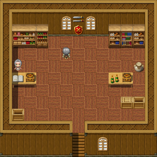

# The Sword of Ultimate Ending

For the shop, the town and Mr and <a href="../People/Dorothy_Markup">Mrs Markup</a>, see <a href="../Places/Penultima">Penultima</a>. For a sword you can actually have, see the <a href="./">catalogue</a>, which has several.

<table class="infobox">
<caption>The Sword of Ultimate Ending</caption>
<tr><td colspan="2" class="infobox-image">Ye Final Shoppe. The sword is in the window</td></tr>
<tr><th>What it is</th><td>A sword, and a shield, in a window</td></tr>
<tr><th>Where</th><td>Ye Final Shoppe, <a href="../Places/Penultima">Penultima</a></td></tr>
<tr><th>Behind</th><td>A velvet rope</td></tr>
<tr><th>Price</th><td>9,999,999 crowns</td></tr>
<tr><th>Priced</th><td>1969, by <a href="../People/Gideon_Markup">Gideon Markup</a></td></tr>
<tr><th>Polished</th><td>Every morning, after the tea</td></tr>
<tr><th>Held, by a customer</th><td>Never</td></tr>
<tr><th>Sold</th><td>Never</td></tr>
<tr><th>Provenance</th><td>See below. Briefly</td></tr>
</table>

The <b>Sword of Ultimate Ending</b> is a sword, with a shield, mounted in the window of Ye Final Shoppe at <a href="../Places/Penultima">Penultima</a>, the last town before the <a href="../Places/The_Obligatory_Tower">Obligatory Tower</a>, behind a velvet rope, with a card beside it. It has been in the window since 1969. Every Chosen One of living memory has seen it. None of them has held it.

## The card

THE SWORD OF ULTIMATE ENDING. 9,999,999 CROWNS.

Gideon Markup wrote the card in 1969, and has not changed it. He set the price, he has told me, at one crown more than a purse will hold, so that it should be beyond the reach of anybody who has ever walked up the road. I have since asked a banker in <a href="../Places/Nether_Sopping">Nether Sopping</a> how much a purse will hold, and he says that a purse will hold a great deal more than that, if it is a good purse, and the owner is careful. I have not told Mr Markup. He has not checked, in thirty-three years, and he is not going to, and I am not going to be the one.

## The sword

I have looked at it through the glass. It is a sword. It is long and bright and very well kept, with a plain cross-guard and a grip wrapped in something dark, and the shield beside it is round and has nothing on it. It may be a very great sword. It may be an ordinary one, polished every morning for thirty-three years, which comes to much the same thing in a window. Nothing about it is engraved, that I could see, and nothing about it is said, by anybody, except the card.

Of where it came from, Mr Markup will say only that it came with the shop. I asked Mrs Markup, who keeps the ledger. She said that he is in the window again, and that he is always in the window.

## Would sir like to hold it?

Mr Markup asks everybody who comes in whether they would like to hold the Sword of Ultimate Ending. Everybody would. He then tells them, warmly, that sir cannot afford to hold it. He said it to the Forty-Eighth. He has said it to everyone who has ever come through that door, and he is not going to stop now.

It is not unkind. I have watched him do it, on the occasion of my visit. He said it to me as well. I did not ask to hold it; I was asked. It is the most sincerely meant refusal I have had in the course of writing this volume, and I have written to the <a href="../Institutions/The_Collegium_Arcanum">Collegium Arcanum</a>.

## Afterwards

The sword is still in the window. Penultima does a trade, since 2000, in people walking up the road to see <a href="../People/Grimspite_the_Inevitable">Grimspite</a>'s chair, and most of them stop at the Final Shoppe on the way, and look at the sword, and are asked whether they would like to hold it, and are told. Mr Markup says that it has never been better for business, and that he has had to have the rope re-velveted.

He brings Mrs Markup her tea every morning, and then he does the window. In thirty-three years he has never once had to be asked.

I asked <a href="../People/Nix">Nix</a>, for the provenance column of this volume, whether she had ever considered the Sword of Ultimate Ending. She said that she had looked at it, in 2000, for some time, and that it was not on any list, and that some things are better in a window. Then she said that the price was wrong, and that she had not told him either. - H.B.

## See also

- <a href="../Places/Penultima">Penultima</a>
- <a href="./">Arms and Artefacts</a>
- <a href="../Cliches/">A Glossary of Cliches</a>, for the last shop before the end
