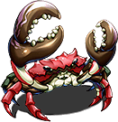
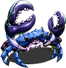
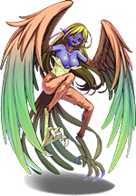
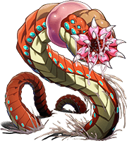
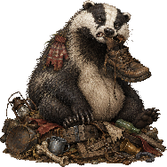
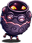
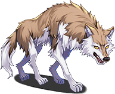
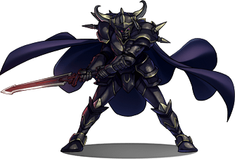
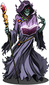

# The Coast and Under It

Contributed by W. Halloway, Cataloguer

From Miss Halloway's Bestiary: the animals of the south coast about Nether Sopping, the Bottomless Pit and the Barrow of the Forty-Fourth. For the places, see <a href="../Places/Nether_Sopping">Nether Sopping</a>, <a href="../Places/The_Bottomless_Pit">The Bottomless Pit</a> and <a href="../Places/The_Barrow_of_the_Forty-Fourth">The Barrow of the Forty-Fourth</a>. The goose has an entry of its own: <a href="The_Goose">The Goose</a>. - H.B.

The south is better documented than the north, because Nether Sopping is full of people who came back and have told everybody what they met. It is not better described.

## The shore

### Shore crab

<figure class="thumb right">

<figcaption>The Territorial Crab, from an account. It is green. The adventurer had red.</figcaption>
</figure>

**What it is.** The common shore crab. Green, broad, sideways.

**Called.** The Territorial Crab.

**Where.** The shingle of the coast road and the west beach; one in the well in Nether Sopping, which looks up.

**Description.** The beach is its beach. It has held its position, without documentation, since before the village.

**Remarks.** Nether Sopping's rule two is that the crab on the west beach is nobody's fault and is not to be provoked. It is a good rule for any crab.

### Shore crab (very large)

<figure class="thumb right">

<figcaption>The Crab of Unusual Size, by the same adventurer, who had run out of red.</figcaption>
</figure>

**What it is.** A shore crab, the same species as the above. Very large. The size of a garden shed.

**Called.** The Crab of Unusual Size. Everybody in Nether Sopping wishes it recorded that they said *unusual*, and not *large*.

**Where.** The west beach, until 2000.

**Description.** It is not unusual. It is large. Crabs go on growing for as long as they go on living, and this one had gone on living for longer than the town, and had not been interfered with. That is the whole of it.

**Method.** Engaged on the Guild's bounty, which wanted a witness, and got one. Underneath it, in the shingle, were eleven years of other people's bad afternoons.

**Remarks.** Four smaller crabs hold the beach now, between them, badly. They are the same species. They will be large in time, if nobody minds them.

### Herring gull

<figure class="thumb right">

<figcaption>The Gull With Ambitions. This plate is not wrong. The gull asks me to say that it is a gull, and that it is not concerned.</figcaption>
</figure>

**What it is.** A herring gull. It says so.

**Called.** The Gull With Ambitions.

**Where.** The coast road, the beach, and the mouth of the Bottomless Pit, which it has worked out.

**Description.** About the size of a woman, with a woman's face, a great deal of green and brown wing, and the feet of a bird, on which it stands along the posts of the coast road in threes, watching people go by. Has worked out that adventurers carry food and that adventurers are, as a class, slow. Both observations are correct. It has not said which food.

**Its account.** I asked it what it was. It said that it was a gull. It said that it was only after a bit of pasty, and would settle for the crimp, which nobody eats anyway. I said that I had no pasty. It said that it was not concerned. I said that a gull cannot talk. It looked at me for some time, in the way it looks at everybody, as if working out how much of them it could lift, and said that it was a gull with ambitions.

**Method.** It goes for the food. Every adventurer's account agrees that it went for them, and its own account is that they were standing in front of the pasty. Engaged. I did not measure it. I do not hold a ruler up to anything that is measuring me back.

**Remarks.** This is the only entry in this Bestiary filed under what the animal says it is. I have no other witness: everybody else it has talked to was some way off the ground at the time. I have entered it under gulls, on its own account, and set out the face, the wings and the feet beside it, and the reader may do the arithmetic. The keepers of the <a href="../Places/The_Lighthouse_of_Saint_Bother">Saint Bother light</a> have kept a *Book of Coast Birds* for four generations. Every entry says GULL. One says NOT A GULL (?). The next, in the same hand, says GULL. I think he asked it. I would ask visitors to the coast road to eat their pasties indoors, and to stay in with them.

### Not described: something in the sand

<figure class="thumb right">

<figcaption>Something in the sand, drawn by somebody who was standing on it at the time. Not described.</figcaption>
</figure>

**What it is.** I do not know. I have not seen it. Nether Sopping does not swim off the west beach and has never written down why, and I have not swum off it either. I have measured the hole it leaves. The hole is a good size. I am not entering an animal on the strength of a hole, and I would ask everybody else not to.

## The Bottomless Pit

The Pit is a hole in a hillside, four feet deep, with a turnstile. It is called bottomless as a courtesy.

### Badger

<figure class="thumb right">

<figcaption>The Thing at the Bottom. A badger.</figcaption>
</figure>

**What it is.** The badger, *Meles meles*. Very large.

**Called.** The Thing At The Bottom.

**Where.** The far end of the Pit, until 2000; then up a slope nobody knew was there.

**Description.** The size of a hay cart. It had been eating two centuries of lost property, which cannot have helped. It was asleep on a mattress of everything Nether Sopping had ever failed to come back for, and it opened one eye and had a strong opinion.

**Method.** The Forty-Eighth's company came and saw the badger, which is what the custodian had been asking the Guild to do for forty years. The Guild had told him that a badger was not a monster. The Guild was correct. It was a badger. It left, at speed, and took one boot with it, and had earned the boot.

### Urn

<figure class="thumb right">

<figcaption>Lost Property. Unclaimed.</figcaption>
</figure>

**What it is.** An urn. Not an animal.

**Called.** Lost Property.

**Remarks.** Two hundred years at the bottom of a pit will do this to anything, apparently, including an urn. I do not know why it moves. Neither, so far as I could tell, does it.

### Not described: something in the crack

**What it is.** It is asleep in a crack in the north wall of the Pit, running back further than a lamp reaches. It is not small, and it has not noticed anybody. It is gravid.

**Remarks.** I was asked, by the Forty-Eighth, whether that was bad. It is the single most normal thing in the cave. I know what it is, and I am not going to wake it to tell you. It is still asleep. It is still enormous. Everything about it is entirely normal, and it is entitled to be left alone, and I would ask visitors to the Pit to pay their two crowns, go down the four feet, and not shine a lamp into the crack.

## The Barrow

### Hound

<figure class="thumb right">

<figcaption>The Barrow Hound, drawn as a wolf, by somebody who met him in a barrow in the dark and did not stay for the collar.</figcaption>
</figure>

**What it is.** A dog. A large one.

**Called.** The Barrow Hound.

**Where.** The Barrow of the Forty-Fourth, the passage, and an alcove off it with a dish, a collar and a name: BUDGE.

**Description.** Buried with him, which nobody asked the hound about.

**Remarks.** Something still uses the alcove. On a mossy pillar near it, at the height of a big dog's shoulder, the moss has been worn smooth by something leaning there, every day, very contentedly, for a very long time. I have not catalogued what. I have catalogued the moss. I am not a sentimental woman, and I left the dish where it was.

## Not animals

**Grave goods (animated).** A full suit of armour, buried with a man who would have preferred the money. Not an animal.

**The previous occupant.** Was in the mound first, and has views about the extension. A person, and long dead, and entitled to the views. Not catalogued.

<figure><figcaption>Grave goods (animated)</figcaption></figure>
<figure><figcaption>The previous occupant, with views</figcaption></figure>

## See also

- <a href="./">The Bestiary</a>
- <a href="The_Goose">The Goose</a>
- <a href="../Places/Nether_Sopping">Nether Sopping</a>
- <a href="../Places/The_Bottomless_Pit">The Bottomless Pit</a>
- <a href="../Places/The_Barrow_of_the_Forty-Fourth">The Barrow of the Forty-Fourth</a>
- <a href="The_North_and_Below">The North, and Below</a>
