# The Fauna of the Valley

Contributed by W. Halloway, Cataloguer

From Miss Halloway's Bestiary: the eleven type specimens of her monograph, <i>The Fauna of the Valley, by What They Are</i>, shelved at the <a href="../Institutions/The_Collegium_Arcanum">Collegium Arcanum</a>, abridged by her for this volume. I asked whether the abridgement lost anything. She said that it lost the footnotes, and that there had been exactly enough. - H.B.

<table class="infobox">
<caption>The Fauna of the Valley, by What They Are</caption>
<tr><th>Author</th><td>W. Halloway</td></tr>
<tr><th>Published</th><td>2000, by the Collegium Arcanum</td></tr>
<tr><th>Bound by</th><td>Sub-Librarian Prewitt, by hand</td></tr>
<tr><th>Type specimens</th><td>Eleven. Measured, not killed</td></tr>
<tr><th>Reviewers</th><td>Professor Mott; Dr Furze; the Honorary Fellow</td></tr>
<tr><th>Subscribers</th><td>Bound in at the back</td></tr>
<tr><th>Supersedes</th><td>Rowbotham, in eleven places</td></tr>
<tr><th>Page four hundred</th><td>Goose</td></tr>
</table>

## Preface to the abridgement

The previous authority on the animals of this valley is Doctor Amias Rowbotham, FRS, who in forty years named some three hundred species after himself, his subscribers, his wife and his dogs, and never had a type specimen for one of them. A type specimen is the individual animal that a name belongs to. Without one, a name is a name for whatever the namer was thinking of at dinner. That is the whole of my objection to Rowbotham, and I would like it understood that it is not personal. He named a beetle after one of his own students. The student is now Professor Mott, and reviewed this monograph, and has asked me to say that he is a person now, and not a beetle, and that you would be surprised what a difference it makes.

A monograph of the Collegium requires a type specimen for every entry, three Fellows to review it, and a list of subscribers. I took eleven type specimens, one for each entry, in eleven fights that I objected to and conducted anyway. Every specimen was measured, not killed. Every one minded being measured a great deal more than it would have minded being fought. Every one was let go.

Each entry gives the animal under what it is, and then Rowbotham's name for it, which is a synonym, and is not to be used.

## The eleven

### Common hedge egg

<figure class="thumb right">
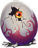
<figcaption>Rowbotham's Breakfast. Not where it was drawn.</figcaption>
</figure>

**What it is.** An egg. It has legs. It lives in hedges.

**Synonym.** *Rowbotham's Breakfast.* It is not a breakfast, whatever he says.

**Behaviour.** It is not where you measured it. This is the whole of its defence and it is a good one: by the time a measurement is written down the egg is a foot to the left of it. I measured it eleven times and took the mean.

### Frilled wall lizard

<figure class="thumb right">
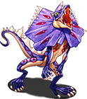
<figcaption>The frill, up.</figcaption>
</figure>

**What it is.** A lizard with a frill, which lives on walls.

**Synonym.** *Rowbotham's Magnificent.* He said it was magnificent. It is a lizard.

**Behaviour.** Does something sudden. The frill goes up, and then the observer's notebook goes up, and the observer has to start the page again.

### Hearth salamander

<figure class="thumb right">
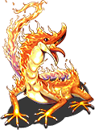
<figcaption>Warm. Drawn by the note-taker, afterwards.</figcaption>
</figure>

**What it is.** A salamander which lives in hearths. It is warm.

**Synonym.** *Rowbotham's Comfort.* It is not a comfort to anyone.

**Behaviour.** Bites the note-taker. Not the person holding it; the person writing. I have the scar on my writing hand and I consider it a professional credential.

### Turnip gnome

<figure class="thumb right">
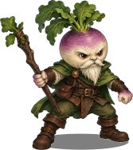
<figcaption>Of fixed opinions, and wearing the turnip. It does not always get out of it first.</figcaption>
</figure>

**What it is.** A gnome that lives in turnips. Small, brown, bearded, and of fixed opinions. Not to be confused with *<a href="Bramus_agricola">Bramus agricola</a>*, which also lives in turnips, and has no opinions at all.

**Synonym.** *Mrs Rowbotham.* He named it after his wife. She knew.

**Behaviour.** Not where you measured it.

### Barn cait

<figure class="thumb right">
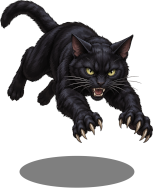
<figcaption>Somewhere else, a moment later.</figcaption>
</figure>

**What it is.** A cat. A large black cat of barns, with a white mark on the chest.

**Synonym.** *Biscuit*, which was his dog. I have never forgiven him that.

**Behaviour.** Bolts for cover, and is somewhere else. I measured it on the third attempt, in a hayloft, and it bit nobody, and looked at me the whole time.

### Striped warren hare

<figure class="thumb right">
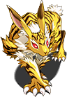
<figcaption>Rowbotham's Tiger. It is a hare.</figcaption>
</figure>

**What it is.** A hare with stripes, which lives in warrens.

**Synonym.** *Rowbotham's Tiger.* It has never once been a tiger.

**Behaviour.** Bolts for cover. Very fast.

### Upright fox

<figure class="thumb right">
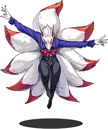
<figcaption>Pelham-Rudd's Fox, as Mr Pelham-Rudd paid to have it drawn. The tails were extra.</figcaption>
</figure>

**What it is.** A fox that walks upright. Otherwise a fox, in every particular.

**Synonym.** *Pelham-Rudd's Fox.* A subscriber paid to have it named. I have not removed Mr Pelham-Rudd from the record. I have moved him from the name to the history, where he belongs, and where he paid to be.

**Behaviour.** Does something sudden.

### Many-eyed grazer

<figure class="thumb right">
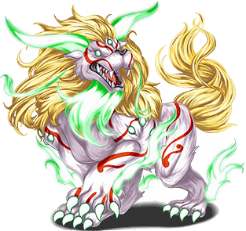
<figcaption>Checking.</figcaption>
</figure>

**What it is.** A large grazing animal with a great many eyes, of the high pastures of the north. White, horned, placid.

**Synonym.** *Rowbotham's Ox.* It is not, in any sense, an ox.

**Behaviour.** Grazes. Is not where you measured it, which in an animal of that size takes some doing. It watched me measure it with all of its eyes at once, and I have never been so thoroughly checked.

### Draught sylph

<figure class="thumb right">
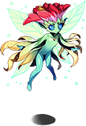
<figcaption>With the doors open.</figcaption>
</figure>

**What it is.** A small sylph which lives in draughts.

**Synonym.** *Lady Amberley.* Named for a subscriber, who had a cold.

**Behaviour.** Bolts for cover. It is very difficult to measure a draught. I shut the doors.

### Tall marsh wader

<figure class="thumb right">
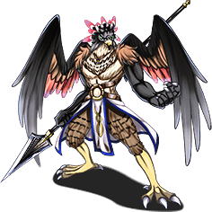
<figcaption>Rowbotham's Self-Portrait. It does look like him.</figcaption>
</figure>

**What it is.** A tall wading bird of the marshes, long in the leg and the beak, solemn, grey, with a crest.

**Synonym.** *Rowbotham's Self-Portrait.* It does look like him.

**Behaviour.** Bites the note-taker.

### Pond kappa

<figure class="thumb right">
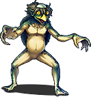
<figcaption>The dish, level.</figcaption>
</figure>

**What it is.** A kappa, in a lake. Green, with a dish of water in the top of its head, which it keeps level.

**Synonym.** *Captain.* Captain was a spaniel. His other dog.

**Behaviour.** Bites the note-taker.

## Reviews

The rules require three Fellows. Two were Rowbotham's own students, who reviewed my first paper when I was twenty-three. Professor Mott said then that it lacked respect, and it did. He read the monograph for a long time, and stopped at the eleventh type specimen, and took his spectacles off, and said that Rowbotham named things after whoever was at dinner, and that he should like, before he died, to be a person. Accepted. Dr Furze said, at twenty-three, *too many footnotes*. There were exactly enough footnotes. He turned the pages without hurrying, and stopped at page four hundred, and read one word several times, and said that he had been in the <a href="../Places/The_Slain_Wyvern">Slain Wyvern</a> the night they asked me to leave, and had always known. Accepted, with no corrections, which he had never written before.

The third Fellow was the Honorary Fellow. It lives on a pond. Its review is a footprint on the title page, in the right place.

I asked Miss Halloway whether she had enjoyed the eleven fights. She said no. I asked whether she would do it again. She said that volume two will need more than eleven. - H.B.

## See also

- <a href="./">The Bestiary</a>
- <a href="The_Goose">The Goose</a>, page four hundred
- <a href="../People/Wren_Halloway">Wren Halloway</a>
- <a href="../Institutions/The_Collegium_Arcanum">The Collegium Arcanum</a>
- <a href="../Places/Fenmarch_Hall">Fenmarch Hall</a>, for the other kind of collection
