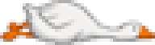

# The Goose

Contributed by W. Halloway, Cataloguer

From Miss Halloway's Bestiary. For the tavern, see <a href="../Places/The_Slain_Wyvern">The Slain Wyvern</a>. For the man who made the wyvern, see <a href="../People/Halloran_Vance">Halloran Vance</a>. I asked Miss Halloway whether this entry might be filed under W, as it is generally known. She said that it is filed under what it is. - H.B.

<table class="infobox">
<caption>The Goose</caption>
<tr><td colspan="2" class="infobox-image">Filed under what it is. W.H.</td></tr>
<tr><th>What it is</th><td>A greylag goose, <i>Anser anser</i></td></tr>
<tr><th>Sex</th><td>Female</td></tr>
<tr><th>Age</th><td>Adult, at death</td></tr>
<tr><th>Of</th><td>A farm on the coast near <a href="../Places/Nether_Sopping">Nether Sopping</a></td></tr>
<tr><th>Called</th><td>The Wyvern; the Slain Wyvern; ONE WYVERN (SLAIN)</td></tr>
<tr><th>Additions</th><td>Two bats' wings; wire; varnish; a jaw, opened</td></tr>
<tr><th>Mounted</th><td>1940, over the fireplace</td></tr>
<tr><th>Plaques</th><td>Two</td></tr>
<tr><th>Specimen status</th><td>Not a type. Not required. It is a goose</td></tr>
</table>

**What it is.** A greylag goose, *Anser anser*, adult, female, of a farm on the coast near Nether Sopping. The commonest grey goose of the region. It has a goose's bill, a goose's neck, a goose's feet and a goose's posture, which is the posture of a bird that has decided to be offended in advance.

**What it is called.** The Wyvern. The Slain Wyvern. ONE WYVERN (SLAIN), on the board outside the tavern, with (GOOSE) scratched off underneath and painted on again. These are not synonyms. A synonym is another name for the same animal. These are the name of a different animal applied to this one, and the different animal does not occur on this coast and never has. I list them because readers will look for them.

**Where it is.** Over the fireplace of the Slain Wyvern, Nether Sopping, wings out, jaws open, since 1940.

**Description.** About the size of a large goose. Two bats' wings have been wired on at the shoulder, over the goose's own, which are folded underneath and visible from the left side of the bar if you stoop. The bill has been opened and set, and teeth added, carved, I think from bone, and very well; I would like to know whose. The whole is varnished, which has preserved it. The plumage under the varnish is in good condition. The feet are a goose's feet and nobody has done anything about them, because there is nothing you can do about a goose's feet.

**How it came to be there.** In 1940 Halloran Vance, Chosen One #41, came back to Nether Sopping from the marshes with nothing, and the town was waiting on the quay for a monster. He went to a farm, and came back two days later with this. I have the account from Mrs Thrupp, who keeps the Wyvern, and from the second plaque, which says so, and I have no reason to doubt either. He did not smile about it once.

**The first plaque.** Under the goose:

SLAIN BY H. VANCE, CHOSEN ONE #41, IN THE MARSHES, AFTER A LONG STRUGGLE.

I have been asked to comment on this plaque and I decline. It is not a description. It is a memorial, and a memorial is not wrong in the way a description is wrong. I did not understand that when I first said what the bird was, out loud, in Mrs Thrupp's house, and I was asked to leave, and I would like it on record that I was right about the goose and she was right to ask.

**The second plaque.** Beside the first:

A GREYLAG GOOSE, ANSER ANSER, OF A FARM ON THIS COAST. MADE INTO A WYVERN IN 1940, IN TWO DAYS, WITH WIRE, BY H. VANCE, CHOSEN ONE #41, BECAUSE THE VILLAGE WAS WAITING ON THE QUAY.

It was engraved at Wick & Barrow's at a crown a letter, a hundred and twenty-eight crowns, which is why it is as short as it is; I had a great deal more to say. It does not correct the first plaque and it does not repeat it. Mrs Thrupp read it first, and twice, and said nothing, and put it up herself. Both are polished. I do not know by whom.

**Method.** None. It was not fought, measured or collected. It is not a type specimen; it does not need to be one, because the species was described long before I was born, by people who looked at it. I examined it from the floor, at a distance of about six feet, for some time, on the evening I was asked to leave, and I have examined it every evening since from the seat under it, which is now mine.

**Remarks.** It is the only animal in this Bestiary I have been thrown out of a building for. It is the only one with a bucket by the fire marked FOR THE GOOSE, filled every morning. It is the only one whose entry in my monograph, on page four hundred, was read aloud in the Slain Wyvern by somebody else, to applause, while I was in the room. I sat through it. I have asked that it not happen again, and it has happened twice.

The farm it came from is still there. I have been to see the geese. They are greylags, and they are very rude, and they are exactly right.

I sit at the next table. Miss Halloway has written, in the evenings, under the goose, for the best part of two years, and in all that time I have not once seen her look up at it. I asked her why not. She said that she knows what it is. - H.B.

## See also

- <a href="../Places/The_Slain_Wyvern">The Slain Wyvern</a>
- <a href="../People/Halloran_Vance">Halloran Vance</a>
- <a href="../People/Wren_Halloway">Wren Halloway</a>
- <a href="./">The Bestiary</a>
