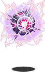
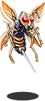
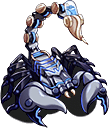
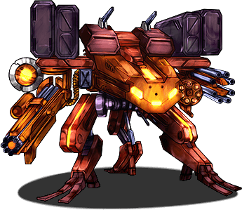
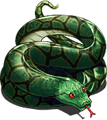
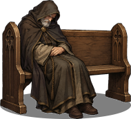
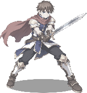
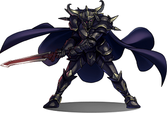
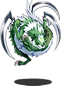

# The North, and Below

Contributed by W. Halloway, Cataloguer

From Miss Halloway's Bestiary: what is met in the Long Field and on the crag, under <a href="../Places/Carn_Drey">Carn Drey</a>, in a chapel at <a href="../Places/Weeping_Bottom">Weeping Bottom</a> at night, and on the <a href="../Places/The_Stair">Stair</a> under <a href="../Places/Hithermost">Hithermost</a>. Very little of it is an animal, and Miss Halloway has said so, at the top, so that nobody can say she did not. - H.B.

I was asked to write up everything a party is likely to fight between <a href="../Places/Upper_Clanging">Upper Clanging</a> and the bottom of the Stair. I have done so. Most of it is machinery, weather, the time of night, or architecture, and one of it is a weasel. I have been strict about what I describe and lenient about what I list, because people will look.

## The Long Field and the crag

None of these is an animal. All of them are the <a href="../Institutions/The_Hoyle_Works">Hoyle Works</a>', and I have referred them to <a href="../People/Ott_Hoyle">Miss Hoyle</a>, who has replied that they are attempts, and are documented, and that their documentation is not open to the public.

**Loose pressure.** A hundred and forty years of stored steam, finding the way out all at once. It is not attacking anybody. It is just leaving. Stand aside.

**Attempt (unnumbered).** Too early to have been given a number. It has been getting one foot off the ground since before anybody now alive was born.

**Ambulant salvage.** Parts of nine different attempts, walking. Nobody assembled it, and nobody can prove that it was not assembled. I asked Miss Hoyle which. She said that it was under review.

**Attempt <a href="../People/Eighty-Four">Eighty-Four</a>.** Came down in the Long Field in 1860 and repaired herself out of her neighbours, a piece at a time, for a hundred and forty years. Stopped in 2000. Miss Hoyle's, and in her bay, and the subject of a paragraph in the <a href="../Places/The_Long_Field">memorandum on the field</a>, which I recommend. I note only that she is the one thing in this volume which nobody taught to do what she did, and which did it anyway, and that in an animal I should have called that behaviour.

<figure><figcaption>Loose pressure, leaving</figcaption></figure>
<figure><figcaption>Attempt (unnumbered), one foot off the ground</figcaption></figure>
<figure><figcaption>Ambulant salvage, under review</figcaption></figure>
<figure><figcaption>Attempt Eighty-Four, in the field, out of her neighbours</figcaption></figure>

## Under Carn Drey

### Worm

<figure class="thumb right">

<figcaption>The Worm of Carn Drey. Not basically anything.</figcaption>
</figure>

**What it is.** A worm. A very large, very old, legless serpent of the deep earth, coiled three times round a chamber under Carn Drey.

**Called.** The Worm of Carn Drey. Never, in my hearing, *basically a dragon*, and if anybody calls it that in my hearing it will not be the Worm I am cross with.

**Where.** Under Carn Drey, east of <a href="../Places/Great_Dunnage">Great Dunnage</a>, at the bottom of a long stair, beyond a stone with a sword in it.

**Description.** Old. Very large. It had been waiting since before <a href="../People/Roland_Fairweather">Roland Fairweather</a> was born for a hero of nineteen. It is patient, and it had been looking forward to it.

**Method.** Engaged, under a prophecy, by Roland Fairweather, aged thirty-four, with help. It was over in about the time it takes to say so. The prophecy was discharged. The Worm was not harmed in any way a worm minds, and went back to sleep.

**Remarks.** It is the only animal in this volume that anybody has been back to visit for tea. Mr Fairweather goes down. I am told that it is very good about it.

## A chapel at Weeping Bottom, at night

These are reported by the watch who kept Sir Aldric Pemberton-Gore's vigil with him in the chapel across the yard from the Sisterhouse, in the year 2000, dusk to dawn. <a href="../People/Sir_Aldric_Pemberton-Gore_III">Sir Aldric</a> did not move or speak, by the rules, and so is not a witness to any of them, though he took all of them. He has asked that they be recorded. None of them is an animal.

**The damp.** It comes in under the chapel door every night. It always has. It is condensation, and it is Weeping Bottom's, and it is, in my professional opinion, the most dangerous thing in this section.

**The small hours.** Cannot be fought, only got through. Gone at dawn. A period of time.

**A small temptation.** Sits on the end of the altar rail. Very reasonable. Not described, at the request of everybody who was there.

**A light going away.** Bobs off down the valley, saying THIS WAY. A marsh light, of the kind I have described under <a href="The_Road_North#marsh-light">The Road North</a>, with the one addition that it speaks, which I do not believe and which every member of the watch reports. Sir Aldric has followed every light in that valley but this one.

<figure><figcaption>The damp, under the door</figcaption></figure>
<figure><figcaption>The small hours</figcaption></figure>
<figure><figcaption>A small temptation. Not described; drawn, which nobody thought to forbid</figcaption></figure>
<figure><figcaption>A light going away, THIS WAY</figcaption></figure>

## The Stair

The Stair goes down from the Door into the Mountain at Hithermost, and the parish has posted a Schedule of Hazards at the top, and I have catalogued it in its own order, because it is a good schedule and I could not improve on it.

**1. The dark.** Some of it. A condition. The reason the board on the Door says what it says. A lamp is the treatment.

**2. The draught.** It puts lamps out. It is a weasel; see below.

**3. The echo.** Do not answer it. Everybody does. An acoustic property of a long stair in rock; I have heard it described as having lovely manners, which I do not doubt. Not an animal.

**4. Somebody coming up.** Not catalogued. The Stair is one wide and the dark is total, and nobody who has met it has been able to see who it is. I do not catalogue what I could not see, and I do not guess who.

**5. The warden of the half-way landing.** A figure in black armour at the head of a flight, with a hook on its belt and nothing on the hook, which inspects whoever comes down. It is employed, and I do not catalogue staff. It is not half way. Nobody had told it. It has been told now, and is getting used to it.

**6. Anything else: NOT ANTICIPATED.**

<figure><figcaption>The dark (some of it)</figcaption></figure>
<figure><figcaption>The echo, which has lovely manners</figcaption></figure>
<figure><figcaption>Somebody coming up. Not seen; drawn anyway, by somebody who also did not see them</figcaption></figure>
<figure><figcaption>The warden, half way, in the opinion of the warden</figcaption></figure>

### Weasel

<figure class="thumb right">

<figcaption>The Draught, as the parish imagined it. It is a weasel.</figcaption>
</figure>

**What it is.** A weasel.

**Called.** The Draught.

**Where.** The upper flights of the Stair, in company with the dark.

**Description.** A weasel. Very fast, very thin, very cold, and in the dark entirely without substance, so that the parish took it for the wind and posted it as a draught. It is not made of wind. It moves the air, which is not the same thing, and it puts out lamps because it goes past them very close, and it goes past everything very close. I am told by people who have been down that it has been described as a weasel made of wind. It is a weasel. The wind is incidental.

**Method.** Relit the lamp.

### Something Unscheduled

<figure class="thumb right">

<figcaption>Something Unscheduled, delighted.</figcaption>
</figure>

**What it is.** Unscheduled.

**Called.** <a href="../People/Something_Unscheduled">Something Unscheduled</a>. That is its own name, and it is the most accurate name in this Bestiary, and I have not been able to improve on it either.

**Where.** The bottom of the Stair, below D. 212, in a chamber with lamps on every ledge, all lit.

**Description.** Large. Purple. Delighted. It is not on the schedule, except as item six; it is not in the <a href="../History/The_Prophecy_of_Thistlewick">Prophecy</a>; and it asked. It had written itself a bounty card, a long time ago, because nobody would put it on anything.

**Method.** It asks whether you have the afternoon. Nobody is obliged to fight it, and it says afterwards that that is what it liked best about it.

**Remarks.** I have been down since, with the Forty-Eighth, on one of his free afternoons, and asked it what it is. It said that it would love to tell me, if I had the afternoon. I had the afternoon. I filled eleven pages. I am not going to print them, because at the end of the afternoon it asked whether I would, and then said, oh, oh no, was that too much, and that it was sorry, it did not get the practice. I said that it was not too much. I have kept the pages. It is in volume two, under U, with the footnotes.

I have asked Mr Bellwether not to call it a Thing. He has not.

## See also

- <a href="./">The Bestiary</a>
- <a href="../Places/The_Long_Field">The Long Field</a>
- <a href="../Places/Carn_Drey">Carn Drey</a>
- <a href="../Places/Weeping_Bottom">Weeping Bottom</a>
- <a href="../Places/The_Stair">The Stair</a>
