# The Road North

Contributed by W. Halloway, Cataloguer

From Miss Halloway's Bestiary: the animals of the fields about Thistlewick, the road north, the Gloamwood and the Obligatory Tower. For the places, see <a href="../Places/Thistlewick">Thistlewick</a>, <a href="../Places/The_Gloamwood">The Gloamwood</a> and <a href="../Places/The_Obligatory_Tower">The Obligatory Tower</a>. - H.B.

Every Chosen One of Thistlewick has walked this road, and forty-seven of them have reported what they met on it, by how it died. None of the reports describes an animal. This is the first list of what is actually there. It is short, because most of what is on the road north is not an animal, and a good deal of it is a person.

## The fields

### Turnip

<figure class="thumb right">
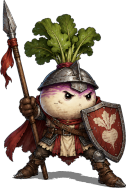
<figcaption>The Militant Turnip, from an account. It is armed. That is the part I cannot account for.</figcaption>
</figure>

**What it is.** A turnip, *Brassica rapa*.

**Called.** The Militant Turnip.

**Where.** The fields about Thistlewick, in the open, generally in company with crows.

**Description.** A turnip, in every particular but one, which is that it has had enough. I have examined one closely. Its anatomy is a turnip's. Its conduct is not. I cannot account for it, and I have tried, and I would ask readers not to send me theories.

**Method.** Engaged at range. Two of whatever it dropped, which was turnip.

**Remarks.** The Forty-Eighth takes these personally, and was not, I noticed, in the least surprised by them.

### Carrion crow

<figure class="thumb right">
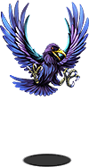
<figcaption>The Crow of Foreshadowing, about to caw. Count them.</figcaption>
</figure>

**What it is.** The carrion crow, *Corvus corone*.

**Called.** The Crow of Foreshadowing.

**Where.** Fields, the road, and the edges of the Gloamwood.

**Description.** A crow. Black throughout. Caws, it is said, exactly three times whenever anything important is about to happen.

**Remarks.** Crows caw in threes. They also caw in twos, fours and elevens. The threes are remembered, because something important is generally about to happen to a party of adventurers, and the twos are not. I counted for a week. The crow is not foreshadowing anything. The adventurers are.

## The road and the wood

### Oak

<figure class="thumb right">
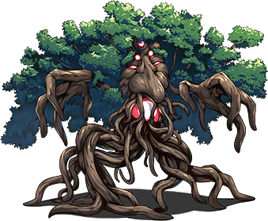
<figcaption>The Grumblewood Treant, objecting.</figcaption>
</figure>

**What it is.** A tree. An oak, I think, from the leaf; it would not hold still for the bark.

**Called.** The Grumblewood Treant.

**Where.** The Gloamwood, and the wooded stretches of the road.

**Description.** Objects to being walked past.

**Method.** We walked past it. It objected. It was then engaged, which is a step I resent in a tree more than in anything else in this volume, because a tree has nowhere to go.

### Marsh light

<figure class="thumb right">
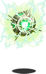
<figcaption>The Wisp of Mild Concern. Mildly.</figcaption>
</figure>

**What it is.** A light. Not an animal. A small burning gas, which hovers, and is seen at dusk in damp places.

**Called.** The Wisp of Mild Concern.

**Where.** The Gloamwood, the road west and the hills.

**Description.** Hovers nearby, looking worried. Attacks anyway.

**Remarks.** I list it because it is in every adventurer's account of the road, and because it looks worried, and readers have asked me what about. It is not worried. It is a gas. The worry is the observer's, and I would not presume to say what about.

### Chest mimic

<figure class="thumb right">
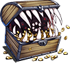
<figcaption>The Chest (Definitely A Chest), open.</figcaption>
</figure>

**What it is.** An ambush predator, chest-shaped.

**Called.** The Chest (Definitely A Chest). A mimic.

**Where.** One, in the Gloamwood, on the path, alone, in perfect condition. It is splinters now.

**Description.** A treasure chest, alone, in the middle of a wood, in perfect condition. Everybody knows. Nearly everybody opens it. It carried an Elixir as bait, which is either very clever or very sad, and I have decided it was clever, because I prefer it.

**Method.** Opened. Then engaged. I would like it noted that I said so first.

### The Thing in the Woods

<figure class="thumb right">
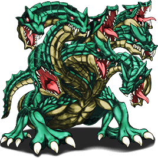
<figcaption>The Thing in the Woods, as the adventurers saw it: one animal, with a great many heads. It is nine snakes.</figcaption>
</figure>

**What it is.** Nine crested grass snakes, courting.

**Called.** The Thing in the Woods. The Thing. In Thistlewick, for two hundred years, a bear, several bears, and a bear-shaped hole in the idea of a wood.

**Where.** The deep clearing of the Gloamwood, mostly in late spring, always at dusk.

**Description.** The crested grass snake is common. It is about four feet long, banded, with a crest feather the colour of a boiled sweet, and it sheds its skin whole. It nests in the forks of trees; there is a nest on the first path, at head height, with a crest feather caught in the rim of it. The crest is not for fighting. It is a display structure, for attracting a mate. It works. That is why there are nine of them.

In spring they gather to court, and nine is usual, and they knot together. From the path, at dusk, it looks like one large thing with a great many heads.

**The record.** The Gloamwood Society has kept forty years of sightings in its newsletter, *The Sighting*. Every one of them has between one and nine heads. I read all forty years in an afternoon. Every sighting is accurate as to the heads and inaccurate as to the number of animals. One sighting, Miss Edith Pellow's of 1971, counts nine, and is the only accurate one in the forty years. I have told her so, in writing, and she has the letter.

**Method.** The party that disturbed the knot in the year 2000 was four people with a sword, which is not a method, and I was not consulted. The knot dispersed, as a courting knot does when four people with a sword walk into it. There is nothing in the Gloamwood. There never was. There are snakes, which are not a Thing, and which are none of anybody's business in the spring.

**Remarks.** Everything we killed that week was in the middle of courting. I do not say that to upset anybody. I say it because it goes in the monograph.

## The Tower

The Obligatory Tower is, I am told, under contract, and so is most of what is in it. I have catalogued what I could.

### Bat

<figure class="thumb right">
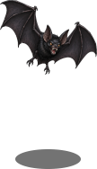
<figcaption>The Tower Bat.</figcaption>
</figure>

**What it is.** A bat. Several species; the commonest in the Tower is a small brown bat of a kind found in any roof.

**Called.** The Tower Bat.

**Where.** The Tower, every floor; and the <a href="../Places/The_Bottomless_Pit">Bottomless Pit</a>.

**Remarks.** There are always bats. It is said to be in the contract. I have not seen the contract. I have seen the bats, and they would be there anyway. A tall stone building with a roof is a bat's idea of a good contract.

### Gargoyle

<figure class="thumb right">
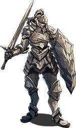
<figcaption>The Load-Bearing Gargoyle, off its post, which raises the questions.</figcaption>
</figure>

**What it is.** Masonry. Not an animal.

**Called.** The Load-Bearing Gargoyle.

**Where.** The Tower, in the walls, until it is not.

**Remarks.** It is structurally important, and it attacks anyway, which raises questions about the Tower. <a href="../People/Ott_Hoyle">Miss Hoyle</a> of <a href="../Places/Upper_Clanging">Upper Clanging</a> asked one of those questions, in writing, and it went up the Tower with the Forty-Eighth, and I understand that it was not answered. I am not competent to answer it. I list the gargoyle so that the next person who asks what the Tower is made of has a place to start: in part, it is made of things that do not want to be in it.

## Persons

The following are met on the road north and are reported in adventurers' accounts as monsters. They are persons. A **goblin** is a person: the one I met had a list of grievances and read from it, which is more than most people do. A **bandit (trainee)** is a person, in the fourth week of a six-week apprenticeship, with a syllabus. A **skeleton (intern)** is the remains of a person, employed, unpaid, for the experience, and I do not catalogue staff. I have not described any of them. See the <a href="./">index</a>.

<figure>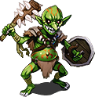<figcaption>A goblin, with grievances</figcaption></figure>
<figure>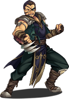<figcaption>A bandit, in week four</figcaption></figure>
<figure>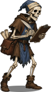<figcaption>A skeleton, interning</figcaption></figure>

## See also

- <a href="./">The Bestiary</a>
- <a href="Bramus_agricola">Bramus agricola</a>, the only animal in the fields anybody had not noticed
- <a href="../Places/The_Gloamwood">The Gloamwood</a>, and the Society
- <a href="The_Coast_and_Under">The Coast and Under It</a>
