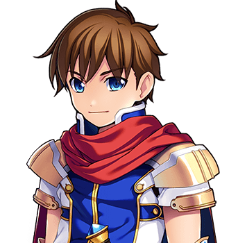

# The Obligatory Quest

This article is about the quest of the Forty-Eighth, in the year 2000. For the forty-seven before it, which went the same way as each other, see <a href="The_Chosen_Ones">The Chosen Ones</a>. For the man, see <a href="../People/Bram_Thistle">Bram Thistle</a>.

<table class="infobox">
<caption>The Obligatory Quest</caption>
<tr><td colspan="2" class="infobox-image">The Forty-Eighth, after the event</td></tr>
<tr><th>Date</th><td>Third Age 2000, the last of the winter</td></tr>
<tr><th>Chosen One</th><td>Bram Thistle, No. 48</td></tr>
<tr><th>Companions</th><td>Up to three at any one time (that is the clause); eleven in all, at one time or another</td></tr>
<tr><th>Objective</th><td>Go north. Kill the Dark Lord. Come home. In that order, ideally</td></tr>
<tr><th>Outcome</th><td>The Dark Lord retired. The Prophecy read in full, and no longer binding. The Chosen One home</td></tr>
<tr><th>Cliches encountered</th><td>Very nearly all of them</td></tr>
<tr><th>Receipt</th><td>Yes</td></tr>
</table>

The <b>Obligatory Quest</b> of the year 2000 was the forty-eighth expedition sent north by the village of <a href="../Places/Thistlewick">Thistlewick</a> under the <a href="The_Prophecy_of_Thistlewick">Prophecy</a>, and the last. It set out like all the others, and went where all the others went, and differed from them in one respect, which is that when it arrived the Chosen One asked the Dark Lord a question and then stayed for the answer.

I have told the whole of it in Volume Two, from first-hand accounts, at length. What follows is the short version. It is still not short.

## The choosing

<a href="../People/Bram_Thistle">Bram Thistle</a> was a turnip farmer, and was asleep when the <a class="new" href="../Institutions/The_Prophecy_Committee">Prophecy Committee</a> chose him. The minutes give his name under *apologies for absence*, with one goat. He woke chosen, took down a sword he did not seem entirely comfortable holding, and went to <a href="../Places/Prophecy_Hall">Prophecy Hall</a>, where Elder <a class="new" href="../People/Elder_Wispel">Wispel</a> unrolled the Prophecy to the far wall and told him it had worked forty-seven times. He asked what had happened the other times. He was told that it had worked forty-seven times.

He was given five hundred crowns and three potions from the parish fund, and the Prophecy, which was, regrettably, free. A neighbour in the lane, a farmer, asked who was doing the west field. Nobody had an answer to that either.

## The company

The clause allows a Chosen One three companions, and Bram, over the course of the Quest, went through rather more than three, though never more than three at once. In the order in which people generally list them, which is not the order in which anybody joined, they were:

- <a href="../People/Merribell">Merribell</a>, Thistlewick's healer;
- <a href="../People/Hob_Grumnir">Hob Grumnir</a>, its blacksmith;
- <a href="../People/Zephyrine_Vance">Zephyrine Vance</a>, a hedge mage, with a history at the Collegium Arcanum;
- <a href="../People/Nix">Nix</a>, in acquisitions;
- <a href="../People/Sir_Aldric_Pemberton-Gore_III">Sir Aldric Pemberton-Gore III</a>, a knight errant who could not find the north gate;
- <a href="../People/Piper_Quill">Piper Quill</a>, a bard, who was writing it all down;
- <a href="../People/Corvin_Ash">Corvin Ash</a>, a doomed rival, from a corner of the Slain Wyvern;
- <a href="../People/Wren_Halloway">Wren Halloway</a>, a cataloguer, from another corner;
- <a href="../People/Roland_Fairweather">Roland Fairweather</a>, a guest star, from a table near the door, who had somewhere to be;
- and <a href="../People/Spare_Cotterill">Spare Cotterill</a>, the ninth of the Cotterills of Upper Clanging, aged nine, who joined after a discussion with his mother.

Which three of them were with him at the top of the Tower is a matter on which I have taken evidence from all of them, and every one of them has told me, kindly and firmly, that it was them. I have not adjudicated. I have noted that Roland Fairweather is the only one who does not claim it, because he left at the door, as he always does. See <a href="../People/Roland_Fairweather">his article</a> for why.

## The road north

The north gate of Thistlewick turns back a Chosen One who goes alone, and is where it has always been, whatever Sir Aldric tells you. Beyond it is the <a href="../Places/The_Gloamwood">Gloamwood</a>, where the Thing In The Woods, about which Thistlewick had argued for two hundred years - is it a bear? several bears? a bear-shaped hole in the idea of a wood? - stopped being in the woods. Thistlewick will never believe it. Bram has not told them anyway.

In the Gloamwood, on a log, the party met the Forty-Sixth, who had got as far as the woods in 1980, decided the woods were enough, and sat down. He asked whether the Forty-Seventh had come back. He has a sack of letters beside him from two members of his old party, who write every month.

## The south, which nobody does

Then the Forty-Eighth did the thing that no Chosen One before him had thought to do. He went south.

Forty miles south is <a href="../Places/Nether_Sopping">Nether Sopping</a>, where clause nineteen sends the heroes who come back, and in Nether Sopping is the <a href="../Places/The_Slain_Wyvern">Slain Wyvern</a>, where they drink, and in the Slain Wyvern is a table by the fire, and at the table, at the time, was I. I asked him to do what I could not: to go round the room and be told. Six first-hand accounts, heard properly, to the end. He did. He found forty-seven of them in a tavern, and sat down, and listened, and in the course of it he found out that the wyvern over the mantel is a goose. My history was finished on the strength of it. He paid the fee later, as I shall come to.

He did a good deal else in the south, and all of it is in Volume Two:

- he registered with the <a class="new" href="../Institutions/The_Adventurers_Guild">Adventurers' Guild (Provisional)</a>, on the strength of a character reference, a hat and the mat, and both of its bounty cards came off the board while he was there;
- he got oil up to the <a href="../Places/The_Lighthouse_of_Saint_Bother">Lighthouse of Saint Bother</a>, which is lit again, and can be seen from the crossroads, which is the whole of what it is for;
- he went down into the <a href="../Places/The_Barrow_of_the_Forty-Fourth">Barrow of the Forty-Fourth</a>, where <a class="new" href="../People/Ambrose_Fitch">Ambrose Fitch</a> was waiting to fight him, because that is what is done, and stopped when asked, which is not, and asked for a bench; and Bram built him one, facing the sea;
- and he walked to the cottage of <a class="new" href="../People/Halbert_Quy">Halbert Quy</a>, the Forty-Fifth, who told him the only thing he had come home with that was worth the trip. *Ask him why.*

## The north

North and west of the road is <a href="../Places/Upper_Clanging">Upper Clanging</a>, where the Hoyle Works had been trying for two hundred years to fly to the Tower. With the Forty-Eighth's help Miss <a class="new" href="../People/Ott_Hoyle">Ott Hoyle</a>'s two hundredth attempt reached it. The attempt log reads REACHED THE TOWER. LANDED ADJACENT. CAUSE: UNDER REVIEW. Clause seven requires a Chosen One to go on foot, and he did, from the grass beside the door, which was as far as the airship would set down. Attempt Eighty-Four, who had been repairing herself out of the wrecks either side of her since she came down in 1860, was stopped, and is being rebuilt. ITEM 1 came off its crag for the first time since 1802. Hob Grumnir met Bryd Ollerenshaw, and they went for a drink, and are still arguing about rivets.

## The Tower

The door of the <a href="../Places/The_Obligatory_Tower">Obligatory Tower</a> was barred. There is a key under the mat, labelled SPARE - DO NOT LOSE AGAIN, which is the most honest thing in the building. Nix did not need it. ("Bar's on the inside. Classic.")

Inside is a plaque that says the building was established approximately four thousand eight hundred years ago, under the same management; an Obelisk with forty-seven RENEWED on it; and a cupboard of hooks with the companions' trades on brass labels, one of them reading GUEST and always empty. The party climbed it. At the top there is a throne, and there was a Dark Lord on it, and he was reading.

## The top

"Forty-eight," said <a href="../People/Grimspite_the_Inevitable">Grimspite the Inevitable</a>. "Right on time. Sit down. No? Fine. Standing is traditional."

He had said "so, you have come at last" forty-seven times, he told them, and meant it the first time. Then the Forty-Eighth asked him why he did not stop.

"Ah. The clever one. They're rarer than you'd think." He could not stop, and he showed them why: the sentence carved forty-seven times into the wall behind them, THE DARK LORD SHALL RISE AGAIN, which is clause twelve, and which is not a threat but a renewal notice. When Bram told him who had sent him with the question, he asked him to go back and tell Halbert that the tea was just tea, and to listen to all of it, because he would like, once, for somebody to have listened to the whole of it.

Bram listened. Then they fought, because the Dark Lord does not stop until he is stopped, and at the end of it Grimspite went down on one knee and said: "...Thank you."

The Prophecy came down from the ceiling to renew him, and found instead a party of the correct size, at the correct place, on the correct date, and appointed it. Grimspite told Bram not to kill it but to read it, out loud, all of it. He read it, and it came apart in the middle of a sentence, and Grimspite the Inevitable stood up and waited to be renewed and was not. "Four thousand eight hundred years," he said, "and it was an admin problem."

He signed a receipt for one Dark Lord, renewable, in case anyone asked whose fault this was, and gave it to Bram, and sent him home. "Grow your turnips. There isn't a forty-nine."

## The account

An account of the Quest was drawn up afterwards, and is kept on a lectern in Prophecy Hall, *as amended*. It lists everything, in order: who came back, how many cliches were walked into and turnips eaten, what was lit and built and flown and rebuilt, and which verses the Committee struck. Of my own work it says this:

> There is a song about it now. Hosea Bellwether wrote it from first-hand accounts and it is, therefore, complete. It is not remotely accurate.

It is not a song. It is four hundred pages and a pamphlet, and none of it rhymes, and I would refer whoever drew up the account to Miss Quill, who writes the songs. The rest of the sentence I accept. That is what Volume Three is for.

Miss Quill's ballad was finished on the road, in the Gilded Turnip, after an afternoon on which the whole party tried to find her a rhyme for *turnip*. There is none. She moved the turnip down a line, in nine seconds, and everybody who had spent the afternoon on it was furious. The last verse, as she fixed it:

'And so he came home to the fields, 
and hung his sword above the grate, 
and sat down with a turnip, which 
was worth the journey, and the wait.'

P. Quill, the ballad, last verse

Of the official account of the Forty-Eighth there are, depending on whom you ask, one or two, and I have been asked by everybody named Quill not to say which is the right one. I have not.

## The morning after

The next morning there were still turnips.

There was also a letter on the mat, in the Committee's envelope: clause nineteen, a quarter's pension, and the key to a cottage at Nether Sopping. *We trust Friday will suit.* At the top of the Tower, Grimspite was in his chair with a kettle, and the book at the bookmark. The Committee struck clause twelve from its records and wrote in its place SEE BRAM. Nobody has needed to yet.

Bram walked south. He told Halbert Quy what Grimspite had said, all of it, in order, including the part about the tea. It took most of an afternoon. Then he came into the Wyvern and told me, and that was the fee, and I filled the last page.

Six months later, after a very long meeting, the Committee struck clause nineteen as well.

## Afterwards

The Quest is over, but it did not quite stop, and some of what came after is as much a part of it as the throne room. Bram has been in and out of the cottage clause nineteen gave him, which was <a class="new" href="../People/Ambrose_Fitch">Ambrose Fitch</a>'s. Roland Fairweather came back. <a class="new" href="../People/Sir_Dunstable">Sir Dunstable</a> lent Bram a lamp, and the party went down the Stair behind the Door into the Mountain at <a class="new" href="../Places/Hithermost">Hithermost</a>, which I have written up under <a class="new" href="../Places/The_Stair">the Stair</a>, and found something at the bottom of it that the Guild had a card for. In the spring, which he had asked about every morning, Spare Cotterill went home to Upper Clanging for the birth of the tenth Cotterill. And every year, on the day, Bram walks up to the top of the Tower, and the kettle is on.

Bram reads this article every time he comes south, and every time he corrects something in it, and every time it is the same thing, which is that he did not do any of it on his own. I have let it stand. He has asked me to add that it was a very long walk. It was.

## See also

- [The Prophecy of Thistlewick](The_Prophecy_of_Thistlewick)
- [The Chosen Ones](The_Chosen_Ones)
- [Timeline](Timeline)
- <a href="../People/Bram_Thistle">Bram Thistle</a>
- <a href="../People/Grimspite_the_Inevitable">Grimspite the Inevitable</a>
