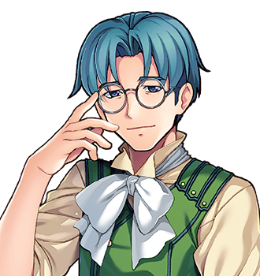

# The Thistle-pedia

Being Volume Three of <i>A Complete And Accurate History Of The Obligatory Quest</i>, arranged alphabetically so that people will stop coming to my table to ask me things.

<figure class="thumb right">

<figcaption>The compiler, at work. The hand at the temple is thought. The ink on it is also thought, after a fashion.</figcaption>
</figure>

My name is <b>Hosea Bellwether</b>, and I am the historian of the Obligatory Quest. I am not the <i>only</i> historian of the Obligatory Quest - the Prophecy Committee of Thistlewick keeps minutes, and the minutes are very thorough about biscuits - but I am the only one who has ever gone and asked the people it happened to. I do my asking from a table of my own by the fire in the <a href="Places/The_Slain_Wyvern">Slain Wyvern</a>, in <a href="Places/Nether_Sopping">Nether Sopping</a>, where the book lives. It needs a table of its own. You will understand why when you try to lift it.

This is the third volume. Volume One was a pamphlet, and there is still a copy upstairs in the Wyvern for any guest who finds themselves short of something to read and long on time. Volume Two is downstairs and is the size of a door; it has been mistaken for one, twice, by people coming in out of the rain. This volume is the same history again, cut up into articles and put in order, with pictures, so that you may look up a turnip farmer, a goose or a clause of a contract without having to read the four hundred pages in between.

## The compiler

I should say at the outset that I have never been on a quest. That is the qualification. Everybody else in the Slain Wyvern has been on one, and not one of them would tell a historian about it - they told me about the weather, and their knees, and what Thistlewick charges for a pint. So for a long while my great work was <i>complete</i>, in the sense that it had a beginning and an end and a great many chapters in the middle, and it was not <i>accurate</i>, in the sense that nobody in it had been consulted.

Then, in the year 2000, a young man from <a href="Places/Thistlewick">Thistlewick</a> came in out of the wet with a sword he did not seem entirely comfortable holding, and stood about. I wrote him down at once. Chapter Three Hundred and Twelve: <i>The Forty-Eighth arrives, and stands about.</i> It remains, I think, the most accurate sentence in the history, and he read it over my shoulder and did not dispute it.

His name was <a href="People/Bram_Thistle">Bram Thistle</a>. He was the forty-eighth Chosen One of the <a href="History/The_Prophecy_of_Thistlewick">Prophecy of Thistlewick</a>, a turnip farmer by trade, and the Prophecy Committee had chosen him while he was asleep. I asked him to do the one thing I could not: to go round the room and be <i>told</i>. Six first-hand accounts, heard properly, to the end. He did. Nobody does. They get two and go and look at a dungeon. He got six, and came back, and I paid him handsomely for a man with ink on both hands, and I wrote him into the history in small type at the bottom of page four hundred and one. The footnote says that he listened. Nobody else has one.

Then I told him to go north, and that I would leave the last page blank until I heard how it went, and that coming back to tell me was the fee.

He came back. He paid. This book is what he paid for. That was two years ago, near enough, and in the two years since I have gone round again and asked everybody what became of them afterwards, which is a question nobody in the Slain Wyvern had ever been asked either. Their answers are at the end of their articles.

## The world, briefly

It is a small world and a long one, and most of it is weather.

**<a href="Places/Thistlewick">Thistlewick</a>** is a village in the middle of it which believes, sincerely and on paper, that it is the middle of it. Every hundred years - or every hundred years as the Committee reckons them, which is a separate subject and has <a href="History/Two_Reckonings">its own article</a> - the <a href="People/Grimspite_the_Inevitable">Dark Lord</a> rises in the <a href="Places/The_Obligatory_Tower">Obligatory Tower</a> to the north, and Thistlewick sends a Chosen One to put him down. It has worked forty-seven times. Thistlewick is extremely proud of this, and has never once asked why there is always a next time.

**<a href="Places/Nether_Sopping">Nether Sopping</a>**, where I am writing this, is a wet fishing town on the south coast, forty miles from Thistlewick and the better part of a world away. It is where Thistlewick's Chosen Ones go when they come back, under <a href="History/The_Prophecy_of_Thistlewick#clause-nineteen-the-resettlement-clause">clause nineteen</a>, which gives a returning hero a pension, a cottage and "such distance from the village as is mutually agreeable". The distance turns out to be forty miles, and the agreement turns out to be Thistlewick's. As a consequence every adventurer in the world who has finished adventuring has pooled down here, in one tavern, with their old companions, their old grudges and a stuffed wyvern over the mantel which is a goose.

**The north** belongs to <a href="Places/Upper_Clanging">Upper Clanging</a>, a town of engineers who have been trying for two hundred years to build a ship that flies to the Tower, and to the <a href="Places/The_Long_Field">Long Field</a>, where they keep the ones that did not. Further north still there is snow, and <a href="Places/Frostwick">Frostwick</a>, and a chapter house that has filed everything. **The west** has <a href="Places/Great_Dunnage">Great Dunnage</a>, a city of guilds, and in the south-west the elves of <a href="Places/Olde_Evermore">Olde Evermore</a>, who have been here longer than the calendar and are very nice about it. **The east** has a magical college and a village that was flooded in somebody's absence, and the south-east a great house whose portraits watch you. And above all of it, on a cloud, there is a castle that nobody has ever reached, with a caretaker in it, who has been waiting.

There are, besides, a great many standing stones, wells, signposts, hermits, chests and old men who know things. I have tried to give each of them their due. Some of them have asked me not to.

## What happened

What happened, to put it as shortly as I am able - and I am not, by temperament, able - is that the Forty-Eighth went north, as forty-seven had before him, and climbed the Tower, and met the Dark Lord, and found that the Dark Lord did not want to be there either. <a href="People/Grimspite_the_Inevitable">Grimspite the Inevitable</a> had held the post for four thousand eight hundred years, by the Prophecy's own count, under a contract that renewed itself every time a hero beat him. He had been beaten forty-seven times, and every time it had counted as a renewal. The Prophecy, you see, was never a prophecy. It was an employment contract, and it had a clause twelve, and when the Forty-Eighth beat him the contract itself unrolled to enforce it.

The Forty-Eighth beat that as well. You may read about it under <a href="History/The_Obligatory_Quest">The Obligatory Quest</a>, and about clause twelve under <a href="History/The_Prophecy_of_Thistlewick">The Prophecy of Thistlewick</a>. Thistlewick struck clause twelve from its records afterwards and wrote in its place a note reading *SEE BRAM*. Nobody has needed to yet. Six months later, after a very long meeting, it struck clause nineteen as well.

He did not go alone. He went with friends - a healer, a smith, a hedge mage, a shopkeeper, a knight, a bard, a brooding man, a naturalist, a guest star and, in the end, a boy from a boiler - though never with all of them at once, and which three of them climbed the last stair with him depends on whom you ask, and everybody I asked says it was them. I have given all of them [articles](People/). I have not adjudicated. A historian who adjudicates between a blacksmith and a knight about who was standing nearest the Dark Lord does not remain a historian for long. He becomes a footnote, in somebody else's book, in small type.

## How to use this book

The volumes are these:

| Volume | What is in it |
|---|---|
| [History](History/) | The Prophecy and its clauses; the forty-eight Chosen Ones; the Quest of the Forty-Eighth; the two calendars and why they disagree; a timeline. |
| [People](People/) | The Forty-Eighth and his companions; the Dark Lord; and the people of the towns, villages and holes in the ground. |
| [Places](Places/) | Every settlement, ruin, tower and tavern I have been able to visit, write to or hear about. |
| [Institutions](Institutions/) | The Prophecy Committee, the Adventurers' Guild (Provisional), the Hoyle Works, the Collegium Arcanum and other bodies with minutes. |
| [Bestiary](Bestiary/) | The creatures of the road, with notes on which of them are what they say they are. |
| [Arms and Artefacts](Artefacts/) | Swords, hats, benches and one crate, stencilled on all six faces. |
| [A Glossary of Cliches](Cliches/) | The well-worn conventions of the adventuring life, as the Forty-Eighth walked into very nearly all of them. |

Words in a different colour lead to other articles. Words in red lead to articles I have promised and not yet written; I am told this is normal in an encyclopedia and I find it a great comfort. The box at the top of the page will search the whole work, which is more than I can do with Volume Two.

## A word on accuracy

Everything in this book is complete. Not all of it is accurate.

Where my sources agree, I have said so. Where they disagree I have given both sides, or all eleven, and said which I believe and why, and you may believe the other. Where they cannot both be true - Merrow Halgate's account of the bridge and Councillor Dree's account of the chair, for instance, cannot both be true on a Tuesday - I have printed both, because that is what *complete* means. Where nobody knows, I have said that nobody knows, and then, being human, I have usually guessed, and marked the guess as mine.

I have been asked by the Prophecy Committee to make clear that this work is not authorised by the Prophecy Committee. It is not. I have also been asked by the elves of Olde Evermore to make clear that the Third Age did not begin with the Prophecy. I asked them what it did begin with, and Elder Faelan said that it began with a great many things, and that the Prophecy was the one with a clerk present. I have left it there. So, I think, should you.

## Acknowledgements

To the regulars of the Slain Wyvern, who told me nothing for years and then told the Forty-Eighth everything in a fortnight. To Dorcas Thrupp, for the table. To the goose. To Piper Quill, who was also writing it all down, and whose version has more rhymes in it and fewer footnotes, and whom I consider a colleague and, in the matter of scansion, a rival. And to Bram Thistle, Chosen One Number Forty-Eight, who came back and told me how it went - all of it, in order, including the part about the tea - and so paid the fee.

H. B. The Slain Wyvern, Nether Sopping The twenty-first of March, Third Age 2002, which Spare Cotterill has confirmed by letter is spring

