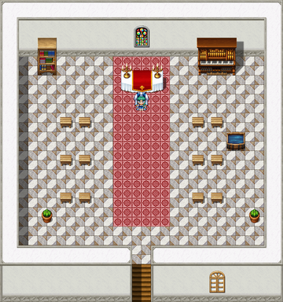

# The Order of Whatever Works

For the mother house, and the afternoon it was settled, see <a href="../Places/Weeping_Bottom">Weeping Bottom</a>. For the Sister in Thistlewick, see <a href="../People/Merribell">Merribell</a>. For the annual meeting of every medic within forty miles, which is not a religious order but would like to be thought as serious, see <a href="The_Healers_Table">The Healers' Table</a>.

<table class="infobox">
<caption>The Order of Whatever Works</caption>
<tr><td colspan="2" class="infobox-image">The Chapel of Whatever Works, Thistlewick</td></tr>
<tr><th>Founded</th><td>1702, by Mother Ursula Pym</td></tr>
<tr><th>Mother house</th><td>The Sisterhouse, <a href="../Places/Weeping_Bottom">Weeping Bottom</a></td></tr>
<tr><th>Prioress</th><td>Aveline Stope</td></tr>
<tr><th>Founding document</th><td>A pamphlet. Four pages, stitched, damp at the corners</td></tr>
<tr><th>Rule of Life</th><td>Four lines, one about socks</td></tr>
<tr><th>Doctrine</th><td>None, and does not want one</td></tr>
<tr><th>Symbol</th><td>None; there was a meeting about it, and somebody made tea</td></tr>
<tr><th>Habit</th><td>White</td></tr>
<tr><th>Soup</th><td>Leek, for everything</td></tr>
</table>

The <b>Order of Whatever Works</b> is an order of healing Sisters, founded in 1702 by <a href="../People/Mother_Ursula_Pym">Mother Ursula Pym</a> at <a href="../Places/Weeping_Bottom">Weeping Bottom</a>, for the sea air. It holds that theology is a distraction from the actual problem, which is usually that you have not had any water today. It has a pamphlet instead of a doctrine and soup instead of a symbol, and it has never been beaten on points.

## The Rule of Life

The whole of the Order's rule is on the first page of Mother Ursula's pamphlet, and it is four lines long:

I. Drink a glass of water. 
II. Sit down. 
III. Dry socks: two pairs, and a spare. 
IV. Then see how you feel.

Mother Ursula Pym, 1702, the Rule of Life

That is not verse, and <a href="../People/Piper_Quill">Piper Quill</a> has told me so. I have set it as verse because it is the only thing in this volume that everybody I asked could recite, and because the parish of <a href="../Places/Sump">Sump</a> has adopted it as a by-law, and walked it, in order, down the street and back, and is the better for it. Socks were the line nobody in Sump had ever had.

The Order's Sisters keep it. Asked what they believe, they will tell you to sit down. Asked when you last drank water, you will find you are being asked, not telling.

## The mother house

Mother Ursula chose the valley for its air, the sea air being the finest cure for the chest in the opinion of every physician consulted, none of whom had been. It drizzles there, and has since about 1702, and the Order has not moved, because the founder is on the stone at the gate and it seemed rude. The Sisterhouse, its ward, its physic garden of ferns, and its shore, where patients breathe in through the nose twice a day on the Founder's orders, are described under <a href="../Places/Weeping_Bottom">Weeping Bottom</a>.

There is one dry thing in any window of the Order, and it is a pair of socks, held up by Mother Ursula in the chapel glass like a relic.

## What Ought To Work

For some years before 2000 the Order was two. The Sisterhouse had begun holding symposia, and a party of the Sisters under **<a href="../People/Sister_Bewick">Sister Bewick</a>** had found that it had a doctrine, and had been examined on it, and had passed, and dyed the trim of its habits black, and called itself the **Order of What Ought To Work**, east door. There was one door. The ward was divided down the middle by a line, and the patients crossed it in the night, because they said there was soup on the other side.

The Prioress, **<a href="../People/Aveline_Stope">Aveline Stope</a>**, held symposia on the question. An order that holds one is thinking, she said; an order that holds eleven has stopped. The minutes of ten of them ended *Resolved, that the matter be referred to the next symposium.*

It was settled in the year 2000, without the eleventh. Merribell, who had left the mother house at twenty-two because it had begun holding symposia, came back for an afternoon and proposed that the door be opened, and twenty patients seen by each half, and whoever was through first was right. Whatever Works won, nineteen to one, on points, with <a href="../People/Sir_Hamo_Tench">Sir Hamo Tench</a> of the Errant keeping the score from the bed on the line. The one was Sister Bewick's, and it was a real case of the Weeping Bottom ague, the first anybody had seen in nine years, and at stage eleven of her *Correct Treatment* the patient sat up and felt better, and Merribell said that was a point to the east, fair's fair.

Then Sister Bewick asked to be examined on the Order's doctrine, since that is how a doctrine is settled, and the Prioress took the pamphlet out of a drawer, and Sister Bewick read it twice, and passed. She said that it was very short, and that she could find nothing wrong with it, and that that was very annoying. She wrote in her notebook *Intervention. Supported.* The eleventh minute reads: *Not held. A queue instead. Whatever Works, on points. Soup.*

Whether that makes one Order again, or two that agree, nobody at Weeping Bottom would tell me; the Prioress said it was a question for a symposium, and that there will not be one. There has been soup on both sides of the line ever since. Sister Bewick's eleven volumes of notes are in the Sisterhouse library, where volume eleven is still very thin, and is consulted, I am told, more than the other ten together.

## Outside the valley

The Order keeps chapels where it has Sisters, and lends them. Its chapel at Weeping Bottom, across the yard, has been lent for a knight's vigil, and it was the right chapel. Its chapel at <a href="../Places/Thistlewick">Thistlewick</a>, the Chapel of Whatever Works, has a teapot over the door on a bracket, because the Order never chose a symbol: it held a meeting about one, and somebody made tea, and that was the meeting. On cold mornings it steams.

In Thistlewick the Order is <a href="../People/Merribell">Merribell</a>, who is the only member of it for eleven miles. She keeps the most complete medical record in the county, every ailment of every soul in the parish, dated, in a good hand, and she has never lost a patient. On the coast road, <a href="../People/Tobias_Frayne">Tobias Frayne</a>, who had been revived eleven times in thirty years by kind people going that way, was told by the Order's Sister that there was nothing wrong with him, that that was the trouble, and that nobody would raise him a twelfth time. That is the Rule of Life applied to a whole cottage, and it worked.

## Afterwards

The Sisterhouse holds no symposia now. The chairs in the chapel, which stood in two rows facing one another for the eleventh, have been put back in rows facing the same way. The patients sit down. Merribell has been back twice to see the Prioress, and they talk.

I asked the Prioress, by letter, whether the Order would now consider a symbol, there being only one of it again. She wrote back that the matter had been raised, and that somebody had made tea.

## See also

- <a href="../Places/Weeping_Bottom">Weeping Bottom</a>
- <a href="../People/Merribell">Merribell</a>
- <a href="../Places/Sump">Sump</a>, for the by-law
- <a href="The_Healers_Table">The Healers' Table</a>
- <a href="The_Order_of_the_Errant">The Order of the Errant</a>, for Sir Hamo
