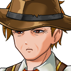

# Absalom Thurle

For the village, its curse and its lifting, see <a href="../Places/Sump">Sump</a>. For the Sister who asked for an item three, see <a href="Merribell">Merribell</a>. Remarks on this article are to be made through the chair.

<table class="infobox">
<caption>Absalom Thurle</caption>
<tr><td colspan="2" class="infobox-image">Parish Clerk. Also the chair</td></tr>
<tr><th>Known as</th><td>Mr Thurle; the Parish Clerk; the chair</td></tr>
<tr><th>Born</th><td>14 May 1941, <a href="../Places/Sump">Sump</a></td></tr>
<tr><th>Sex</th><td>Male</td></tr>
<tr><th>Parish Clerk</th><td>Since 1972. The sixth hand in the minutes</td></tr>
<tr><th>Is also</th><td>The chair. There is one chair</td></tr>
<tr><th>Item one</th><td>The curse. Lifted, 2000</td></tr>
<tr><th>Item two</th><td>The wasps. Deferred, 1794-1999. Not deferred, 2000</td></tr>
<tr><th>Item three</th><td>Never, until 2000. The Rule</td></tr>
<tr><th>Hat</th><td>Wide. Off, once, on the record</td></tr>
</table>

<b>Absalom Thurle</b> is the Parish Clerk of <a href="../Places/Sump">Sump</a>, and the chair, and stood in front of the parish hut for twenty-eight years with the ledger under one arm and two fingers pressed very hard to the side of his head. Item one was the curse. Item two was the wasps, deferred. There was never an item three. There was never time. In the year 2000 there was an item three, and he took his hat off.

## The chair

He introduces himself as the agenda, which is how he thinks of himself, and I do not say that unkindly:

> "Absalom Thurle. Parish Clerk. If it's about the curse, it's on the agenda. If it's about the wasps, it is not."

He was born in Sump in 1941 and took the ledger over in 1972 from his uncle, who had it from the clerk before, and so on back to 1794. The minutes are in six hands, and his is the sixth, and the neatest, and the one that went through the paper. He kept them as they had always been kept. Every year, item one, the curse; every year, item two, the wasps, deferred, because nobody could say whose they were. A wasp is an animal, which is the Pound. A nest is a structure, which is Buildings. And a well is Water, and the Water Committee was wound up in 1794, on the grounds that there wasn't any. He would explain this to anybody who asked, and without the slightest sign of having heard it.

The parish hut has a long table, one chair at its head, and a great many empty chairs, which were kept for when things got better. Mr Thurle had the one at the head. Nobody had moved that he should; there had been nobody to second it. So he was the chair as well as the clerk, and anybody who wished to speak in Sump, about anything, did it through him. Most of them did not wish to. It was the curse. He had a head like a drum, and so did everybody, and nobody in Sump had had a decent night's sleep in six generations.

## Item three

In the year 2000 <a href="Merribell">Merribell</a> of the <a href="../Institutions/The_Order_of_Whatever_Works">Order of Whatever Works</a> came to Sump with the Forty-Eighth's company, and looked at him for about nine seconds, and opened her mouth. "Through the chair, please," he said. There was no chair. He was the chair. She closed her mouth again, with some difficulty, and wrote something on the back of her hand.

When she came back she stood in front of him, exactly where a chair would be if there were one, and asked whether there was an item three. He said there was never an item three. She said there was now, and she would be quick, and she was, and got as far as what colour all of the parish's water must be before he said "THROUGH the chair. Please," and somebody in the end house closed a window. Then:

> "...The chair recognises the Sister."

She asked when anybody in Sump had last drunk a glass of water. He opened the ledger and went back, a page at a time, through all six hands, for some while, and said "...1794." She said that was not a curse. That was thirst. He took his two fingers away from the side of his head and looked at them, and said that it was a very thorough curse, and she said it was a very thorough thirst.

She moved that the Water Committee be re-formed. The Forty-Eighth seconded. It was the first motion seconded in Sump since 1794, and Mr Thurle had to look up how one was written down, and found it in the last one, which was the motion of 1794 winding the Water Committee up. He wrote the new one directly under it, in the same form. The Committee had one member and its first business was wasps, and he wrote WASPS, and his pen hovered over the word that had always come after it, for a long moment.

> "...Not deferred."

He read the parish its Standing Orders for the Lifting of the Curse, six clauses, drafted in 1795 and never used, and the parish met each one, in order, with something smaller than the clause had in mind. The whole of that is in the article on Sump. Then Merribell asked for item three, through the chair, and the chair recognised the Sister, and the Rule of Life of her order was adopted as a by-law. "Seconded?" he said. The Forty-Eighth seconded. "Carried." And the parish of Sump drank a glass of water, sat down, saw to its socks, and saw how it felt, and Mr Thurle took his hat off.

> "Item one. The curse. Lifted, 2000. There's time for an item four, if anybody has one."

Nobody had. It was wonderful.

I wrote to the parish of Sump for its article, and Mr Thurle replied for the chair, by return, in the sixth hand. I wrote again for this one, and he replied that he could not very well reply for the chair about the chair, and that he had therefore put my letter on the agenda, as item four, which is the first item four the parish has ever had, and that the parish had resolved, on a show of hands, that I might print what I liked so long as I said that he took his hat off. He did. I was not there; nine people have told me so, and it is in the minutes. - H.B.

## Afterwards

The empty chairs in the parish hut are sat in now. The first meeting at which they were was in the spring of 2001, on a motion to put up a plaque about the lifting of the curse, which was carried, with <a href="Mr_Gammage">Mr Gammage</a> asleep in the third chair from the end. Mr Thurle chaired it from the head of the table, through himself, and says that it was the longest meeting in the parish's history, at forty minutes, and that it went very well, and that he did not once have to press anything to the side of his head.

He still writes WASPS on every agenda, and after it, NOT DEFERRED, to see how it looks. He says it looks well. He wears the hat out of doors, because Sump is a spit of sand in the sun, and takes it off in the hut, and has both hands free, and nothing pressed to anything. There is time.

## See also

- <a href="../Places/Sump">Sump</a>
- <a href="Merribell">Merribell</a>, through the chair
- <a href="Mr_Gammage">Mr Gammage</a>, the eldest
- <a href="Mother_Ursula_Pym">Mother Ursula Pym</a>, whose Rule is item three
