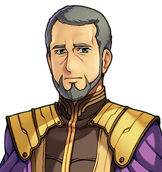
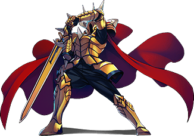

# Ambrose Fitch

For his mound, see <a href="../Places/The_Barrow_of_the_Forty-Fourth">the Barrow of the Forty-Fourth</a>. For his cottage, see <a href="../Places/Nether_Sopping#number-forty-fives-and-the-cottage-next-door">Nether Sopping</a>. For the woman who kept him alive, see <a href="Ysolde_Marrow">Ysolde Marrow</a>.

<table class="infobox">
<caption>Ambrose Fitch</caption>
<tr><td colspan="2" class="infobox-image">Not in the circle</td></tr>
<tr><th>Known as</th><td>The Forty-Fourth</td></tr>
<tr><th>Born</th><td>14 May 1934, <a href="../Places/Thistlewick">Thistlewick</a></td></tr>
<tr><th>Died</th><td>About 1999</td></tr>
<tr><th>Sex</th><td>Male</td></tr>
<tr><th>Mother</th><td>Born a Bother, at the lighthouse</td></tr>
<tr><th>Cousin</th><td><a href="Ferrety_Bother">Ferrety Bother</a>, along the coast</td></tr>
<tr><th>Chosen</th><td>1960</td></tr>
<tr><th>Kept alive by</th><td>Ysolde Marrow, nine years, on and off</td></tr>
<tr><th>Pensioned to</th><td><a href="../Places/Nether_Sopping">Nether Sopping</a>, by clause nineteen</td></tr>
<tr><th>Written to by Thistlewick</th><td>Never</td></tr>
<tr><th>Watered</th><td>A pot with a dead thing in it, every morning, forty years</td></tr>
<tr><th>Buried</th><td>In a barrow, by masons, within the fortnight</td></tr>
<tr><th>Asked for</th><td>A bench</td></tr>
<tr><th>Got</th><td>One</td></tr>
</table>

<b>Ambrose Fitch</b> was the Forty-Fourth Chosen One of <a href="../Places/Thistlewick">Thistlewick</a>, who went north in 1960, came home, was given a cottage at <a href="../Places/Nether_Sopping">Nether Sopping</a> by clause nineteen, and was ignored for forty years. Then he died, and within a fortnight there were masons out in the eastern hills building him a barrow, with a curse on it. He did not want a barrow. He wanted a bench. He is the only person in this encyclopedia who was set in a mound to be fought, and fought because it was expected, and stopped when he was asked.

## The forty years

He went north as they all did, with a sword and a medic, and the medic was <a href="Ysolde_Marrow">Ysolde Marrow</a>, who kept him alive for nine years on and off and has never been entirely sure how. He did the sword. He came home.

Clause nineteen sent him forty miles south to a cottage on the front, with a window that looks out at the sea and at the end of the north road where it comes over the hill, and a pension, and nothing else. Thistlewick did not write. He had a chair, turned to face the window, and on the sill a pot with a dead thing in it, which he watered every morning for forty years. It was dead when he bought it. Ysolde asked him why, and he said it was the principle. <a href="Halbert_Quy">Halbert Quy</a>, who lived next door from 1970, says that nothing ever grew. "Nothing grew then, either."

The window had one other thing in it. His mother was a Bother, the saint's granddaughter, who was born in <a href="../Places/The_Lighthouse_of_Saint_Bother">the lighthouse</a> and went inland to Thistlewick to marry, having had, she said, enough of stairs; and so the light on the point east of the town was kept, all the forty years he sat facing it, by his uncle and then, from 1970, by his first cousin, <a href="Ferrety_Bother">Ferrety Bother</a>. Neither of them was a man for visiting. They met, Ferrety says, about once a year, in the town, by accident, and nodded, and each said that the other was looking well, and Nether Sopping, which could not tell them apart, spent forty years thanking the wrong one. Ferrety was thanked for the Dark Lord at least once a month. Ambrose was asked about the oil.

Ysolde says that he used to say there was a whole trade in it: you keep someone alive, and then they go and live, and you don't get to see much of it. She says he was right about most things.

## The mound

<figure class="thumb right">

<figcaption>The way this went, and they both knew it.</figcaption>
</figure>

He died about the year 1999. Thistlewick, which had not once written, sent masons. In the eastern hills above the north road they raised a long barrow, at some expense, with a stone door, a curse, and THISTLEWICK REMEMBERS cut over the entrance, and inside it, in a chamber chalked with a circle, they set the Forty-Fourth in armour, with a sword, in the exact centre, the way the dead hero in the mound is set, so that he could fight the living one. It is on the sign outside. It is in the chalk. It is in the shape of the room.

So that is what he did. When the Forty-Eighth came, with a Guild Card, Ambrose Fitch said that he would shake his hand but there was a way this went and they both knew it, and they did what's done, and it took four minutes. "Forty years I've been waiting to have that fight and it took four minutes." Then he sat down on the floor of his own burial chamber, which the shape of the room does not allow for, and explained why he had done it, if he did not want to.

> "Because it's what's done. Weren't you listening? That's the whole trouble with the lot of us. It's what's done, so we do it."

He gave the Forty-Eighth the sword and the ring, given rather than taken, which he was extremely particular about, because they had never been his: they were what a hero is supposed to be buried with. He was asked whether there was anything he wanted.

> "A bench. Top of the mound. Facing the sea. You can see the north road from up there. People walk that road tired and there's nowhere for them to sit down for four miles. Forty years of standing in a circle and that's what I want. A bench. Anyone's bench. Not mine. Anyone's."

And a message: if they saw Ysolde, and they would, tell her he said she was right about the four hit points.

## The bench

It was built. How, and by whom, and with what timber, is in the article on <a href="../Places/The_Barrow_of_the_Forty-Fourth">the Barrow</a>, and I will not tell it twice. The burial chamber is empty now. The circle on the floor has gone unswept for the first time in forty years, and there is nobody standing in it. If you want him, he is on the top of the mound, on a bench, facing the sea, and I have been out and sat at the other end of it, and he did not mind.

I have been asked whether a man who has died can sit on a bench. I am a historian, not a theologian, and I can only report that the bench is sat on, and that the view from it is of the sea and the north road, and that the people who walk that road tired now have somewhere to sit down. He asked for nothing for himself, and was very firm about it, and I have decided that what he is doing on top of the mound is none of my business, which is a rule I have also had to apply to <a href="Sir_Dunstable">Sir Dunstable</a>.

## Afterwards

The bench is on the mound, and he is on the bench. When I went out, there was a cup on the end of it, not mine; I do not know whose. <a href="Merrow_Halgate">Merrow Halgate</a> thinks that Ambrose may have known about the older bench on the Middle Distance, which has no plaque and faces the sea, and wanted one nearer the road.

The cottage on the front was the Committee's to give again, and the Committee gave it, with the key, to the Forty-Eighth, and trusted that Friday would suit. <a href="Bram_Thistle">Bram</a> does not live in it. He uses it when he comes south. The chair is still turned to the window, and Bram has never moved it, and has never sat in it. He waters the pot. It goes on being dead, but it has been watered. Mrs Pimm, who has the other key, still airs the place on Tuesdays.

Thistlewick has not written. I have checked. But the Committee's minute book for the autumn of 2000 records that clause nineteen, the clause that sent him south, was struck, after a very long meeting, and I have chosen to read that as a letter, late.

## See also

- <a href="../Places/The_Barrow_of_the_Forty-Fourth">The Barrow of the Forty-Fourth</a>
- <a href="Ysolde_Marrow">Ysolde Marrow</a>
- <a href="Halbert_Quy">Halbert Quy</a>, next door
- <a href="Ferrety_Bother">Ferrety Bother</a>, his cousin, who kept the light
- <a href="../History/The_Chosen_Ones">The Chosen Ones</a>
- <a href="Merrow_Halgate">Merrow Halgate</a>
