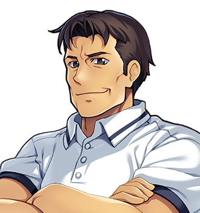

# Bryd Ollerenshaw

For the forge, see <a href="../Places/Upper_Clanging#the-forge">Upper Clanging</a>. For the other smith, see <a href="Hob_Grumnir">Hob Grumnir</a>.

<table class="infobox">
<caption>Bryd Ollerenshaw</caption>
<tr><td colspan="2" class="infobox-image">Waiting for a spar to get ready</td></tr>
<tr><th>Known as</th><td>Ollerenshaw</td></tr>
<tr><th>Born</th><td>22 June 1959, <a href="../Places/Upper_Clanging">Upper Clanging</a>, over the forge</td></tr>
<tr><th>Sex</th><td>Male</td></tr>
<tr><th>Of</th><td><a href="../Places/Upper_Clanging">Upper Clanging</a>, at the foot of the street</td></tr>
<tr><th>Trade</th><td>Smith. If it is iron and it has to hold</td></tr>
<tr><th>The forge</th><td>His, his father's, and his father's mother's</td></tr>
<tr><th>Sign</th><td>BRYD - SMITH. THE BEST IN THE NORTH. (SAYS WHO)</td></tr>
<tr><th>Best in Hall</th><td>1987 (Grumnir not entered; a cold)</td></tr>
<tr><th>Says</th><td>Aye; we shall see</td></tr>
<tr><th>Apprenticed with</th><td><a href="Hob_Grumnir">Hob Grumnir</a></td></tr>
</table>

<b>Bryd Ollerenshaw</b> keeps Ollerenshaw's, the forge at the foot of the street in <a href="../Places/Upper_Clanging">Upper Clanging</a>, which was his father's and his father's mother's before that. If it is iron and it has to hold, it goes to him. He was apprenticed alongside <a href="Hob_Grumnir">Hob Grumnir</a>, and they have been rivals for twenty years, and are both enormous, and between them they have said perhaps forty words in that time, most of them <i>aye</i>.

## The forge

Miss Hoyle of the works sends him a drawing every spring, and every spring it is a spar. "One of these springs I will get it right." He means the drawing, not the spar; his spars are right. He says *we shall see* of every job he takes, and Miss Hoyle knows what he means by it, and so does everybody else in the town, and none of them has ever explained it to me.

There is a certificate on his wall, BEST SMITH IN THE NORTH, awarded by B. Ollerenshaw to B. Ollerenshaw, in real gold leaf. There is also a real one, from the Smiths' Hall at <a href="../Places/Great_Dunnage">Great Dunnage</a>, BEST IN HALL, 1987, which is the year Hob did not enter, having a cold. Hob says he would have won. Bryd says aye. Neither of them has suggested settling it, and I have come to think that neither of them would want it settled.

His apprentice is <a href="Grommet_Cotterill">Grommet Cotterill</a>, who is put upon, and who is small enough to go inside a boiler, which in a smith's apprentice in Upper Clanging is a qualification.

## The spar

When the Forty-Eighth brought Miss Hoyle's drawing down the hill in the year 2000, the spar was not ready. "It will not get ready by being asked." It wanted two smiths, he said. It had always wanted two. Asked whether there was anybody else who could do it, he said, "There was. He went south twenty year ago come spring. Grumnir. You will not know him." He said the name the way a man reads a dimension off a drawing he has known by heart for a very long time.

Hob was in the company. What followed was this. Each of them said the other's surname. Neither said anything else. Each of them looked at the other's anvil and found something wrong with it. Then Hob took his coat off, and they made the spar in an afternoon, without a word, and stood and looked at it for a while. "That will hold." "Aye." "There is a house at the bottom of the hill that does a pale." "Aye." A child of the town, asked about it, said that this is what they do every time. Bryd says it was a good spar, and a good afternoon, an' all.

He asked the Forty-Eighth to tell Miss Hoyle that he said *we shall see*. She knew what he meant by it.

## The tube plate

Later the same year Hob came back up the hill, about a tube plate for the Two Hundred's boiler, which wanted four hands, one heat, and somebody small enough to go inside it afterwards. Everybody in the forge looked at Grommet. Hob took his coat off, which is not a sentence, but is the nearest either of them comes. Grommet went in after, and came out black to the eyebrows, and looked at the two of them, and said what he had to say about it to the Forty-Eighth, not to them.

## Afterwards

In 2001 he and Hob sat as joint judges of the Smiths' Hall prize at Great Dunnage, and disagreed for nine hours. The prize was awarded. Neither of them will say to whom. They are still arguing about rivets. He has a cabinet in the forge of three drawers: RIVETS; OTHER RIVETS; RIVETS (GRUMNIR'S - DO NOT USE). I asked him whether the third drawer was ever opened. He said, aye.

The sign over the forge still has its third line, SAYS WHO, in Hob's paint. Bryd has repainted the first two lines since, and not the third. Half the town has money on which of them will admit the other is the better smith. Nobody has collected. Miss Hoyle sent him a drawing this spring. It is a spar.

## See also

- <a href="Hob_Grumnir">Hob Grumnir</a>
- <a href="../Places/Upper_Clanging">Upper Clanging</a>
- <a href="Ott_Hoyle">Ott Hoyle</a>
- <a href="The_Cotterills">The Cotterills</a>
- <a href="../Institutions/The_Worshipful_Company_of_Smiths">The Worshipful Company of Smiths</a>
