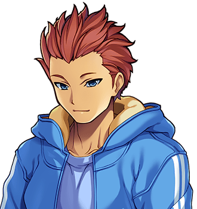

# Clevis Cotterill

For the family, on whom the book was run, see <a href="The_Cotterills">The Cotterills</a>. For the name that came in, see <a href="Washer_Cotterill">Washer Cotterill</a>. Do not encourage Clevis; see <a href="Ferrule_Cotterill">Ferrule Cotterill</a>.

<table class="infobox">
<caption>Clevis Cotterill</caption>
<tr><td colspan="2" class="infobox-image">Do you want to put money on the name?</td></tr>
<tr><th>Known as</th><td>Clevis; "the bookie", by the works; "that child", by the Parish Rooms</td></tr>
<tr><th>Born</th><td>1 February 1987, <a href="../Places/Upper_Clanging">Upper Clanging</a></td></tr>
<tr><th>Named for</th><td>A clevis, which is a U-shaped shackle with a pin through it. Grommet has not ruled on it</td></tr>
<tr><th>Ran</th><td>A book on the tenth one's name, 1999-2000</td></tr>
<tr><th>Opening prices</th><td>Gib evens; Cleat two to one; Washer twenty to one</td></tr>
<tr><th>Winner</th><td>Washer, at twenty to one</td></tr>
<tr><th>Paid out</th><td>Most of Upper Clanging</td></tr>
<tr><th>Book</th><td>Closed</td></tr>
<tr><th>Odds of Clevis running another</th><td>Not quoted</td></tr>
</table>

<b>Clevis Cotterill</b> is the seventh of the ten Cotterills of <a href="../Places/Upper_Clanging">Upper Clanging</a>, and in 1999 and 2000 ran a book on the name of the tenth, which was the most popular wager in the history of the town, and which Clevis lost, comprehensively, because Mr Cotterill had said *not Washer*, and Clevis had priced Washer at twenty to one on the strength of it, and had not reckoned with Spare.

## The book

Clevis has run a book on something since the age of seven: on which of the family would be first down to breakfast, on whether the rain would stop by the dinner hour, on how many times Mrs Cotterill would get up while she was meant to be sitting down. The stakes are farthings, and buttons, and on one occasion Shim's bearing, which Shim would not put up, and which Clevis has been trying to get onto the board ever since. Clevis keeps the book in a penny notebook with a pencil in the spine and keeps it honestly, which everybody in the town agrees about, and which is, Clevis says, the whole of the trade.

When the tenth was on the way, Clevis opened a book on the name. The Forty-Eighth was offered a price at the door. "Do you want to put money on the name? Gib is evens. Cleat is two to one. Washer is twenty to one, because Da has said not Washer."

The reasoning was sound. Mrs Cotterill had always said that she had Washer in reserve, and Mr Cotterill had said, very firmly, *not Washer*, and in that house, in twenty-four years, a thing Mr Cotterill had said very firmly had generally been listened to, at least for a while. A week later, Clevis reported, "Gib has shortened. I would get in now."

## Twenty to one

Half the works put a farthing on Washer, because Da had said not Washer, and the works has known Mr Cotterill a long time, and has a feeling about the things he says very firmly. Clevis took all of it, and laid it off against nobody, because there was nobody to lay it off against, and was, on the night of the ninth letter, holding a very great deal of the town's money against a single name.

Spare got to it first. "He said call it Washer," said Mrs Cotterill, "and I was tired."

> "Washer came in at twenty to one. Half the works had a farthing on it because Da said not Washer. I have had to pay out most of Upper Clanging. The book is closed. Mam says there is not going to be another one."

Clevis paid every farthing. It took three days, and a loan from Gudgeon at no interest, and the sale of the notebook's spare pencil, and Tappet's sweepstake winnings on the dragon, which Tappet lent without being asked, and which Clevis says is the only time in the family's history that anybody has lent a bookmaker money without first asking what the odds were.

I asked Clevis whether there was any lesson in it. Clevis thought about it for some time, and then said that the lesson was that you should never price a name on what Da says, because Da says things, and that you should price it on who is going to be in the room when Mam is tired. And then, after a moment: that it had been Spare, and you could not have priced Spare. Nobody could. That was the whole trouble with Spare, and the whole point. - H.B.

## Afterwards

Clevis is fifteen. The book is closed, and has stayed closed, on the subject of names, Mam having said that there is not going to be another one. The whole street now has money on what Washer's first word will be, and Clevis has been begged, by the works, by the Safety Valve and by the vicar, to make a book on it. Clevis will not. "The family," says Clevis, "has been through enough." That is the official position. I have it from Shim that the true position is that Clevis has worked out that Spare will be in the room for it, and has declined to be beaten twice by the same brother.

Clevis has begun a second notebook, on the airship, the Two Hundred and First, and when it will fly, and is offering six to four on the spring of 2003, and is not taking any bets at all from Miss Hoyle, who has asked, because Miss Hoyle has the schedule.

## See also

- <a href="The_Cotterills">The Cotterills</a>
- <a href="Washer_Cotterill">Washer Cotterill</a>, twenty to one
- <a href="Ferrule_Cotterill">Ferrule Cotterill</a>, who is not to be encouraged either, but in a different way
- <a href="Spare_Cotterill">Spare Cotterill</a>, who could not be priced
