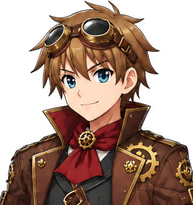

# Cotter Cotterill

For the family, see <a href="The_Cotterills">The Cotterills</a>. For his wife, see <a href="Bessie_Cotterill">Bessie Cotterill</a>. For the town he walked home from every Saturday, see <a href="../Places/Great_Dunnage">Great Dunnage</a>.

<table class="infobox">
<caption>Cotter Cotterill</caption>
<tr><td colspan="2" class="infobox-image">Saturday. Six o'clock. Eleven miles</td></tr>
<tr><th>Known as</th><td>Cotter; "the eldest", by himself, first, every time</td></tr>
<tr><th>Born</th><td>17 January 1976, <a href="../Places/Upper_Clanging">Upper Clanging</a></td></tr>
<tr><th>Sex</th><td>Male</td></tr>
<tr><th>Named for</th><td>A cotter pin, which holds a wheel on</td></tr>
<tr><th>Married</th><td><a href="Bessie_Cotterill">Bessie Marsden</a>, 1999</td></tr>
<tr><th>Worked</th><td>The big furnace, the Iron Company, <a href="../Places/Great_Dunnage">Great Dunnage</a>, 1994-2000</td></tr>
<tr><th>Walked home</th><td>Every Saturday: eleven miles up the valley, and eleven back for the Monday</td></tr>
<tr><th>Boots</th><td>Shod at heel and toe with somebody else's heel-irons</td></tr>
<tr><th>Is</th><td>Always very glad to get home</td></tr>
<tr><th>Home for good</th><td>Spring 2000</td></tr>
</table>

<b>Cotter Cotterill</b> is the eldest of the ten Cotterills of <a href="../Places/Upper_Clanging">Upper Clanging</a>. For six years he worked the big furnace at the Iron Company in <a href="../Places/Great_Dunnage">Great Dunnage</a>, and walked home up the valley every Saturday, eleven miles, and back down again for the Monday, and he was always very glad to get home. He has been home for good since the spring of 2000. He is still very glad. He has not been told that he can stop.

## The eldest

He introduces himself the same way to everybody, and he introduced himself that way to the Forty-Eighth, at the gate of the Iron Company in Great Dunnage, with his hand out:

> "Cotter Cotterill. Upper Clanging, originally. Eldest of nine."

That was in the year 2000, before the spring, and it was correct at the time. He has since had to change it, and says it now with a short pause in the middle, *eldest of... ten*, as if checking, and he is always pleased with the answer.

A cotter pin goes through the end of an axle and holds the wheel on. Grommet, who has a view on the names, says that this one is fine. It is one of only two names in the family that Grommet has passed, the other being Gudgeon's (a gudgeon is a pin), and Cotter, who passed first, being the eldest, would like that on his headstone, and Mrs Cotterill has told him not to be morbid, and also that he is not to have a headstone for a good long while yet, and that is not a request.

## Down the valley

He went down the valley at eighteen, in 1994, because the Iron Company paid half again what the foundry at home did, and the house at the end of the street had nine in it by then and was, as he says, full in all directions. "Nine works," he told the Forty-Eighth. "I'm on the big furnace at the Iron Company till the spring. Then home for good."

He lodged in Great Dunnage, with a Mrs Pettit in Cinder Lane, who gave him a room and his tea and his Sunday dinner on the Saturday, because he was never there on the Sunday. Every Saturday he came off the furnace at six, and walked up the valley road, eleven miles, and was home by the time it was dark, and walked back down on the Sunday night in time for the Monday. He did that for six years. He worked it out for me: about six hundred and twenty walks, near enough seven thousand miles, the most of any Cotterill, and he has not once been asked whether he minded it, because nobody in his family would think to ask a thing like that, and he would not know what to say.

"I'm always very glad to get home," he says. His father says it too. It is, I think, the family motto, and it has never been written down, and it does not need to be.

The heel-irons on his boots, which are worn bright, came from the forge in Thistlewick, and Hob Grumnir knew them at once, and asked whether he could have them back till the spring. Cotter said that he was home in the spring, for good, and that he would not get home without them, eleven miles up every Saturday and eleven back. Hob said, "Aye. Get home." I have asked Hob how his heel-irons came to be on a furnace man in Great Dunnage. He says that things he makes go where they are needed, and that this is the best place he has ever heard of one going. - H.B.

## The bottom lock

In the year 2000, a little before the spring, the bottom lock on the Dunnage cut jammed, with thirty of the Iron Company's boats sat on the water behind it, and the Canal Company sent in their smallest man at eleven, and he did not come out. Cotter saw his brother at the gate, and knew at once what the answer was, and would not ask. "I'd not ask," he said. "Mam would say -"

Spare went down. What happened in the culvert is Spare's, and in his article. Mr Pocock came out, and the paddle came clear, and thirty boats went down the cut, and the Mayor had his scissors back, which had been on the paddle since Tuesday, and cut the ribbon again, properly, with scissors, having had to open two things with a knife in the meantime. The Canal Company's man went home for a lie down, and said that Spare was to have his job. Cotter gave him a bun. "That's from me," he said. "I'll tell Mam on Saturday."

He did tell Mam on Saturday. Mrs Cotterill has not said what she said. Cotter says she was very quiet for a long time, and then she did more potatoes.

## Home

He came home in the spring, as he had said. Bessie wrote to him that Washer had been born, at six on the hooter, and that Da had said not Washer. "It's spring," he told the Iron Company. "I'm going home on Saturday, for good." He asked for the day, and they gave him the rest.

## Afterwards

He is at the foundry in Upper Clanging, on days, with Rivet, and the two of them pass their father on the foundry steps at six, going the other way; Rivet says that between the three of them there is now a great deal of passing, and that some mornings there is a queue. He is a father. The child came in the summer of 2000, on time, and is not named in this encyclopedia, at the request of its great-grandmother, until the seating plan is settled. He walks to work four hundred yards and back. He says he misses the eleven miles, a little, on a Saturday, and that he goes for a walk instead, up the valley road and back, and that he is very glad to get home.

## See also

- <a href="The_Cotterills">The Cotterills</a>
- <a href="Bessie_Cotterill">Bessie Cotterill</a>
- <a href="Spare_Cotterill">Spare Cotterill</a>, for the culvert
- <a href="../Places/Great_Dunnage">Great Dunnage</a>
- <a href="Hob_Grumnir">Hob Grumnir</a>, whose heel-irons they are
