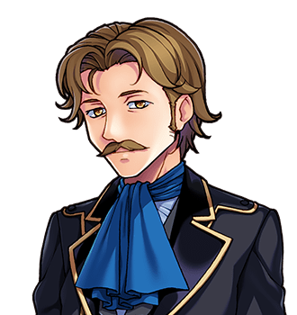

# Councillor Dree

For the room he sits alone in, see <a href="../Places/The_Slain_Wyvern">The Slain Wyvern</a>. For the spectacles, see <a href="Nix">Nix</a>. For the bridge, which cannot have been on the same Tuesday as the chair, see <a href="Merrow_Halgate">Merrow Halgate</a>.

<table class="infobox">
<caption>Councillor Dree</caption>
<tr><td colspan="2" class="infobox-image">Not the Dark Lord</td></tr>
<tr><th>Known as</th><td>Councillor Dree; Dree; the advisor</td></tr>
<tr><th>Born</th><td>1922</td></tr>
<tr><th>Sex</th><td>Male</td></tr>
<tr><th>Of</th><td><a href="../Places/The_Slain_Wyvern">The Slain Wyvern</a>, <a href="../Places/Nether_Sopping">Nether Sopping</a>, a table to himself</td></tr>
<tr><th>Was</th><td>The kindly old advisor. You know the sort</td></tr>
<tr><th>Suspected</th><td>From week three</td></tr>
<tr><th>Tied to a chair</th><td>Week eleven</td></tr>
<tr><th>Revealed</th><td>That he needs spectacles</td></tr>
<tr><th>Compensation</th><td>A hat</td></tr>
<tr><th>Certified</th><td>Not the Dark Lord. He had to get one</td></tr>
</table>

<b>Councillor Dree</b> sits alone in <a href="../Places/The_Slain_Wyvern">the Slain Wyvern</a> at <a href="../Places/Nether_Sopping">Nether Sopping</a>, with the air of a man who has been sat alone deliberately. He was the kindly old advisor of a party that went north, and from the third week of it they suspected him of not being, and in the eleventh week they tied him to a chair and demanded that he reveal himself, and he revealed that he was a kindly old advisor, and needed spectacles. His is one of the six accounts in Volume Two of my history, and he gave it with great composure, and refilled his cup twice.

## The advisor

> "I was the advisor. The kindly old advisor. You know the sort."

We do. The party he went north with I have agreed not to name, because, he says, they were lovely about it, and he would not have them made a story of. He was a parish councillor before he was an advisor, and the title came with him and stayed, and he was asked to go north because he was known to give sensible advice, kindly, and was old, and the party felt that it ought to have somebody who was. He thinks now that it was the having that did it. Every story they had ever heard had a kindly old advisor in it, and in every one of them he turned out to be the villain, and they were young, and well read.

> "Week three, they started watching me. Week five, the bard wrote a verse about how my eyes went strange at night. Week eight they searched my bags."

What was strange about his eyes at night was that he could not see. He had been short-sighted for forty years, and had never owned spectacles, and had got by, in a parish, where everybody stands close enough to talk to; and at night, in a wood, on the road north, he squinted at everything, and his eyes went strange, and the bard noticed, and rhymed it.

## The chair

> "Week eleven they tied me to a chair and demanded I reveal myself."

He revealed that he was a kindly old advisor. That he had always been a kindly old advisor. That the strange thing about his eyes was that he needed spectacles. They apologised. They were lovely about it. They bought him a hat. And then, for the rest of the quest, they were just a *little* bit careful of him.

It is the chair that cannot be reconciled with <a href="Merrow_Halgate">Merrow Halgate</a>'s bridge, not on a Tuesday, and I have tried, and printed both in my history, and said so. I put it to them both, separately. Each of them is sure of his day, and says that the other is a very decent man, and probably thinking of a Wednesday.

> "If it helps: I am not the Dark Lord. I have a certificate. I had to get one."

The certificate was issued by a magistrate on the way home, after an examination of his eyes, which found them ordinary and short. He keeps it in the hat.

## The spectacles

In the year 2000 <a href="Nix">Nix</a> returned eleven things that had been in her ledger longest, and one of them was a pair of reading spectacles, left on the Wyvern's bar, which nobody had come for all week. She put them on the table in front of Councillor Dree.

> "I have never owned spectacles. That was rather the point of the whole business."

He put them on anyway, and looked round the Slain Wyvern properly, possibly for the first time. "Good heavens. Is that what everybody looks like?" At the next table somebody who had been watching his eyes for eleven years stopped, very slightly. I have been asked not to say who.

> "My eyes are entirely ordinary now. I shall miss being suspected. Nobody has ever watched me so closely."

I think he meant it. I think that is why, in fifty years, he never bought a pair. A kindly old advisor is listened to, and nodded at, and not looked at; a suspected one is looked at all the time, by everybody, very closely, for eleven weeks, and then bought a hat. I said something of the kind to him, and he looked at me through the spectacles for some time, and said that he could see me very clearly now, and that I was quite right, and that he would thank me not to put it in. I have put it in the margin, which is not in. - H.B.

## Afterwards

He wears the spectacles, and his eyes are entirely ordinary, which nobody in the Wyvern has quite accepted. He still sits alone, deliberately, and with great composure. The Wyvern still watches him a little, out of habit, and he is grateful for it, and says nothing, and wears the hat.

## See also

- <a href="../Places/The_Slain_Wyvern">The Slain Wyvern</a>, and the room
- <a href="Nix">Nix</a>, and the RETURNED column
- <a href="Merrow_Halgate">Merrow Halgate</a>, and the bridge
- <a href="Hosea_Bellwether">Hosea Bellwether</a>, and the six accounts
- <a href="../Cliches/Index">Cliches</a>: the mysterious advisor
