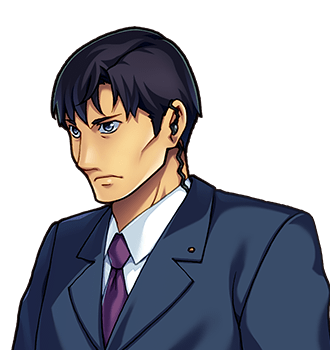

# Dr Pike

For the inn, see <a href="../Places/Restwell">Restwell</a>. For the fiddle player he watches, see <a href="Walt_Ashbury">Walt Ashbury</a>. For the theories, there is no article. He does not like them.

<table class="infobox">
<caption>Dr Pike</caption>
<tr><td colspan="2" class="infobox-image">"I watch."</td></tr>
<tr><th>Known as</th><td>Dr Pike; Pike. Doctor</td></tr>
<tr><th>Born</th><td>Alaric Pike, 19 November 1941, at Haverleigh, the doctor's house, the son of the doctor</td></tr>
<tr><th>Practised</th><td>Medicine, at Haverleigh, 1967-1989</td></tr>
<tr><th>Retired</th><td>In the practical sense, which is to say nobody comes</td></tr>
<tr><th>Took a room at the Eight Hours</th><td>For a fortnight, in 1989, to think about it</td></tr>
<tr><th>Still there</th><td>Thirteen years on</td></tr>
<tr><th>Bottle</th><td>TONIC - DR PIKE. It is cold tea. He has never claimed otherwise</td></tr>
<tr><th>Guests watched</th><td>About fifteen thousand</td></tr>
<tr><th>Theories</th><td>Several. He does not like them</td></tr>
</table>

<b>Dr Pike</b> is a retired physician who has had a chair by the fire at the Eight Hours in <a href="../Places/Restwell">Restwell</a> since 1989, when he took a room for a fortnight, to think about it. He watches. Twelve hundred guests a year go up the staircase to a fiddle playing eight bars, and every one of them comes down better, and nobody can tell him why. He has theories. He does not like them.

## Haverleigh

He was born in 1941 at Haverleigh, a market town in the south, the son of the town's doctor, and became its doctor in his turn, in 1967, and practised there for twenty-two years, carefully, with a good black bag and a better memory, and was, by every account I have had from Haverleigh, an excellent doctor, which in his opinion means that he cured about a third of the people who came to him, made another third comfortable, and told the rest the truth.

In 1989 a younger man set up in the town, with newer methods, and Dr Pike found within the year that nobody came, and that he did not mind, and that he did not know what to do with himself. He took a room at the Eight Hours at Restwell for a fortnight, to think about it, on the recommendation of a patient, who had been once and said it had done him good.

## The fortnight

> "Pike. Doctor. Retired in the practical sense, which is to say nobody comes."

> "Eleven years. I took a room for a fortnight, to think about it."

He went up the stairs on his first night, and Walt Ashbury played him up, and he came down at twenty past two the next afternoon better than he had been in thirty years, and had a chop, and sat down by the fire to think about why. He has been thinking about it since. It is now thirteen years. The fortnight has never formally ended. He pays by the week, on Fridays, and Mrs Ashbury writes *fortnight (contd.)* in the book.

## The watching

> "I watch. Twelve hundred guests a year go up that staircase, and every one of them comes down better, and nobody can tell me why."

He has notes. He showed me some of them: thirteen years of them, in a doctor's hand, in black notebooks numbered on the spine, of everybody who has gone up the stairs at the Eight Hours since 1989, with what was wrong with them when they went up, if he could tell, and what was wrong with them when they came down, which was never anything. Coughs. Backs. Sorrows. One broken heart, which he says came down mended, or at least set. A man with gout who came down and walked to Penultima. I asked what was in the notes about the tune. He said there was nothing in the notes about the tune, because a tune is not a clinical sign.

> "I have theories. I do not like them."

He would not tell me any of them. He did say that every one of them came down, in the end, to a man on a step with a fiddle playing eight bars that he had not made up, and that this was not a medical explanation, and that he was a doctor, and that he had come to Restwell to think and had been thinking for thirteen years, and that he would very much like a medical explanation, and that there was not going to be one.

The bottle on the table beside his chair is labelled TONIC - DR PIKE, and it is cold tea, and he has never once claimed otherwise. I asked why he had labelled it at all. He said that it was the only thing he had prescribed since 1989, and that he had prescribed it to himself, and that it had done him exactly as much good as he had expected, which was a comfort to a man in his position. - H.B.

## His own case

I asked him, before I left, whether the stairs had done him any good. He said that he had gone up them about four thousand seven hundred times, and come down better every time, and that he was sixty, and had never been so well in his life, and that it was unscientific and he resented it. Then he poured himself a cup of the tonic, and looked at the fiddle player on the step for slightly too long, and then back at his breakfast, which was a chop.

## Afterwards

He is still by the fire. The younger man at Haverleigh has written to him, twice, to ask whether he would come back and take some of the patients, the town being busier since the road to the Tower opened up; he wrote back to say that he would think about it, and that he was at present in the middle of a fortnight. He has begun a new notebook, number forty, headed THE NORTH ROAD: VISITORS TO THE CHAIR, because the traffic since 2000 has doubled his sample. He says that it has not helped.

## See also

- <a href="Walt_Ashbury">Walt Ashbury</a>
- <a href="Hester_Ashbury">Hester Ashbury</a>
- <a href="../Places/Restwell">Restwell</a>
- <a href="../Institutions/The_Healers_Table">The Healers' Table</a>, of which he has never been a member, and to which he has twice been asked to speak, and has declined, on the grounds that he would only be able to say *I don't know*
