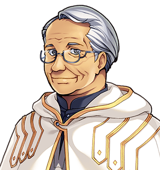

# Edwin Tarrant

"You seek wisdom." For the hill he looks at, see <a href="../Places/The_Barrow_of_the_Forty-Fourth#near-by">the Middle Distance</a>. For the convention, see <a href="../Cliches/">the Glossary of Cliches</a>, under <i>The hermit</i>. For the shop that now delivers, see <a href="Lavinia_Barrow">Mrs Barrow</a>.

<table class="infobox">
<caption>Edwin Tarrant</caption>
<tr><td colspan="2" class="infobox-image">Looking at the middle distance, with great authority</td></tr>
<tr><th>Known as</th><td>The Hermit</td></tr>
<tr><th>Born</th><td>14 September 1929, <a href="../Places/Nether_Sopping">Nether Sopping</a></td></tr>
<tr><th>Sex</th><td>Male</td></tr>
<tr><th>Trade</th><td>Clerk to a ship's chandler, 1944-1981. Hermit, 1981-</td></tr>
<tr><th>Lives</th><td>A hut, on a rock, near the Barrow of the Forty-Fourth</td></tr>
<tr><th>Wisdom</th><td>Bread. Candles. A wedge of the hard cheese, not the soft. Nails, two inch. Something for a cough</td></tr>
<tr><th>Gave away</th><td>His second-best thing</td></tr>
<tr><th>Candles</th><td>Nearly out. He shan't mention it</td></tr>
</table>

<b>Edwin Tarrant</b> is the Hermit. He has lived in a hut on a rock near the <a href="../Places/The_Barrow_of_the_Forty-Fourth">Barrow of the Forty-Fourth</a> since 1981, looking at the middle distance with great authority, and he has wisdom for passing travellers, and it is his shopping list. In nineteen years nobody ever once came up and asked him if he needed anything, until the Forty-Eighth.

## Before the rock

He was a clerk for thirty-seven years to a ship's chandler in <a href="../Places/Nether_Sopping">Nether Sopping</a>, which supplied ships that, by the time he started, had stopped coming. He kept the stock book. In 1981, at fifty-one, he closed the stock book one evening, and went up the hill to find out whether he had any wisdom. He says that he did not tell anybody because he did not want a fuss, and because he expected to be back by Thursday. He found a hut, which was empty, and a rock, which was exactly the right height for looking at the middle distance, and he found that the middle distance was very fine, and he stayed.

He has been looking at it for twenty-one years. I asked him what he has learned. He said that it changes with the weather and is never the same twice, and that it does not need anything from you, and that this is restful. Then he said that the one thing he had learned for certain was that he should have brought more candles.

## Wisdom

> "You seek wisdom."

The Forty-Eighth had in fact been walking past.

> "Then hear it, traveller. Bread. Candles. A wedge of the hard cheese, not the soft. Nails, two inch. Something for a cough."

It was pointed out to him that this was a shopping list.

> "It is a shopping list, yes. I have been up here nineteen years and no one has ever once come up and asked me if I needed anything."

The Forty-Eighth went and got his shopping. It took an afternoon. Mr Tarrant was so pleased that he gave them his second-best thing, which was an elixir that had been in the hut when he found it, and two hundred crowns, which was his savings from the chandler's, which had been under the bed for nineteen years with nothing to be spent on. He would like it known that he did not need the company. He needed the cheese.

I asked him what his best thing was. He pointed at the middle distance.

> "The middle distance is very fine today. Also I am nearly out of candles again, but I shan't mention it."

I went up to see him for this article, and I took candles, because I had read my own notes. He looked at the candles for some time and said that he had not mentioned them. I said that he had not. He said that it was very good of me to know, and put them away, and asked whether I sought wisdom. I said I supposed I did. He said, "Matches." It was, as it turned out, exactly what he was out of. - H.B.

## Afterwards

He is seventy-two. Since the spring of 2000 Wick & Barrow has delivered to the rock, on the first of every month: bread, candles, the hard cheese, not the soft, nails, two inch, and something for a cough, whether or not he has a cough. Mrs Barrow charges for delivery. He says that it is the first time in nineteen years that anybody has charged him for anything, and that he finds it companionable. He is still nearly out of candles, by about the twentieth of every month. He has not mentioned it to anybody, and everybody knows.

## See also

- <a href="../Places/The_Barrow_of_the_Forty-Fourth">The Barrow of the Forty-Fourth</a>, and the Middle Distance near it
- <a href="Lavinia_Barrow">Lavinia Barrow</a>
- <a href="../Places/Wayside_Sights">Wayside sights</a>
