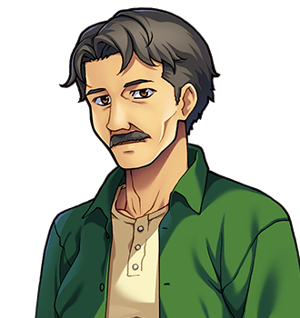

# Ernest Cotterill

"Mr Cotterill." For the family, see <a href="The_Cotterills">The Cotterills</a>. For Mrs Cotterill, see <a href="Nora_Cotterill">Nora Cotterill</a>, who would like it known that she is not to be looked up second.

<table class="infobox">
<caption>Ernest Cotterill</caption>
<tr><td colspan="2" class="infobox-image">Always very glad to get home</td></tr>
<tr><th>Known as</th><td>Mr Cotterill; Da; Ern, by the foundry</td></tr>
<tr><th>Born</th><td>9 January 1951, <a href="../Places/Upper_Clanging">Upper Clanging</a>, the house at the end of the street, in the room he now sleeps in, by day</td></tr>
<tr><th>Works</th><td>The foundry. Nights: twelve on, twelve off, six days</td></tr>
<tr><th>On nights since</th><td>1978</td></tr>
<tr><th>Off nights</th><td>Once, spring 2000, for Washer</td></tr>
<tr><th>Minds</th><td>The walk home in the dark</td></tr>
<tr><th>Has ever once minded</th><td>The walk home</td></tr>
<tr><th>Has said</th><td>Call it Spare (1991); not Washer (1999-2000)</td></tr>
<tr><th>Views</th><td>None, since about Ferrule</td></tr>
</table>

<b>Ernest Cotterill</b> is the father of the ten Cotterills of <a href="../Places/Upper_Clanging">Upper Clanging</a>, and works nights at the foundry: twelve on, twelve off, six days, since 1978. He passes his second son at the front door at six every morning, going the other way. He is always very glad to get home. Mrs Cotterill says so, and so does everybody on the street, and so does he, and it is the most reliably reported fact in the north.

## Nights

He was born in 1951, in the house at the end of the street, which was his father's, who was also on nights, so that Ernest says he grew up thinking that fathers were something that came in for breakfast. He went into the foundry at fourteen, on days, and met Nora Sprag at nineteen, when he walked into a coal wagon she had just stopped, and apologised to it.

He went on to nights in 1978, after Rivet, because nights paid a crown a week more and the house had stopped being big enough by day. He has been on them since. His own account of it is short, and I give it whole, because it is the most complete statement of a working life I have ever been given, and it took eleven seconds:

> "Nights. Twelve on, twelve off, six days. It is not the work I mind. It is the walk home in the dark."

He thinks about that for a moment.

> "Mind, I have never once minded the walk home."

He has walked home from the foundry, by my reckoning, about six thousand six hundred times. It is four hundred yards, uphill. The walk to work is the same four hundred yards, downhill, and he has never mentioned it once.

## The door at six

Rivet is on days. They pass at the front door at six, every day, Sunday and all, one going out and one coming in. Rivet has given me the whole of their exchange: *"Rivet." "Da."* "That is a conversation, that is," says Rivet. "Some mornings he says the weather." I asked Mr Cotterill about the weather. He said it was usually about the same as the day before, and that it did not need saying every time, and that some mornings it did.

## The names

He named two of the ten, which is not many, and he would like that understood: the rest were Mrs Cotterill's, and very good names, and he had no hand in them. In 1991 they had run out, and she was tired, and he said call it Spare. He has never been allowed to forget it. In 1999, when the tenth was coming, he said, very firmly, *not Washer*. Clevis, who was running a book on the name, immediately lengthened Washer to twenty to one, and half the works put a farthing on it, because Mr Cotterill had said not Washer, and the works has known Mr Cotterill a long time.

Spare got to it first. "I said not Washer," Mr Cotterill says now, with no hope at all, and great contentment. "Washer. I have stopped saying not."

## The argument

He was called into the argument with Spare once, by Mrs Cotterill, under the move she calls *Ask Your Father*. He came in from the kitchen, in his socks, and looked at the two of them, and said, "Mam."

"I know," said Mrs Cotterill.

That was his entire contribution, and both of them say that it was the turning point, and neither of them will say why. I have thought about it a good deal, and I believe that he meant something like *the boy is nine in a useful way*, and that she knew he meant it, and had known it for some time. I may be wrong. I did not ask him. He would have said that he had no view, and he has not had one since about Ferrule.

## Spring

On the morning in the spring of 2000 when it was spring, every Cotterill in Upper Clanging was indoors, and Mr Cotterill came off nights for it, for the first time in twenty-two years. He and Rivet passed at the door at six, the both of them going in. Washer was born at six on the hooter.

He was very pleased. He did not say so. "Ten," he said, and then, "That is all of them." Mrs Cotterill says that was the most he had said in a morning since the wedding.

## Afterwards

He is still on nights, and still very glad to get home. The foundry offered him days in the summer of 2000, as a kindness, after twenty-two years, and he went on days for a week, and was home at night with ten children in the house, and asked to go back on nights, and was given them. The works says it was the first time anybody had ever asked. He says that he likes the walk home. He has never once minded it.

## See also

- <a href="The_Cotterills">The Cotterills</a>
- <a href="Nora_Cotterill">Nora Cotterill</a>
- <a href="Rivet_Cotterill">Rivet Cotterill</a>, at the door at six
- <a href="Washer_Cotterill">Washer Cotterill</a>, not
