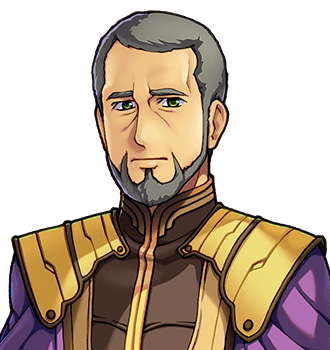

# Ferrety Bother

"It's a family name." For the light, the tower and everything in it, see <a href="../Places/The_Lighthouse_of_Saint_Bother">The Lighthouse of Saint Bother</a>. For the oil, see <a href="Lavinia_Barrow">Mrs Barrow</a>, who charged for it.

<table class="infobox">
<caption>Ferrety Bother</caption>
<tr><td colspan="2" class="infobox-image">At the bottom of the stairs</td></tr>
<tr><th>Known as</th><td>Mr Bother; the keeper</td></tr>
<tr><th>Born</th><td>3 February 1938, in the lighthouse, on the ground floor, under the tapestry of the storm</td></tr>
<tr><th>Sex</th><td>Male</td></tr>
<tr><th>Keeper of</th><td><a href="../Places/The_Lighthouse_of_Saint_Bother">The Lighthouse of Saint Bother</a>, since 1970. The fourth generation</td></tr>
<tr><th>Great-grandmother</th><td>The saint. She'd have hated the fuss</td></tr>
<tr><th>Stairs climbed</th><td>Eleven thousand times, by 2000</td></tr>
<tr><th>Jumpers</th><td>A great many, all identical, all with a lighthouse on</td></tr>
<tr><th>Has walked to the crossroads</th><td>Once</td></tr>
</table>

<b>Ferrety Bother</b> keeps the light at the point east of <a href="../Places/Nether_Sopping">Nether Sopping</a>, as his father did, and his grandmother, and his great-grandmother before her, who is the saint. No ship has passed the point since 1909. The light is not for the ships. It is for the ones coming back down the north road at night, who can see it from the crossroads, and walk home by it.

## The family

> "Ferrety Bother. It's a family name. The saint was my great-grandmother and she'd have hated the fuss."

Her book, on the top floor, is signed *S. Bother*. Her first name is not in it, or anywhere in the lighthouse, and the family says she would have hated the fuss of a first name too. The tapestries of her on the ground floor were made by her son's wife, Ferrety's grandmother, who also found something on the rocks one winter, which is in a pickling jar in the store and has never been named. The deckchair tapestry, with SHE'D HAVE HATED THE FUSS embroidered underneath, is Ferrety's, done in the winter of 1971, his first as keeper, when he had a great many evenings.

He was born in the tower, in February, in a gale. His father, who was keeping the light that night, came down the stairs between trimming the wick and trimming it again, and went back up. There are no other Bothers. He has never married. He says that there was never anybody who wanted to live up eleven floors of stairs, and when I pointed out that it is six, he said that it is six going up.

## Out of oil

The Guild paid a stipend for the light until the shipping stopped, and then stopped paying it. The family went on buying oil out of their own pockets for ninety-one years, until the spring before the Quest, when the oil ran out and so did the pocket. Mrs Barrow at Wick & Barrow had oil, and also had a price.

> "One gallon. That's all it takes. Mrs Barrow, across from the Guild. Tell her it's for the light. She'll still charge you. Tell her anyway."

The Forty-Eighth was told this by a man sitting at the bottom of a dark lighthouse in the dark, which is a thing you notice about a lighthouse immediately. He was told that a lighthouse with no ships was not a lamp on a rock, because it had not been for the ships for four generations. He went to Mrs Barrow, who charged him, and brought the gallon back, and Mr Bother said, "You'll be wanting to go up, then," and did not get up. He had been up those stairs eleven thousand times. He wanted somebody else to do it once. When they came down he pressed a keeper's lamp on them without a word, which, from him, is a speech.

## The crossroads

> "You can see it from the crossroads. I checked. I walked out to the crossroads at midnight to check, and I stood there, and I looked back."

It is the only time in his life he has walked to the crossroads. He went the night the light was relit, after the company had gone, and locked the door behind him, which he had never done, and walked out along the road in the dark as far as the crossroads, and turned round. He says that it was lit. He says that he stood there for some time. He did not say anything else about it, and I have put it in this article in his words and not added any.

He has made one ship in a bottle a year since 1970, each with a tiny lighthouse in it, lit, for the shelf, because his father did and his grandmother did. I asked him what he would put in the bottle for 2000. He said a lighthouse, lit, the same as every year. Then he took it down to show me, and there is a very small figure in it, at the foot of the tower, with a gallon can. He said that it was in proportion. - H.B.

## Afterwards

He is sixty-four. The lamp needed oil again in the spring of 2001, and somebody got it, now that somebody has, and it has not gone out since. He has not walked to the crossroads again. He says that he does not need to, and that he might, one night, if somebody was coming home. He still uses one plate, and washes it, and dusts the other twenty-nine on Sundays, and he still trims the wick square every week, regardless.

## See also

- <a href="../Places/The_Lighthouse_of_Saint_Bother">The Lighthouse of Saint Bother</a>
- <a href="Lavinia_Barrow">Lavinia Barrow</a>
- <a href="../History/The_Chosen_Ones">The Chosen Ones</a>, who walked home by the light
