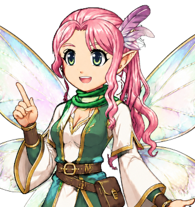

# Fizz

HEY! LISTEN! For the meadow, see <a href="../Places/Firstfield_Meadow">Firstfield Meadow</a>. For the body that employs her, see <a href="../Institutions/The_Guild_of_Guides">The Guild of Guides</a>. For lore, see nobody. That is lore.

<table class="infobox">
<caption>Fizz</caption>
<tr><td colspan="2" class="infobox-image">Every. Journey. Begins. HERE.</td></tr>
<tr><th>Known as</th><td>Fizz; Tutorial Sprite, Third Class</td></tr>
<tr><th>Born</th><td>Issued 1 March 1981, by the Guild of Guides, Firstfield Chapter, out of a dandelion clock, on the stroke of nine. The Guild says the date is lore. Fizz says it was a Sunday, and that she remembers, and that she was doing so well</td></tr>
<tr><th>Sex</th><td>Female</td></tr>
<tr><th>Size</th><td>Small</td></tr>
<tr><th>Volume</th><td>Audible from the road</td></tr>
<tr><th>Explains</th><td>Everything, once. ONCE</td></tr>
<tr><th>Doors explained</th><td>About three thousand, several to somebody already holding one open</td></tr>
<tr><th>Does not cover</th><td>Lore</td></tr>
<tr><th>Ambition</th><td>Boss Warning Sprite, First Class</td></tr>
<tr><th>Graduates</th><td>One</td></tr>
</table>

<b>Fizz</b> is the guide at <a href="../Places/Firstfield_Meadow">Firstfield Meadow</a>, at the foot of the rainbow: a Tutorial Sprite, Third Class, of the <a href="../Institutions/The_Guild_of_Guides">Guild of Guides</a>, small, bright and audible from the road. She has explained walking, talking, chests, signs and doors to every Chosen One of living memory, or tried to; forty-seven of them pressed the button really fast. The Forty-Eighth did not. He is her only graduate, and she painted the number on the sign herself.

## Issue

She was issued by the Guild's Firstfield Chapter in the spring of 1981, out of a dandelion clock, at nine in the morning, which is when the Guild restocks. The Guild will not confirm the date or the clock, because both are lore. Fizz will confirm both, at length, and will add that she knew how to explain doors before she knew how to fly, and that the first thing she ever said was HEY, and the second was LISTEN, and that the Guild was very pleased, and that she was doing so well.

She has been at the meadow ever since: twenty-one years, every day, waiting at the bottom of it for somebody to walk in off the rainbow, so that she could tell them that every journey begins here. Most of the time nobody came. The Chosen Ones came once a generation, or once a decade lately, and pressed the button. Between them she practised on the pigs, which are sheep.

## Once

The Guild is very firm on once. A guide explains everything once. Fizz is very firm on it as well, and explained it to the Forty-Eighth, once, and then again, in capitals, and then a third time in case he had not heard the capitals, and then told him that she knew he had heard, she knew. She is firm, too, on signs: a sign is a sign, and signs are for reading, and you press the button to read it, and she knows you already did, she knows. She appears in front of your face whenever you try to read one, to tell you that it is a sign. It is not in the Guild's rules. It is in every guide's heart.

When the Forty-Eighth said that his journey had begun some time before, in a turnip field, and that since then he had walked out of a village and down a road, she said:

> Every. Journey. Begins. HERE.

and then explained walking to him, because he had just done it, and told him he was doing so well. He has told me since that she was right, in a way, and that he did not know it at the time; that a journey had certainly begun in the turnip field, but that it had been somebody else's, the Committee's, and that the meadow was the first place anybody had asked him to do anything, and then told him he had done it well.

## Lore

Asked what the Dark Lord's weakness was, where the Sacred Key was, or what the lever does, she says LORE, three times. She was right about the lever, which does not exist, and which there always is. I have asked her other things, for this article: how old she is, what a sprite eats, whether she sleeps, and what the Guild pays. All of them were lore. I asked what was not lore. She said that doors were not lore, and explained one to me, and I was holding it open.

## Boss Warning Sprite, First Class

Her ambition is to be a Boss Warning Sprite, First Class, and wait outside the last door, and shout IT'S WEAK TO FIRE. She practises on the sheep, which are pigs, and are not weak to fire, and she asks you not to check. Since the Quest she has applied for the post, and has put the Forty-Eighth down as a reference. When I wrote to the Guild to ask whether he had been consulted, the Guild wrote back to say that that was lore.

I asked the Forty-Eighth whether he would give her a reference. He said that he already had: that the Guild had written to him, in 2001, asking whether the sprite had been helpful, and that he had written back yes, and that he had been asked to say what about, and had written *doors*. I have since learned that the Guild has no grade between Third Class and First, or that if it does, it is lore. Either way, I hope she gets it. I hope the last door she waits outside is a long way off, and that whatever is behind it is very weak to fire. - H.B.

## Afterwards

She is still at the meadow, still Third Class, pending. The graduation sign at the top still reads TUTORIALS COMPLETED IN THIS MEADOW: ONE, the *one* painted over a nought, very carefully, by somebody with small hands and no experience of paint. The paint has run a little at the bottom of the one. She has not touched it up. She says that it is how you can tell it is real.

## See also

- <a href="../Places/Firstfield_Meadow">Firstfield Meadow</a>
- <a href="../Institutions/The_Guild_of_Guides">The Guild of Guides</a>
- <a href="Old_Hollis">Old Hollis</a>, <a href="Dilys_Fenwick">Dilys Fenwick</a> and <a href="Norbert_Pelling">Norbert Pelling</a>, of the meadow
- <a href="Bram_Thistle">Bram Thistle</a>, her graduate
