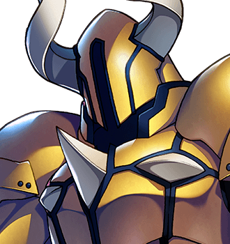

# Grimspite the Inevitable

For the contract, see <a href="../History/The_Prophecy_of_Thistlewick">The Prophecy of Thistlewick</a>. For the building, see <a href="../Places/The_Obligatory_Tower">The Obligatory Tower</a>. For the forty-eight people who came up the stairs, see <a href="../History/The_Chosen_Ones">The Chosen Ones</a>.

<table class="infobox">
<caption>Grimspite the Inevitable</caption>
<tr><td colspan="2" class="infobox-image">At the bookmark</td></tr>
<tr><th>Known as</th><td>The Dark Lord; Grimspite the Inevitable; latterly, Grimspite</td></tr>
<tr><th>Born</th><td>Not stated. Asked by letter, he declined (see <a href="../History/Two_Reckonings">Two Reckonings</a>)</td></tr>
<tr><th>Sex</th><td>Male</td></tr>
<tr><th>Of</th><td>The top of the Obligatory Tower</td></tr>
<tr><th>Post</th><td>Dark Lord, under the Prophecy of Thistlewick, renewable</td></tr>
<tr><th>Held</th><td>Four thousand eight hundred years, by the contract</td></tr>
<tr><th>Renewed</th><td>Forty-seven times</td></tr>
<tr><th>Appointed</th><td>The same way the post was nearly filled in 2000</td></tr>
<tr><th>Age</th><td>His own affair</td></tr>
<tr><th>Hand</th><td>Very beautiful</td></tr>
<tr><th>Status</th><td>Retired, 2000. Receipt issued</td></tr>
<tr><th>Kettle</th><td>On</td></tr>
</table>

<b>Grimspite the Inevitable</b> was for four thousand eight hundred years, by the Prophecy's own count, the Dark Lord of the <a href="../Places/The_Obligatory_Tower">Obligatory Tower</a>, against whom the village of <a href="../Places/Thistlewick">Thistlewick</a> sent forty-eight Chosen Ones. He did not want the job. It was an employment contract, and he could not get out of it, and every time a Chosen One beat him it renewed him before they reached the stairs. The forty-eighth asked him why he did not stop, and listened to the answer, and read the contract, and Grimspite has been retired since.

He reads. He was reading when every one of the forty-eight came up the stairs, and he put the bookmark in every time. He is very tired and very polite, and he writes to me.

## The post

The post of Dark Lord was held, before the Prophecy, at the castle on the cloud that its caretaker now calls the <a href="../Places/The_Former_Premises">Former Premises</a>, which no hero could ever reach. Grimspite has never been there. "I've read the file. The drains were a disgrace, and the east wing faced the wrong way."

He holds, or held, the post at the Tower, under clause twelve of the [Prophecy](../History/The_Prophecy_of_Thistlewick#clause-twelve-the-renewal). Every hundred years, by the Committee's reckoning of a hundred years, a Chosen One came up the stairs, and he said, "So, you have come at last." He said it forty-seven times. "And I meant it the first time." They fought him and they won, and clause twelve renewed him. It is carved forty-seven times into the wall behind his throne: THE DARK LORD SHALL RISE AGAIN. "It isn't a threat. It's a renewal notice."

How he came to hold it in the first place he told the Forty-Eighth in four words, at the moment when the Prophecy had just declared the post vacant and congratulated the party on it. "That's how I got the job." I have not been able to find out any more than that, and I have tried, and I have been told by letter that he hopes I am keeping well.

## The forty-seven

All forty-seven did the sword. Not one of them asked. Clause fourteen says the first meeting shall not go well, and it never did: <a href="Merrow_Halgate">Merrow Halgate</a>'s party of twenty fought him at the bridge and lost, as was written down in advance, and he tells me that halfway through, Grimspite stopped, and apologised, and then carried on. Nobody ever believes him about that part. I do. One of them, <a href="Halbert_Quy">Halbert Quy</a>, the Forty-Fifth, was offered a cup of tea, and declined it, because he thought it was a trick, and has thought about it ever since. Grimspite has wondered too.

None of them died, at the top. "Forty-seven of them, and they all won. Do you know how that looks, to the forty-eighth?" He has four skeletons up there, in plaster, for the look of the thing. One of them has an extra foot, because there was a foot over and it seemed a shame.

## The forty-eighth

"Forty-eight," he said. "Right on time. Sit down. No? Fine. Standing is traditional."

The Forty-Eighth asked him why he did not stop. He said: "Ah. The clever one. They're rarer than you'd think. I can't." He showed them the wall. He asked who had told <a href="Bram_Thistle">Bram</a> to ask, and when he heard it was Halbert he asked him to go back and tell Halbert that the tea had just been tea, and to listen to all of it, because he would like, once, for somebody to have listened to the whole of it. Bram did.

He answered the other questions he was brought. Clause seven requires a Chosen One to go on foot, "because a thing that flies over and drops something is not a story. It is a Tuesday." He was of the view that <a href="Ott_Hoyle">Miss Hoyle</a> of <a href="../Places/Upper_Clanging">Upper Clanging</a> would never get one off the ground in sight of his tower. Asked, on her behalf, what the Tower is made of, he said that nobody had ever asked him that, that he did not know, and that he had leaned on that wall every day for four thousand years and never once wondered. "Tell her the work was good."

When ITEM 1 was set down in front of his throne, it smoked, and knocked the bookmark on to the floor, and did nothing else, because of clause thirty-one. He looked at it for some time. "That is the first new thing in four thousand eight hundred years, and I would like a moment with it. Whoever made that has never once been told that it was any good."

Then they fought, because that is the part they were for, and at the end of it he went down on one knee and said, "...Thank you."

The rest is under [The Obligatory Quest](../History/The_Obligatory_Quest#the-top). It was his idea to read the thing. "Four thousand eight hundred years, and it was an admin problem." He signed the Forty-Eighth a receipt for one Dark Lord, renewable, and sent him home with a message: "There isn't a forty-nine."

## The top of the Tower

The room at the top is furnished in the traditional manner, and he will tell you about every piece of it, which nobody did before the ending because nobody stayed. The tablet over the door was a present from the Prophecy, in the year one, and was the only joke it ever made. The two statues are of an aunt, who sat for both and would not stop talking, and did not like either of them, "and you don't throw away an aunt". One mirror is late, because of the altitude. The other shows where you would rather be, and he has put his name down for a bungalow. There are two seeing-orbs, which are very old and very heavy and show only each other.

## Afterwards

He is retired. He stays in the Tower, in his chair, with a kettle and the book at the bookmark. He is still on the same book. The forty-eighth carving will not be needed.

He receives visitors and has about one a month, most of them people who would like to see the chair. Bram comes up once a year, on the day, and the kettle is on. Halbert Quy, who said no to the tea thirty years ago, has been told all of it, the tea included, and has not been back up for a cup; the kettle is always on now, and he knows it. Mr Quy sends his regards up the hill.

He writes to me, in a very beautiful hand, about my dates. He has corrected three of them in Volume Two, all of them correctly. I asked him how old he is. He said he had held the post for four thousand eight hundred years, and that how old he had been when he took it was his own affair.

I have sent him this article for his corrections. He returned it with none, and a note: that it was very fair, that the east wing still faced the wrong way, and that if I should ever be passing there was a kettle. I have not yet been passing. I am a historian, and I do not climb things. But I have begun to think about it.

## See also

- [The Prophecy of Thistlewick](../History/The_Prophecy_of_Thistlewick)
- [The Chosen Ones](../History/The_Chosen_Ones)
- [Bram Thistle](Bram_Thistle)
- <a href="Halbert_Quy">Halbert Quy</a>
- <a href="../Places/The_Obligatory_Tower">The Obligatory Tower</a>
