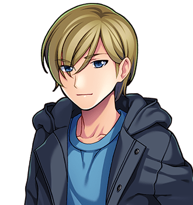

# Grommet Cotterill

For the family, whose names are wrong, see <a href="The_Cotterills">The Cotterills</a>. For his master, see <a href="Bryd_Ollerenshaw">Bryd Ollerenshaw</a>. For the other one, see <a href="Hob_Grumnir">Hob Grumnir</a>.

<table class="infobox">
<caption>Grommet Cotterill</caption>
<tr><td colspan="2" class="infobox-image">Has got the makings</td></tr>
<tr><th>Known as</th><td>Grommet; "the lad", in the forge; "the apprentice", in his own account, with some weight on the "the"</td></tr>
<tr><th>Born</th><td>19 January 1985, <a href="../Places/Upper_Clanging">Upper Clanging</a></td></tr>
<tr><th>Named for</th><td>A grommet, which is a ring that keeps a rope from chafing. It is not a fastener either, and he knows</td></tr>
<tr><th>Apprenticed</th><td>To Bryd Ollerenshaw, at the forge, autumn 1999</td></tr>
<tr><th>Has got</th><td>The makings. Said slowly (1999-2000); said a little faster (2002)</td></tr>
<tr><th>Has been inside</th><td>A boiler tube plate, with a candle and a drift. All forty-one holes true</td></tr>
<tr><th>Corrects the family</th><td>Every day</td></tr>
<tr><th>They do this</th><td>Every time</td></tr>
</table>

<b>Grommet Cotterill</b> is the sixth of the ten Cotterills of <a href="../Places/Upper_Clanging">Upper Clanging</a>, and is apprenticed to Bryd Ollerenshaw at the forge, where he is put upon. Mr Ollerenshaw says he has got the makings, and says it slowly. He is the only Cotterill who has studied what the family are named after, and he has found that most of the names are wrong, and he has told them so every day since, and none of them has changed their name, and he does not expect them to, and he is going to keep saying it.

## The names

He went into the forge at fourteen, in the autumn of 1999, and in his first month Mr Ollerenshaw taught him the names of things. He came home that evening and stood in the kitchen and told the family what he had learned.

> "Shim is not a fastener. A shim is a packing piece."

> "Ferrule is a collar. It fastens nothing. It only stops a split."

> "A gudgeon is a pin. That one is fine."

He has said it every day since, and they have taken it, he says, very badly, by which he means that they have taken no notice of it at all. Mrs Cotterill says that the names are not wrong; they are what she called them. Shim says that she does not mind being a packing piece, because a packing piece is what you put in to make a thing fit, and that is a good thing to be. Ferrule says nothing, and makes him stand up.

He has not been asked about his own name, and so I asked him. He said that a grommet is the ring that goes round a hole in a sail, so that the rope does not chafe it, and that it is not a fastener either, and that he had known that since his first week, and had decided not to bring it up. "Somebody has to be right in this family," he said. "It doesn't have to be me."

## The forge

Mr Ollerenshaw's forge at Upper Clanging has a sign over it that says BRYD - SMITH. THE BEST IN THE NORTH. (SAYS WHO), and the third line is in Hob Grumnir's paint, and Grommet was told on his first day not to mention it, and has not. Grommet's duties are those of an apprentice everywhere: he blows, he fetches, he sweeps, he quenches, and he is sent inside things, because he is small enough to go inside a boiler, and has.

"Mr Ollerenshaw says I have got the makings," he told the Forty-Eighth. "He says it slowly." I asked Mr Ollerenshaw how slowly. He said, "Aye," after a while, and I took that to be the answer.

## The tube plate

In the year 2000 a drawing came down the hill from the Hoyle Works on the morning spike, and it was not a spar. It was a tube plate, for the refit. Mr Ollerenshaw and Hob Grumnir looked at it, and then at each other, and neither of them finished a sentence. It wanted four hands, one heat, and somebody small enough to go inside it afterwards. Everybody in the forge looked at Grommet.

"I knew it," said Grommet.

It was done in one heat, because it could only be done in one, and in the whole of it the four hands were never once in each other's way. Then Grommet went in, feet first, with a candle and a drift, and sighted the holes from the inside. "They're true. All of them. Can I come out." Mr Ollerenshaw said, "When it's -" and Hob said, "Let the lad out," and he came out black to the eyebrows, and looked at the two of them, and said it to the company, not to them: "They do this every time."

Miss Hoyle tried every one of the forty-one holes with a gauge pin, and nodded at every one, and asked who had gone in. She was told. "Good lad," she said. In the Hoyle Works that is not framed, because "that will do" is framed, and there is only so much wall; but Grommet has it written down, on the inside of his cap.

"I've been inside a tube plate," he says now, to anybody. "Mr Ollerenshaw says I did it right." And then, because he is a fair-minded boy: "He said it quick, an' all."

Rivet, who shares a bed with him, would like it known that he sleeps with his elbows. Grommet would like it known that Rivet has never once said so to his face, and that a man who has things to say about elbows should say them in the bed, where the elbows are. - H.B.

## Afterwards

He is seventeen, and two years and more at the forge. Mr Ollerenshaw still says he has got the makings, and says it a little faster, and on one occasion in 2001, Grommet says, he said it before he had finished looking at the work, which Grommet regards as the high point of his career so far. He still tells the family every day that the names are wrong. Washer, now nearly two, has not said a word yet, but looks at him, when he starts, with what Grommet calls an expression. The whole street has money on what the first word will be. Grommet says that if it is *wrong* he will consider the matter closed.

## See also

- <a href="The_Cotterills">The Cotterills</a>
- <a href="Bryd_Ollerenshaw">Bryd Ollerenshaw</a>
- <a href="Hob_Grumnir">Hob Grumnir</a>
- <a href="Ott_Hoyle">Ott Hoyle</a>, who said "good lad"
- <a href="Rivet_Cotterill">Rivet Cotterill</a>, about the elbows
