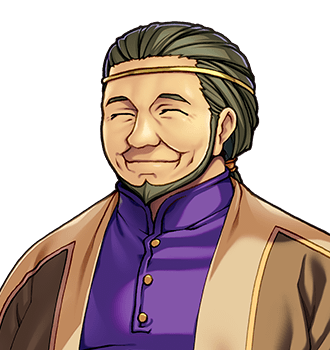

# Halbert Quy

For the cottage, see <a href="../Places/Nether_Sopping#number-forty-fives-and-the-cottage-next-door">Nether Sopping</a>. For the man he did not have tea with, see <a href="Grimspite_the_Inevitable">Grimspite the Inevitable</a>.

<table class="infobox">
<caption>Halbert Quy</caption>
<tr><td colspan="2" class="infobox-image">Potting something</td></tr>
<tr><th>Known as</th><td>Number Forty-Five; the Forty-Fifth</td></tr>
<tr><th>Born</th><td>7 February 1929, <a href="../Places/Thistlewick">Thistlewick</a></td></tr>
<tr><th>Sex</th><td>Male</td></tr>
<tr><th>Chosen</th><td>1970</td></tr>
<tr><th>Of</th><td><a href="../Places/Thistlewick">Thistlewick</a>, and then, by the Friday, <a href="../Places/Nether_Sopping">Nether Sopping</a></td></tr>
<tr><th>Age</th><td>In his seventies</td></tr>
<tr><th>Grows</th><td>Roses. No turnips, as a policy</td></tr>
<tr><th>Declined</th><td>A cup of tea</td></tr>
<tr><th>Asked</th><td>Why there is always a next one</td></tr>
<tr><th>Thought about it</th><td>Thirty years</td></tr>
<tr><th>Distance from Thistlewick</th><td>Forty miles. He has walked it</td></tr>
</table>

<b>Halbert Quy</b> was the Forty-Fifth Chosen One of <a href="../Places/Thistlewick">Thistlewick</a>, who went north in 1970, did the sword, was offered a cup of tea at the top of the <a href="../Places/The_Obligatory_Tower">Tower</a> and said no, and came home and asked one question at a meeting, and has lived in <a href="../Places/Nether_Sopping">Nether Sopping</a> ever since. He is the reason the Quest of the Forty-Eighth ended the way it did, and he would like that left out. I have not left it out.

## The tea

He went up as they all went up, with the sword, and at the top a tall, tired, very well-read man offered him a cup of tea, and he said no, because he thought it was a trick. It was not a trick. He has thought about that tea, by his own account, every day for thirty years.

## The question

He came home, and the Committee was already drafting the next one, and at the next meeting he asked: *if it works every hundred years, why is there always a next one?* The cottage was ready by the Friday.

That is clause nineteen, the Resettlement Clause: a pension, a cottage, and "such distance from the village as is mutually agreeable". "Turned out to be forty miles," he says. "They're not cruel. They're embarrassed. A hero who came back asks questions." He has had thirty years to measure the distance and makes it forty miles, which is a great deal further than the signpost says, and I believe him over the signpost. He can tell a Thistlewick man from the way he stands.

His cottage is one of the two at the north end of the town. There are roses, and there is not one turnip, as a matter of policy. The Committee's framed commendation is face down on the shelf, dusted round rather than moved. The sword over his fire is exactly like the one over every Chosen One's fire, and has dust on its upper edge, which takes a long time and a great deal of not looking. Next door was <a href="Ambrose_Fitch">Ambrose Fitch</a>'s, the Forty-Fourth's, and they were neighbours for thirty years.

## What he told the Forty-Eighth

In the year 2000 the Forty-Eighth walked in, and Mr Quy told him to sit down, because he was blocking the light, and said *Thistlewick*, from the standing. Then, at the kitchen table, turning a pot a quarter turn at a time, he told him what Grimspite was like - "Polite. Tired. Very well read." - and then put down the trowel and told him the only thing he had come home with that was worth the trip.

> "Nobody asks him why. Forty-seven of us. Forty-seven. We all did the sword. Not one of us ever asked the man why he doesn't stop."

> "Ask him. That's all. Ask him why. And then listen to the whole answer, because it's long, and because I didn't."

The Forty-Eighth asked. What the answer was is in [The Obligatory Quest](../History/The_Obligatory_Quest) and the article on [the Prophecy](../History/The_Prophecy_of_Thistlewick), and it was long, and he listened to all of it. At the top of the Tower, Grimspite stopped, and asked who had told him to ask, and was told, the Forty-Fifth, a man in a garden forty miles south, and said, "Halbert," and asked to have a message taken back: that the tea was just tea.

It is the most consequential conversation in this encyclopedia and it happened over a seed tray. I asked Mr Quy whether he had known, when he told the boy to ask, what would come of it. He said that he had known what came of not asking, and that he had had thirty years to get tired of it. Then he said I was blocking the light.

## Afterwards

<a href="Bram_Thistle">Bram</a> walked south again, after the ending, and sat at the kitchen table, and told him what Grimspite had said, all of it, in order, including the part about the tea. It took most of an afternoon. What was said at the end of it is between the two of them, and in Nether Sopping that is a complete answer, and I have not asked twice.

He still grows roses. He still has no turnips, and says the policy has outlived its purpose and he is keeping it out of loyalty. He has not been back up the Tower, though the kettle at the top is always on now, and he knows it. He sends his regards up the hill, by Bram, once a year, on the day, and Grimspite sends his back.

When Bram comes south, about once a month, and stops next door at Fitch's, Mr Quy tells him he is blocking the light, though he is outside, and on the other side of a hedge.

## See also

- <a href="../History/The_Chosen_Ones">The Chosen Ones</a>
- <a href="Ambrose_Fitch">Ambrose Fitch</a>, next door
- <a href="Grimspite_the_Inevitable">Grimspite the Inevitable</a>
- <a href="Bram_Thistle">Bram Thistle</a>
- <a href="../Places/Nether_Sopping">Nether Sopping</a>
