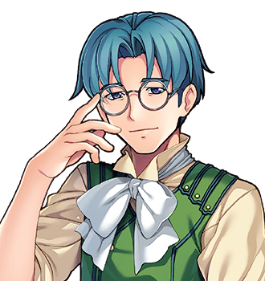

# Hosea Bellwether

This article is about the compiler of this volume, and was written by him, against his judgement, on the advice of everybody else. For his work, see the <a href="../Index">front page</a>.

<table class="infobox">
<caption>Hosea Bellwether</caption>
<tr><td colspan="2" class="infobox-image">With ink hands</td></tr>
<tr><th>Known as</th><td>The historian at the table by the fire</td></tr>
<tr><th>Of</th><td><a href="../Places/Nether_Sopping">Nether Sopping</a>, the <a href="../Places/The_Slain_Wyvern">Slain Wyvern</a>, the table by the fire</td></tr>
<tr><th>Trade</th><td>Historian</td></tr>
<tr><th>Work</th><td><i>A Complete And Accurate History Of The Obligatory Quest</i>, three volumes</td></tr>
<tr><th>Complete</th><td>Going well</td></tr>
<tr><th>Accurate</th><td>The problem</td></tr>
<tr><th>Quests undertaken</th><td>None</td></tr>
<tr><th>Things climbed</th><td>None</td></tr>
<tr><th>Footnotes awarded</th><td>One</td></tr>
</table>

<b>Hosea Bellwether</b> is a historian of <a href="../Places/Nether_Sopping">Nether Sopping</a>, and the compiler of <i>A Complete And Accurate History Of The Obligatory Quest</i>, of which this is the third volume. Complete is going well. Accurate is the problem. He has never been on a quest, and has written about little else.

I did not want to write this article. An encyclopedia that leaves its compiler out is, I was told by everyone I asked, inaccurate, and they were right, and I have done it, in the third person where I could bear to and the first where I could not.

## Nether Sopping

He is a Nether Sopping man, which is to say that he counts in plain years, sixty and forty and thirty, and that he lives forty miles from <a href="../Places/Thistlewick">Thistlewick</a>, among the people Thistlewick sent there. Clause nineteen of the Prophecy sends a returning Chosen One to a cottage at a mutually agreeable distance, and the distance has been Nether Sopping for most of a century, and Nether Sopping is consequently the only place in the world where everybody in the bar has been to the top of the Obligatory Tower except the historian.

I have sat at the table by the fire in the <a href="../Places/The_Slain_Wyvern">Slain Wyvern</a> for most of my working life, under the goose, as it now is, with ink on my hands, listening. I have had a great many stories. I have had very few of them to the end.

## Volume Two

Volume Two, the history proper, was compiled at that table, from first-hand accounts. Everybody in the room had been on one, and not one of them would tell a historian. They told the Forty-Eighth. He was going north; he was in it. So I asked him to do the thing I could not, and go round the room and be told: six first-hand accounts, heard properly, to the end, and then come back. I paid, handsomely, for a man with ink hands.

Nobody does it. They get two and go and look at a dungeon. He did all six. They came from Ysolde Marrow, Hulda Bole, Nabb, Merrow Halgate, Councillor Dree, and the young lady with the tiara, who is going to work it out any day now, and it will be marvellous.

With those, the history was complete. It is not accurate, because Merrow's bridge and Dree's chair cannot both be true on a Tuesday, but it is complete. It runs to four hundred pages and a pamphlet. At the bottom of page four hundred and one, in small type, there is a footnote that says the Forty-Eighth listened. Nobody else has one of those.

I left the last page blank, until I heard how it went, and told him that hearing it was the fee. He came back, after the Tower and after Halbert Quy, and told me, and I filled it.

The account in Prophecy Hall says that I wrote a song. I did not. I have dealt with this elsewhere, and calmly.

## Volume Three

This is Volume Three. It is the encyclopedia: every person, place, institution, creature, artefact and cliche of the Quest, in order, with the cross-references the history could not hold. It is signed on the twenty-first of March, Third Age 2002, which is two years after the Quest and the first day of spring, as Spare Cotterill has confirmed by letter.

I have not written all of it. Where somebody knew a thing better than I did, I asked them to write it, and printed what they sent me whole, with my notes in the margin: the <a href="../Bestiary/">Bestiary</a> is Miss Halloway's, the technical articles are Miss Hoyle's, the songs are Miss Quill's, and there are letters from the top of the Tower which have been the greatest pleasure of the work.

## Method

I believe what I am told, and then I write down who told me. Where two accounts disagree I print both. Where the Committee's account and the calendar disagree I print both, and say which is which (see <a href="../History/Two_Reckonings">Two Reckonings</a>). Where a matter is none of my business I have tried to say so, and to leave it there, and I have not always managed the second part.

Where I do not know a thing I have said so, which in a history is more honest than it looks and in an encyclopedia is rarer than it should be.

## Afterwards

The last page of Volume Two is filled. Volume Three is this.

Bram Thistle comes south about once a month, to correct me, and is always right, and always about the same thing. Miss Quill and I meet at the Wyvern to disagree. Spare Cotterill writes. Grimspite writes. I have had a kind letter from Miss Pargeter of Frostwick, pointing out a clause.

I am told that I am in Miss Quill's notebooks, at some length, in the third person. I have asked to see the verses and been told that I may when they are finished, and that she has been finishing them since the Quest, and that they will scan.

It has been suggested to me, more than once and by a dark lord, that a historian of the Obligatory Quest ought one day to climb the Obligatory Tower. I have said that I do not climb things. I have also, this winter, bought a pair of boots.

## See also

- <a href="../Index">The front page</a>
- [The Obligatory Quest](../History/The_Obligatory_Quest)
- <a href="../Places/The_Slain_Wyvern">The Slain Wyvern</a>
- [Piper Quill](Piper_Quill)
