# People

A great many people have been on the Obligatory Quest, and a great many more have stood beside the road while it went past. This volume holds the ones who did something about it - which in practice means the ones who talked to me, or to the Forty-Eighth, which is the same thing at one remove.

## The Forty-Eighth and his company

<figure><a href="Bram_Thistle">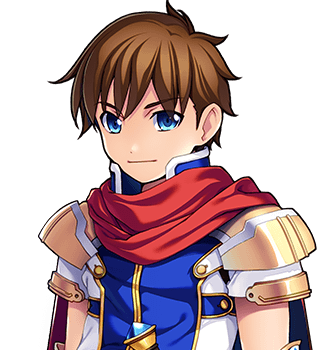</a><figcaption><a href="Bram_Thistle">Bram Thistle</a></figcaption></figure>
<figure><a href="Merribell">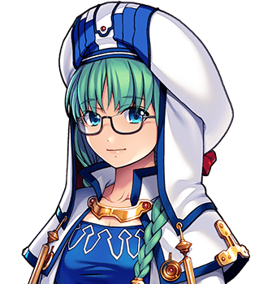</a><figcaption><a href="Merribell">Merribell</a></figcaption></figure>
<figure><a href="Hob_Grumnir">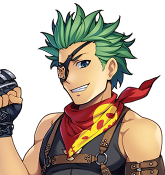</a><figcaption><a href="Hob_Grumnir">Hob Grumnir</a></figcaption></figure>
<figure><a href="Zephyrine_Vance">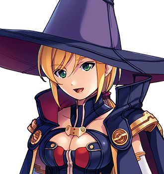</a><figcaption><a href="Zephyrine_Vance">Zephyrine Vance</a></figcaption></figure>
<figure><figcaption><a href="Nix">Nix</a></figcaption></figure>
<figure><a href="Sir_Aldric_Pemberton-Gore_III">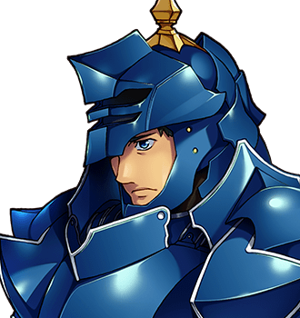</a><figcaption><a href="Sir_Aldric_Pemberton-Gore_III">Sir Aldric</a></figcaption></figure>
<figure><a href="Piper_Quill">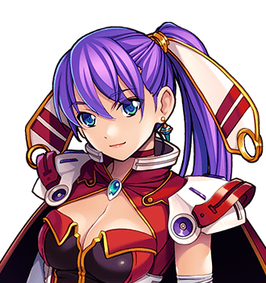</a><figcaption><a href="Piper_Quill">Piper Quill</a></figcaption></figure>
<figure><figcaption><a href="Corvin_Ash">Corvin Ash</a></figcaption></figure>
<figure><a href="Wren_Halloway">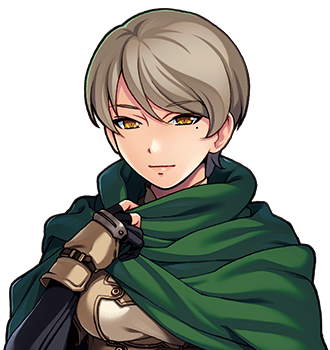</a><figcaption><a href="Wren_Halloway">Wren Halloway</a></figcaption></figure>
<figure><figcaption><a href="Roland_Fairweather">Roland Fairweather</a></figcaption></figure>
<figure><figcaption><a href="Spare_Cotterill">Spare Cotterill</a></figcaption></figure>

## The other party to the contract

- <a href="Grimspite_the_Inevitable">Grimspite the Inevitable</a>, the Dark Lord, retired

## The Chosen Ones who came home

<figure><a href="Ambrose_Fitch">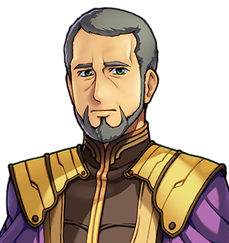</a><figcaption><a href="Ambrose_Fitch">Ambrose Fitch</a></figcaption></figure>
<figure><a href="Halbert_Quy">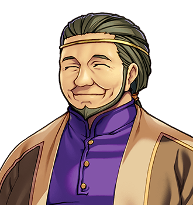</a><figcaption><a href="Halbert_Quy">Halbert Quy</a></figcaption></figure>

And one who neither went up the road nor came home, and has an article because he was sitting down where I could find him:

<figure><a href="Godfrey_Stopford">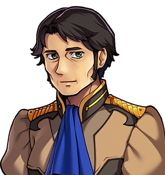</a><figcaption><a href="Godfrey_Stopford">Godfrey Stopford</a>, the Forty-Sixth</figcaption></figure>

Two of the forty-seven have articles of their own, because they talked to me, or to the Forty-Eighth; the other forty-five are in <a href="../History/The_Chosen_Ones">The Chosen Ones</a>. The Forty-First has no portrait, and an article anyway: <a href="Halloran_Vance">Halloran Vance</a>, who made a wyvern.

## Thistlewick and the south

<figure><a href="Elder_Wispel">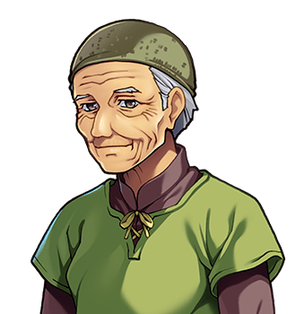</a><figcaption><a href="Elder_Wispel">Elder Wispel</a></figcaption></figure>
<figure><a href="Councillor_Fenn">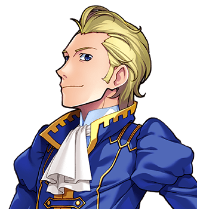</a><figcaption><a href="Councillor_Fenn">Councillor Fenn</a></figcaption></figure>
<figure><a href="Ambrosine_Quill">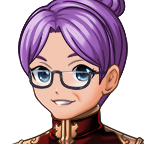</a><figcaption><a href="Ambrosine_Quill">Ambrosine Quill</a></figcaption></figure>
<figure><a href="Ysolde_Marrow">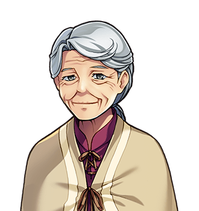</a><figcaption><a href="Ysolde_Marrow">Ysolde Marrow</a></figcaption></figure>
<figure><a href="Merrow_Halgate">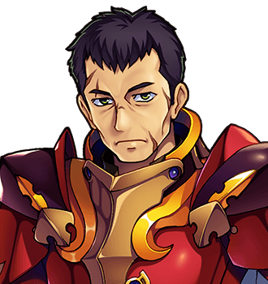</a><figcaption><a href="Merrow_Halgate">Merrow Halgate</a></figcaption></figure>
<figure><a href="Cobb_Lorrimer">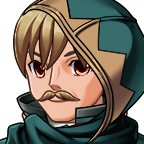</a><figcaption><a href="Cobb_Lorrimer">Cobb Lorrimer</a></figcaption></figure>

### Thistlewick

At <a href="../Places/Thistlewick">Thistlewick</a>.

<figure><a href="Mrs_Thistle">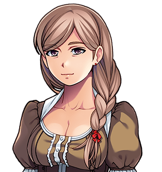</a><figcaption><a href="Mrs_Thistle">Mrs Thistle</a></figcaption></figure>
<figure><a href="Prudence_Thrupp">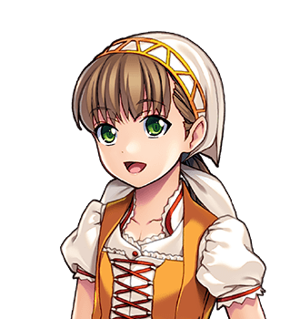</a><figcaption><a href="Prudence_Thrupp">Prudence Thrupp</a></figcaption></figure>
<figure><a href="Mrs_Lumb">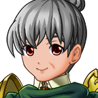</a><figcaption><a href="Mrs_Lumb">Mrs Lumb</a></figcaption></figure>
<figure><a href="The_Gatekeeper">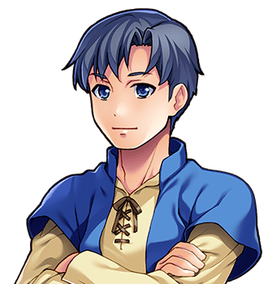</a><figcaption><a href="The_Gatekeeper">The Gatekeeper</a></figcaption></figure>

### Nether Sopping

At <a href="../Places/Nether_Sopping">Nether Sopping</a>.

<figure><a href="Dorcas_Thrupp">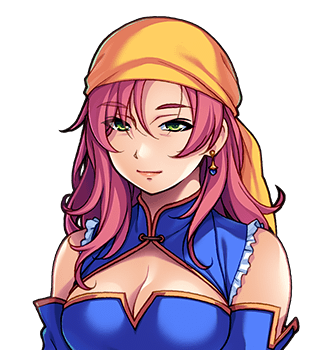</a><figcaption><a href="Dorcas_Thrupp">Dorcas Thrupp</a></figcaption></figure>
<figure><figcaption><a href="Lionel_Pell">Registrar Pell</a></figcaption></figure>
<figure><a href="Lavinia_Barrow">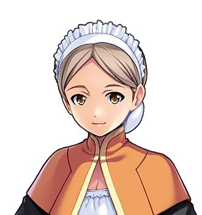</a><figcaption><a href="Lavinia_Barrow">Mrs Barrow</a></figcaption></figure>
<figure><a href="Sops">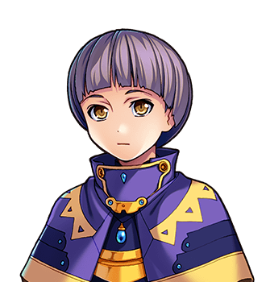</a><figcaption><a href="Sops">Sops</a></figcaption></figure>
<figure><a href="Tibb">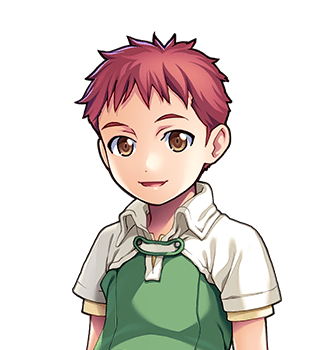</a><figcaption><a href="Tibb">Tibb</a></figcaption></figure>
<figure><a href="The_Ferryman">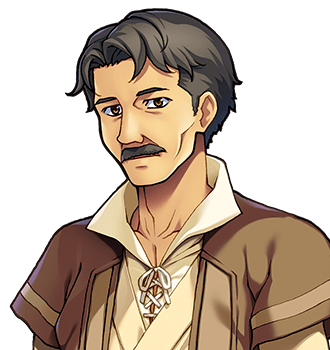</a><figcaption><a href="The_Ferryman">The Ferryman</a></figcaption></figure>
<figure><a href="Nabb">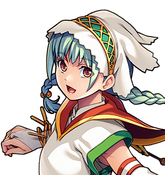</a><figcaption><a href="Nabb">Nabb</a></figcaption></figure>
<figure><a href="Tolly">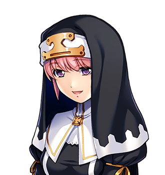</a><figcaption><a href="Tolly">Tolly</a></figcaption></figure>
<figure><a href="Hulda_Bole">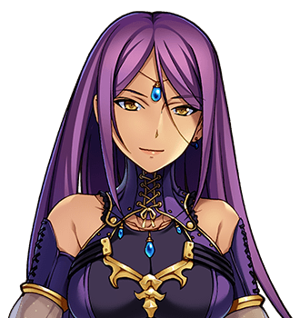</a><figcaption><a href="Hulda_Bole">Hulda Bole</a></figcaption></figure>
<figure><a href="Perpetua_Small">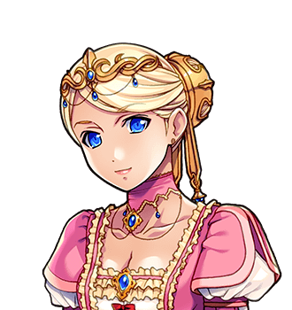</a><figcaption><a href="Perpetua_Small">Perpetua Small</a></figcaption></figure>
<figure><a href="Councillor_Dree">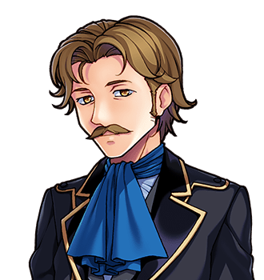</a><figcaption><a href="Councillor_Dree">Councillor Dree</a></figcaption></figure>
<figure><a href="Jack_Furrow">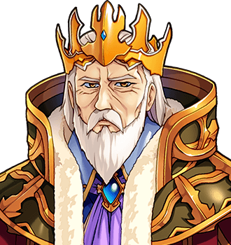</a><figcaption><a href="Jack_Furrow">Jack Furrow</a></figcaption></figure>
<figure><a href="Jill_Furrow">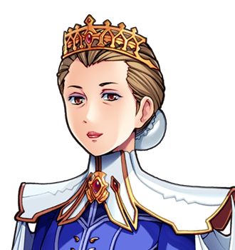</a><figcaption><a href="Jill_Furrow">Jill Furrow</a></figcaption></figure>
<figure><a href="Ferrety_Bother">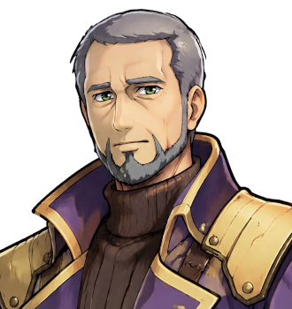</a><figcaption><a href="Ferrety_Bother">Ferrety Bother</a></figcaption></figure>
<figure><a href="Fenwick_Splint">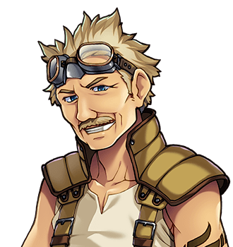</a><figcaption><a href="Fenwick_Splint">Fenwick Splint</a></figcaption></figure>

## On the road, and the sites along it

### Firstfield Meadow

At <a href="../Places/Firstfield_Meadow">Firstfield Meadow</a>.

<figure><a href="Fizz">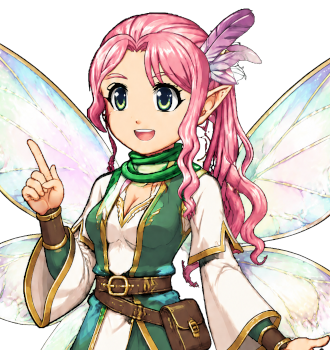</a><figcaption><a href="Fizz">Fizz</a></figcaption></figure>
<figure><a href="Old_Hollis">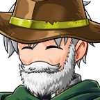</a><figcaption><a href="Old_Hollis">Old Hollis</a></figcaption></figure>
<figure><a href="Dilys_Fenwick">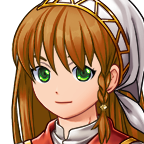</a><figcaption><a href="Dilys_Fenwick">Dilys Fenwick</a></figcaption></figure>
<figure><figcaption><a href="Norbert_Pelling">Norbert Pelling</a></figcaption></figure>

### Penultima and Restwell

<figure><figcaption><a href="Gideon_Markup">Gideon Markup</a></figcaption></figure>
<figure><a href="Dorothy_Markup">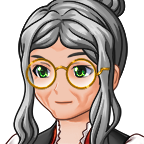</a><figcaption><a href="Dorothy_Markup">Dorothy Markup</a></figcaption></figure>
<figure><a href="Walt_Ashbury">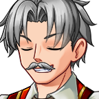</a><figcaption><a href="Walt_Ashbury">Walt Ashbury</a></figcaption></figure>
<figure><figcaption><a href="Hester_Ashbury">Hester Ashbury</a></figcaption></figure>
<figure><a href="Dr_Pike">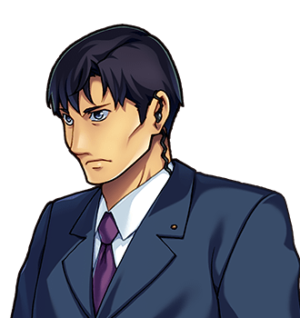</a><figcaption><a href="Dr_Pike">Dr Pike</a></figcaption></figure>

### Fairholme

At <a href="../Places/Fairholme">Fairholme</a>.

<figure><figcaption><a href="King_Aldous">King Aldous</a></figcaption></figure>
<figure><a href="Princess_Rosamund">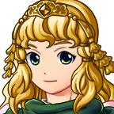</a><figcaption><a href="Princess_Rosamund">Princess Rosamund</a></figcaption></figure>
<figure><figcaption><a href="Mr_Pilbeam">Mr Pilbeam</a></figcaption></figure>
<figure><a href="Mrs_Emberthwaite">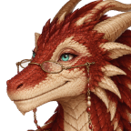</a><figcaption><a href="Mrs_Emberthwaite">Mrs Emberthwaite</a></figcaption></figure>

### Gladhollow and the Former Premises

<figure><figcaption><a href="Toby_Wendle">Toby Wendle</a></figcaption></figure>
<figure><a href="Prosper_Hollowell">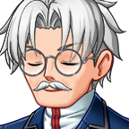</a><figcaption><a href="Prosper_Hollowell">Prosper Hollowell</a></figcaption></figure>

### Little Gore, Sump and Ashcombe

<figure><a href="Hester_Vane">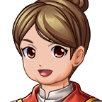</a><figcaption><a href="Hester_Vane">Hester Vane</a></figcaption></figure>
<figure><figcaption><a href="Dame_Winifred_Cope">Dame Winifred Cope</a></figcaption></figure>
<figure><a href="Absalom_Thurle">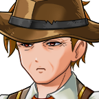</a><figcaption><a href="Absalom_Thurle">Absalom Thurle</a></figcaption></figure>
<figure><a href="Mr_Gammage">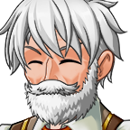</a><figcaption><a href="Mr_Gammage">Mr Gammage</a></figcaption></figure>
<figure><a href="Mrs_Ash">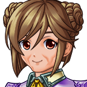</a><figcaption><a href="Mrs_Ash">Mrs Ash</a></figcaption></figure>
<figure><figcaption><a href="Hubert_Weir">Hubert Weir</a></figcaption></figure>

### Weeping Bottom and Fenmarch Hall

<figure><figcaption><a href="Aveline_Stope">Prioress Aveline Stope</a></figcaption></figure>
<figure><figcaption><a href="Sister_Bewick">Sister Bewick</a></figcaption></figure>
<figure><a href="Sir_Hamo_Tench">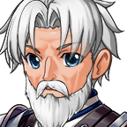</a><figcaption><a href="Sir_Hamo_Tench">Sir Hamo Tench</a></figcaption></figure>
<figure><a href="Mr_Ottershaw">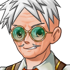</a><figcaption><a href="Mr_Ottershaw">Mr Ottershaw</a></figcaption></figure>
<figure><figcaption><a href="Pemberton-Gore_IV">The Fourth</a></figcaption></figure>

### Wayside sights

At <a href="../Places/Wayside_Sights">Wayside sights</a>.

<figure><a href="Mother_Selvidge">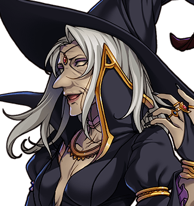</a><figcaption><a href="Mother_Selvidge">Mother Selvidge</a></figcaption></figure>
<figure><figcaption><a href="Elias_Meech">Elias Meech</a></figcaption></figure>
<figure><figcaption><a href="Dunnock">Dunnock</a></figcaption></figure>
<figure><figcaption><a href="Miss_Privet">Miss Privet</a></figcaption></figure>
<figure><figcaption><a href="The_Drainage_Commissioner">The Drainage Commissioner</a></figcaption></figure>
<figure><figcaption><a href="Edwin_Tarrant">The Hermit</a></figcaption></figure>
<figure><figcaption><a href="Somebody_Large">Somebody Large</a></figcaption></figure>

### The western hills

<figure><figcaption><a href="Meredith_Crooke">Meredith Crooke</a></figcaption></figure>

## The north

<figure><figcaption><a href="Ott_Hoyle">Ott Hoyle</a></figcaption></figure>
<figure><figcaption><a href="Bryd_Ollerenshaw">Bryd Ollerenshaw</a></figcaption></figure>
<figure><figcaption><a href="The_Cotterills">The Cotterills</a></figcaption></figure>
<figure><figcaption><a href="Pargeter">Pargeter</a></figcaption></figure>
<figure><figcaption><a href="Tobias_Frayne">Tobias Frayne</a></figcaption></figure>

### The Cotterills, one at a time

Ten children, two parents and a daughter-in-law, in order of age, as Gudgeon would want. The ninth is above. The tenth was drawn on the morning she was born, and has not sat still for one since.

<figure><figcaption><a href="Nora_Cotterill">Mrs Cotterill</a></figcaption></figure>
<figure><figcaption><a href="Ernest_Cotterill">Mr Cotterill</a></figcaption></figure>
<figure><figcaption><a href="Cotter_Cotterill">Cotter</a></figcaption></figure>
<figure><figcaption><a href="Bessie_Cotterill">Bessie</a></figcaption></figure>
<figure><figcaption><a href="Rivet_Cotterill">Rivet</a></figcaption></figure>
<figure><figcaption><a href="Gudgeon_Cotterill">Gudgeon</a></figcaption></figure>
<figure><figcaption><a href="Tappet_Cotterill">Tappet</a></figcaption></figure>
<figure><figcaption><a href="Ferrule_Cotterill">Ferrule</a></figcaption></figure>
<figure><figcaption><a href="Grommet_Cotterill">Grommet</a></figcaption></figure>
<figure><figcaption><a href="Clevis_Cotterill">Clevis</a></figcaption></figure>
<figure><figcaption><a href="Shim_Cotterill">Shim</a></figcaption></figure>
<figure><figcaption><a href="Washer_Cotterill">Washer</a></figcaption></figure>

### Upper Clanging

At <a href="../Places/Upper_Clanging">Upper Clanging</a>. And <a href="Eighty-Four">Eighty-Four</a>, who is not a person, at Miss Hoyle's insistence.

<figure><figcaption><a href="Winnie_Marsden">Winnie Marsden</a></figcaption></figure>
<figure><figcaption><a href="Mrs_Tunnicliffe">Mrs Tunnicliffe</a></figcaption></figure>
<figure><figcaption><a href="Mr_Kell">Mr Kell</a></figcaption></figure>
<figure><figcaption><a href="Nib">Nib</a></figcaption></figure>
<figure><figcaption><a href="Isaac_Sowerby">Old Sowerby</a></figcaption></figure>
<figure><figcaption><a href="Enoch_Bagshawe">Enoch Bagshawe</a></figcaption></figure>

### Frostwick and Coldbarrow

<figure><figcaption><a href="Wilhelmina_Blagg">Mrs Blagg</a></figcaption></figure>
<figure><figcaption><a href="Clem_Blagg">Clem Blagg</a></figcaption></figure>
<figure><figcaption><a href="Perce_Stagg">Perce Stagg</a></figcaption></figure>
<figure><figcaption><a href="Ida_Stagg">Ida Stagg</a></figcaption></figure>
<figure><figcaption><a href="Mordaunt">Mordaunt</a></figcaption></figure>

### Great Dunnage

At <a href="../Places/Great_Dunnage">Great Dunnage</a>.

<figure><figcaption><a href="Mayor_Gristwood">Mayor Gristwood</a></figcaption></figure>
<figure><figcaption><a href="Mr_Tibbs">Mr Tibbs</a></figcaption></figure>
<figure><figcaption><a href="Mrs_Harbottle">Mrs Harbottle</a></figcaption></figure>
<figure><figcaption><a href="Mr_Tweddle">Mr Tweddle</a></figcaption></figure>
<figure><figcaption><a href="Septimus_Dray">Mr Dray</a></figcaption></figure>
<figure><figcaption><a href="Lettice_Moon">Miss Moon</a></figcaption></figure>
<figure><figcaption><a href="Miss_Fettle">Miss Fettle</a></figcaption></figure>
<figure><figcaption><a href="Fellow_Blunt">Fellow Blunt</a></figcaption></figure>
<figure><figcaption><a href="Convenor_Swale">Convenor Swale</a></figcaption></figure>
<figure><figcaption><a href="Prime_Warden_Stannard">Prime Warden Stannard</a></figcaption></figure>
<figure><figcaption><a href="Mr_Plummer">Mr Plummer</a></figcaption></figure>

### The Sable Hart

<a href="The_Rivals_of_the_Sable_Hart">The Rivals of the Sable Hart</a>, five of them, on one page, by their own request, and Mrs Garrow, who keeps the house.

## The mountain, the elves and further out

<figure><figcaption><a href="Sir_Dunstable">Sir Dunstable</a></figcaption></figure>
<figure><figcaption><a href="Brother_Quillon">Brother Quillon</a></figcaption></figure>
<figure><figcaption><a href="Mirabel">Mirabel</a></figcaption></figure>
<figure><figcaption><a href="Elder_Faelan">Elder Faelan</a></figcaption></figure>
<figure><figcaption><a href="Elder_Lirien">Elder Lirien</a></figcaption></figure>
<figure><figcaption><a href="Maud_Penhallow">Maud Penhallow</a></figcaption></figure>
<figure><figcaption><a href="Dean_Fenwold">Dean Fenwold</a></figcaption></figure>
<figure><figcaption><a href="Mr_Gedge">Mr Gedge</a></figcaption></figure>
<figure><figcaption><a href="Sub-Librarian_Prewitt">Sub-Librarian Prewitt</a></figcaption></figure>

And <a href="Something_Unscheduled">Something Unscheduled</a>, at the bottom of the Stair, which is not a person and asked to be put in.

### Much Pottering

<figure><figcaption><a href="Effie_Gotobed">Effie Gotobed</a></figcaption></figure>
<figure><figcaption><a href="Marjorie_Gotobed">Mrs Gotobed</a></figcaption></figure>
<figure><figcaption><a href="Humphrey_Gotobed">Mr Gotobed</a></figcaption></figure>
<figure><figcaption><a href="Mr_Cobley">Mr Cobley</a></figcaption></figure>

## Further back

<figure><figcaption><a href="Mother_Ursula_Pym">Mother Ursula Pym</a></figcaption></figure>

- <a href="Mother_Ursula_Pym">Mother Ursula Pym</a> (1659-1744), who founded the Order of Whatever Works, for the air

## In other hands

- <a href="From_the_Notebooks_of_P._Quill">From the Notebooks of P. Quill</a>, songs and fragments from the road, chosen and introduced by Miss Quill, in the third person

## On his rounds

<figure><figcaption><a href="The_Courier">The courier</a></figcaption></figure>

Everywhere, already.

## Everybody else

A great many more people are written up where they live, because they are hard to take out of it: the goose and the regulars at <a href="../Places/The_Slain_Wyvern">the Slain Wyvern</a>, the works' dead in <a href="../Places/The_Long_Field">the Long Field</a>, and every town's shopkeepers, sisters, sheep and clerks. And <a href="Hosea_Bellwether">Hosea Bellwether</a>, the compiler, who was persuaded that leaving himself out would be inaccurate.
