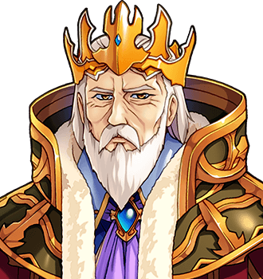

# Jack Furrow

"Good evening. We are peasants." Not to be confused with <a href="Jill_Furrow">Jill Furrow</a>, to whom he is no relation, and whom he met on the road. Yesterday. For the table they share, see <a href="../Places/The_Slain_Wyvern">The Slain Wyvern</a>.

<table class="infobox">
<caption>Jack Furrow</caption>
<tr><td colspan="2" class="infobox-image">In a peasant crown</td></tr>
<tr><th>Known as</th><td>A very ordinary traveller. "Jack Furrow, farm", on Dorcas's board</td></tr>
<tr><th>Born</th><td>On a farm. Beans, mostly</td></tr>
<tr><th>Sex</th><td>Male</td></tr>
<tr><th>Trade</th><td>Peasant</td></tr>
<tr><th>Wears</th><td>A peasant crown, very common where he comes from, which is a farm</td></tr>
<tr><th>Luggage</th><td>One crate, PEASANT LUGGAGE, gold corners, velvet cushion</td></tr>
<tr><th>Dinner</th><td>Beans, untouched. Roast pheasant, to the bone</td></tr>
<tr><th>Acquainted with Jill Furrow</th><td>No</td></tr>
<tr><th>Ring</th><td>New, gold, and not to be read into</td></tr>
</table>

<b>Jack Furrow</b> is a peasant, of a small farm, beans mostly, who has been in <a href="../Places/Nether_Sopping">Nether Sopping</a> since the autumn of 1999, at a corner table of the <a href="../Places/The_Slain_Wyvern">Slain Wyvern</a>, with Jill Furrow, whom he does not know. He wears a crown. It is a peasant crown. The town let him get away with this for four months before the Quest, and was starting to enjoy it, and has gone on enjoying it for two years since.

## A very ordinary traveller

> "Good evening. We are peasants."

You may remark, as the Forty-Eighth did not quite, that he is wearing a crown.

> "Peasant crowns. Very common where we come from. Which is a farm."

Miss Furrow, at his side, adds that it is a small farm, beans mostly. If you speak to him again, he will tell you: "Beans. As discussed."

Their table has two plates. One is beans, untouched. The other was roast pheasant with all the trimmings, and has been eaten down to the bone. There is a bottle of wine with a royal crest on it and a label stuck over the crest in a hurry, FARM WINE. Their luggage is a crate stencilled PEASANT LUGGAGE, with gold corners and a little velvet cushion on top, for sitting on, and he sits on it.

## Room four

On the board by the bar in the Wyvern, room four has a line drawn through it. Dorcas Thrupp says that room four has not been down since Tuesday, that they are the best guests she has ever had, no trouble and no noise to speak of, and that she leaves the tray on the mat, and that it is lovely to see newlyweds happy. Put to Mr Furrow, this produced:

> "We are peasants, and we are unacquainted."

Miss Furrow said that they had met on the road. Mr Furrow said, "Yesterday." Miss Furrow said, "Yesterday." They were holding hands, and had been the entire time, and under the peasant crowns both of them were wearing a new gold wedding ring, and both of them kept looking at it. He says that they have been discussing beans.

The whole of Nether Sopping has asked me not to find out who they are. I have found that this is the easiest piece of research I have ever not done. I had a drink with Mr Furrow, at his invitation, and he told me a great deal about beans, all of it wrong, with tremendous authority, and paid for both drinks out of a purse that I will not describe, and asked me, as I left, very kindly, whether I had enough to manage on. I said I had. He looked relieved, and a little disappointed, as if he would have liked to help. - H.B.

## Afterwards

He is still in Nether Sopping, and so is Miss Furrow, whom he does not know. They met on the road yesterday, which they have said every day for two years and four months, and it has not yet stopped being true to look at them. In the spring of 2001 they kept, by Dorcas's count, an anniversary of some kind, and had anniversary beans, and did not eat them. Room four still has a line through it. The tray is still left on the mat.

## See also

- <a href="Jill_Furrow">Jill Furrow</a>, no relation
- <a href="Dorcas_Thrupp">Dorcas Thrupp</a>
- <a href="../Places/The_Slain_Wyvern">The Slain Wyvern</a>
