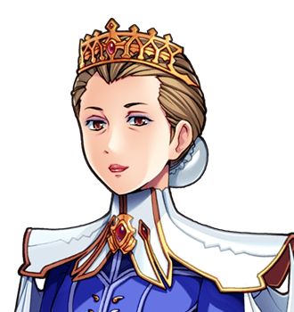

# Jill Furrow

"Do not curtsey. Nobody does." Not to be confused with <a href="Jack_Furrow">Jack Furrow</a>, to whom she is no relation, and whom she met on the road. Yesterday. For room four, see <a href="Dorcas_Thrupp">Dorcas Thrupp</a>, who is delighted.

<table class="infobox">
<caption>Jill Furrow</caption>
<tr><td colspan="2" class="infobox-image">Beans people</td></tr>
<tr><th>Known as</th><td>Also a very ordinary traveller. "Jill Furrow, a different farm, no relation", on Dorcas's board</td></tr>
<tr><th>Born</th><td>On a different farm. Also beans</td></tr>
<tr><th>Sex</th><td>Female</td></tr>
<tr><th>Trade</th><td>Peasant</td></tr>
<tr><th>Curtseys received</th><td>None, by request</td></tr>
<tr><th>Acquainted with Jack Furrow</th><td>No. Do not read anything into the hand</td></tr>
<tr><th>Ring</th><td>Or the ring</td></tr>
</table>

<b>Jill Furrow</b> is also a very ordinary traveller, and a peasant, from a small farm, beans mostly, and is staying at the <a href="../Places/The_Slain_Wyvern">Slain Wyvern</a> in <a href="../Places/Nether_Sopping">Nether Sopping</a>, at the same table as Jack Furrow, whom she met on the road yesterday and does not know. She would like it understood that she is beans people, and that nobody curtseys.

## Beans people

> "Do not curtsey. Nobody does. We are beans people."

The Forty-Eighth had not curtseyed. Miss Furrow considered this, and said: "Well. Don't start." It is the most regal thing I have ever heard said by anybody, and I have met a king. If you speak to her again she says, "Beans."

She gave her name to Dorcas Thrupp the evening they arrived, after Mr Furrow had given his, and Dorcas wrote it on the board by the bar, in her small neat hand, against room four: *Jill Furrow, a different farm, no relation.* Miss Furrow watched her write it, and asked her to underline *no relation*, and Dorcas did.

## The hand, and the ring

After the board by the bar with room four on it:

> "We are unacquainted. Do not read anything into the hand. Or the ring."

The Forty-Eighth had not read anything into the ring. "Well. Don't start." Mr Furrow said that they had met on the road, yesterday. Miss Furrow said, "Yesterday." Asked again, she said, "Beans. Anniversary beans."

I have asked her what the anniversary was of. She said, of the beans. I asked how long they had been in Nether Sopping. She said, since yesterday. Then she looked at Mr Furrow, who was looking at his ring, and she looked at hers, and I went and sat somewhere else for a bit.

I have been asked by the town not to find out who she is, and I have not, and I want it on record that I have not even looked at the crest under the FARM WINE label, though it is on the table in front of me every time I go in, and would take a moment. Some research is better left undone, and some is better left to Nether Sopping, which has been enjoying this for two years and has no intention of stopping. - H.B.

## Afterwards

She is still at the Wyvern, and has still not been curtseyed to, by anybody, and has twice had to stop a fisherman beginning to. Room four still has a line through it; the tray is still left on the mat. The Furrows, who are no relation, came down to the bar in the spring of 2001 for anniversary beans, which nobody ate, and a pheasant, which they did. Dorcas has kept room four for them for another year, and has not rubbed out the underlining.

## See also

- <a href="Jack_Furrow">Jack Furrow</a>, no relation
- <a href="Dorcas_Thrupp">Dorcas Thrupp</a>
- <a href="../Places/The_Slain_Wyvern">The Slain Wyvern</a>
