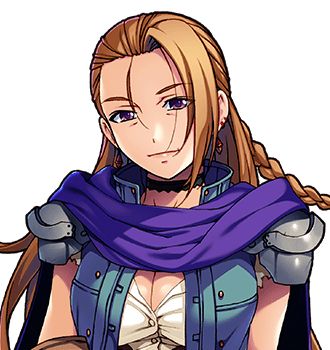

# Meredith Crooke

"Meredith Crooke. Principal." For the bounty on her, see <a href="../Institutions/The_Adventurers_Guild">The Adventurers' Guild (Provisional)</a>. For the anvil, see <a href="Hob_Grumnir">Hob Grumnir</a>. For her cohort, Miss Halloway declines, on the grounds that they are persons; see the <a href="../Bestiary/">Bestiary</a>'s introduction.

<table class="infobox">
<caption>Meredith Crooke</caption>
<tr><td colspan="2" class="infobox-image">"Did you all see the footwork?"</td></tr>
<tr><th>Known as</th><td>Crooke; M. Crooke, Bandit Chief, on the Guild's board; "Miss", to the cohort</td></tr>
<tr><th>Born</th><td>14 September 1963</td></tr>
<tr><th>Sex</th><td>Female</td></tr>
<tr><th>Principal</th><td>Of a six-week banditry apprenticeship, with a syllabus</td></tr>
<tr><th>Camp</th><td>The western hills: eight tents, a cook fire, and a board with a timetable on it</td></tr>
<tr><th>Bounty</th><td>1,200 crowns and the Guild's quiet relief. Discharged, 2000</td></tr>
<tr><th>Pass rate</th><td>Ninety per cent, 2000. "More than his Guild can say for anything"</td></tr>
<tr><th>Week one</th><td>Reading</td></tr>
</table>

<b>Meredith Crooke</b> runs a six-week apprenticeship in banditry from a camp in the western hills, with a syllabus, a marking rubric, a timetable on a board and an unusually loyal cohort. The Adventurers' Guild put a bounty on her. When the Forty-Eighth came to collect it she was pleased to see him, and asked him not to hold back, because her cohort were in week four and needed to see one of these go badly for the tutor. "It's the only lesson that ever sticks."

## The syllabus

The board at the camp gives the last three weeks:

WEEK 4: INTIMIDATION (PRACTICAL) WEEK 5: DEMANDS - STRUCTURE AND DELIVERY WEEK 6: ASSESSMENT AND CERTIFICATE

I have asked for the first three and been told that they are available to enrolled students. I know from the court of record, which is the anvil, that week one is reading, and that week four, module seven, is the acquisition of a heavy object. Her own way with a demand, I am told by people who were on the receiving end of one, is to make it with the syllabus open, so that you can follow along.

## The bounty

The Guild's card read: BOUNTY: M. CROOKE, BANDIT CHIEF. *Camp in the western hills. Runs a six-week banditry apprenticeship with a syllabus. Reward: 1200 crowns and the Guild's quiet relief.* The Forty-Eighth's party went up into the hills in the year 2000 and found the camp, and her, and four trainee bandits in a semicircle behind her, taking notes.

She fought with two of them at her side, as a demonstration. She lost, as a demonstration. When it was over she said, "Good! Did you all see the footwork?" and the cohort had, to a bandit, written down the footwork. She handed over the takings herself, and told the party to go and claim their bounty, and to tell Registrar Pell that her pass rate that year was ninety per cent, which was more than his Guild could say for anything. Mr Pell was told. He did not reply. The card on the Guild's board has DISCHARGED across it now, and somebody has pinned her syllabus up beside it, as a curiosity.

To anybody who went back to the camp afterwards she said, "Week five. Come back Thursday, and let them see it done to you properly." Nobody did.

## Module seven

Later that year two of her apprentices, Ivy Scrope and Hodge, stole Hob Grumnir's anvil out of the smithy at <a href="../Places/Thistlewick">Thistlewick</a>, in the dark, for module seven. It weighs three hundredweight. They got it eleven feet. In the morning it was face down on the grass outside the smithy door, with a head at either end of it, and when Mr Grumnir had lifted it off them a woman came down the lane with a clipboard. She looked at the anvil, and at the door, and at the eleven feet between them, and wrote something down.

"Fail. Both of you."

Hodge said that it was three hundredweight. "It says so on the side," said Miss Crooke. "Reading was week one." Miss Scrope asked if she might write to Mr Grumnir first, and wrote an apology on the back of her syllabus in a very good hand, and Miss Crooke said, "Week one. It's all week one," and took them both off up the lane, one ear each. If the party had beaten her in the hills, she knew them at once: "You. The footwork."

The apology is framed in the smithy now. Mr Grumnir says it is the best-written thing in Thistlewick, which Elder Wispel has taken personally. I have seen it. He is right. - H.B.

## Afterwards

She is thirty-eight. The course still runs, six weeks at a time, in the western hills, with the same board. She sends Registrar Pell her pass rate every year, on a card, unasked, and he files it, unanswered. It has not been below eighty-five. Module seven has been revised: the heavy object is now a coal scuttle, and the student is required to read the side of it first and write down what it says.

Miss Scrope resat module seven in the autumn of 2000, and passed, and took her certificate in week six, and has since taken a post as clerk to the course. She writes the syllabus out fair. Hodge resat it twice, and is in the next cohort, and Miss Crooke says he will get there, because he does not give up, which she says is the whole of week four.

## See also

- <a href="Hob_Grumnir">Hob Grumnir</a>
- <a href="Lionel_Pell">Lionel Pell</a>
- <a href="../Institutions/The_Adventurers_Guild">The Adventurers' Guild (Provisional)</a>
