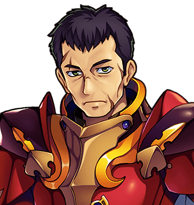

# Merrow Halgate

For the clause that decided his fight before he got up that morning, see <a href="../History/The_Prophecy_of_Thistlewick">The Prophecy of Thistlewick</a>, clause fourteen.

<table class="infobox">
<caption>Merrow Halgate</caption>
<tr><td colspan="2" class="infobox-image">Drinking carefully</td></tr>
<tr><th>Known as</th><td>Merrow of the Bridge</td></tr>
<tr><th>Of</th><td><a href="../Places/Nether_Sopping">Nether Sopping</a>, the <a href="../Places/The_Slain_Wyvern">Slain Wyvern</a></td></tr>
<tr><th>Party</th><td>Twenty. The best-equipped that ever went north</td></tr>
<tr><th>Fought</th><td>The Dark Lord, at the bridge</td></tr>
<tr><th>Result</th><td>Lost, as written down in advance</td></tr>
<tr><th>At peace with</th><td>The losing</td></tr>
<tr><th>Not at peace with</th><td>The paperwork</td></tr>
<tr><th>Believed about the apology</th><td>Rarely</td></tr>
</table>

<b>Merrow Halgate</b> is a big man in old armour who drinks carefully in the <a href="../Places/The_Slain_Wyvern">Slain Wyvern</a>, and was one of a party of twenty, the best-equipped party that ever went north, which fought the Dark Lord at the bridge and lost. They were meant to lose. It was written down.

## The bridge

> "Twenty of us. Best-equipped party that ever went north. We fought him at the bridge and we lost. And here's the thing. We were MEANT to lose. It was written down. In advance. Clause fourteen: the first meeting shall not go well."

He puts the cup down very precisely at this point, every time, and I have watched him do it a dozen times, and the cup has never once made a sound.

> "Twenty of us, and a document decided how it went before we got up that morning. I've made my peace with losing. I have not made my peace with the paperwork."

Which Chosen One the twenty went north with he does not say, and I have not pressed him, because it is one of the tales of the Wyvern, and one of the rules of the Wyvern is that a tale is told the way its teller tells it. It was a first meeting. The first meeting shall not go well, and it did not.

## The apology

Ask him what Grimspite was like, and he will tell you that halfway through, the Dark Lord stopped, and apologised, and then carried on. "I think about that more than the losing." Nobody ever believes him about that part. He says so himself.

I do. I believed him before the Forty-Eighth came back, and I believe him a good deal more since, having had three letters from the Dark Lord about my dates, each of them apologising for the trouble. It would be very like him.

## Afterwards

He still drinks carefully. He has been told, by the Forty-Eighth and by me, what was said at the top of the Tower in the year 2000, and about the contract, and the clauses, and the forty-eight hundred years; and he listened to all of it, and was quiet, and then said that it was a comfort, in a way, to know that the paperwork had been bothering the other fellow as well.

He has his own theory about the old bench on the Middle Distance, which is older than anybody's memory and faces the sea: that it was put there by somebody who had walked that road tired and done something about it, and had not wanted a plaque. He thinks Ambrose Fitch may have known about it, and wanted one nearer the road. He went out to Ambrose's bench, when it was built, and sat on it, and came back, and said that it was a good bench.

People believe him about that.

## See also

- <a href="../History/The_Prophecy_of_Thistlewick">The Prophecy of Thistlewick</a>
- <a href="Grimspite_the_Inevitable">Grimspite the Inevitable</a>
- <a href="../Places/The_Slain_Wyvern">The Slain Wyvern</a>
- <a href="Ambrose_Fitch">Ambrose Fitch</a>
