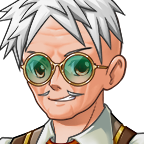

# Mr Ottershaw

"Ottershaw. Ninety in March. I did the animals." For the house and the gallery, see <a href="../Places/Fenmarch_Hall">Fenmarch Hall</a>. For the naturalist who found the joins, once shown, see <a href="Wren_Halloway">Wren Halloway</a>.

<table class="infobox">
<caption>Jonas Ottershaw</caption>
<tr><td colspan="2" class="infobox-image">Composer</td></tr>
<tr><th>Known as</th><td>Mr Ottershaw; Mr J. Ottershaw, on the write-up</td></tr>
<tr><th>Born</th><td>Jonas Ottershaw, 14 March 1910, at Fenmarch, in the gamekeeper's lodge</td></tr>
<tr><th>Ninety</th><td>In March, 2000</td></tr>
<tr><th>Did</th><td>The animals. 1930 to the present</td></tr>
<tr><th>Preserved them?</th><td>Anybody can preserve. A cook can preserve. He COMPOSED them</td></tr>
<tr><th>Cases</th><td>Eighty. Seventy-nine composed, each of two animals</td></tr>
<tr><th>Joins found</th><td>None, in seventy years. Then all of them, once shown</td></tr>
<tr><th>Case forty</th><td>Not examined</td></tr>
<tr><th>Write-up</th><td>Over his bench. <i>Finest</i> underlined twice</td></tr>
</table>

<b>Jonas Ottershaw</b> has done the animals at <a href="../Places/Fenmarch_Hall">Fenmarch Hall</a> for seventy years, three generations of the Pemberton-Gores, and the family will tell you that every one of them is rare, and the family are right: there is one of each. He did not preserve them. Anybody can preserve. A cook can preserve. He COMPOSED them, and in seventy years nobody found a join, because not one of them ever looked.

## The lodge

He was born in 1910 in the gamekeeper's lodge at Fenmarch, the gamekeeper's son, and learned the knife at nine, on a crow, which he says was a very good crow and that he was sorry about it. In 1930, at twenty, Sir Aldric the First asked him to set up a bear for the long gallery, and there was no bear, there being no bears in the county, and he said so, and was told that the family would like a bear, and that he was a clever lad. He had a black bear's front half, from a dealer, and a very large marsh crab, and he went into the stillroom for a fortnight.

The Marsh Bear came out. It is bear to the waist and crab below. The family looked at it for some time and said that it was the rarest thing they had ever seen, and that he must go on. He went on. Seventy years.

> "Seventy years. Three generations. The family'll tell you every one of them's rare. The family are right. There's one of each."

## The join

> "Look at the shoulder. Now tell me where it stops."

You look. You look for a long time, at feathers and then at scales, and you find nowhere at all where the one becomes the other. "Seventy years, and nobody's found a join. Not one of them ever looked."

In the year 2000 the family engaged Miss Wren Halloway, a naturalist, a proper one, with the jars, to look at them properly, and to tell the household what they were. When she told Mr Ottershaw that she had been engaged to authenticate them, he put down the needle, took off his lenses and put them on again to see her better, and said that in seventy years nobody had ever ASKED. Then he took her down the gallery at a pace you would not expect of a man of ninety, and showed her every join. The Phoenix is a salamander and the top of something that fell in Cook's fire. The Horse is crab and unicorn, and the plate is blank because nobody liked to ask what it was.

She found each join only when he had put his finger on it, and wrote it down, and her hand was not quite steady.

The joins are the finest work I have seen. I have looked for joins all my life. I could not find these without being shown, and then I could not stop looking at them. Case forty: not examined. W. Halloway.

He has a copy over his bench, with *finest* underlined twice.

He went past case forty, Miss Halloway tells me, the way you go past a door you don't open. I have not asked him about it. I asked him only whether he would like anything added to this article, and he wrote back, in a very fine hand, that there were eighty-three now. - H.B.

## Afterwards

He was ninety-two this month. He is still at his bench at the far end of the gallery, in green lenses, with a needle and a great deal of thread, and there are eighty-three cases now, and he says that he is working on the eighty-fourth, and that it is going to be his best, and that it is going to be of three animals, which he has never attempted, and that he will not say which three, and that Miss Halloway will be told, and will be asked to find the joins, and will not be shown first, this time, because he would like to see her try.

## See also

- <a href="../Places/Fenmarch_Hall">Fenmarch Hall</a>
- <a href="Wren_Halloway">Wren Halloway</a>
- <a href="Pemberton-Gore_IV">The Fourth</a>, who said COMPOSED was better than real
