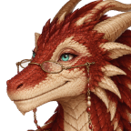

# Mrs Emberthwaite

"Come in, come in, mind the gold, it gets everywhere." For the kingdom at the foot of her hill, see <a href="../Places/Fairholme">Fairholme</a>. She is not in the <a href="../Bestiary/">Bestiary</a>, at her own request, over a hand of whist.

<table class="infobox">
<caption>Mrs Emberthwaite</caption>
<tr><td colspan="2" class="infobox-image">Reading spectacles, on a chain</td></tr>
<tr><th>Known as</th><td>Mrs Emberthwaite; "dear", to herself, when she has lost a trick, which is rare</td></tr>
<tr><th>Born</th><td>Hatched 9 May 1930, in the hills above Fairholme, on a sunny ledge, the only egg of the clutch, which her mother said was plenty</td></tr>
<tr><th>Sex</th><td>Female</td></tr>
<tr><th>Age</th><td>Seventy-two this year, by <a href="Princess_Rosamund">Rosamund</a>'s reckoning</td></tr>
<tr><th>Married</th><td>Mr Emberthwaite, 1951. He did the roaring, mostly</td></tr>
<tr><th>Widowed</th><td>1984</td></tr>
<tr><th>Retired</th><td>She has had a letter</td></tr>
<tr><th>Hoard</th><td>Dusted every morning, with a feather</td></tr>
<tr><th>Whist</th><td>Thursdays. All welcome. Has not lost to Rosamund yet</td></tr>
<tr><th>Cheats</th><td>Rosamund says so. The deck is fine. It is you</td></tr>
<tr><th>Sponge</th><td>Lovely</td></tr>
</table>

<b>Mrs Emberthwaite</b> is a dragon, very large and very red, who lives in a cave on the hill above <a href="../Places/Fairholme">Fairholme</a>, wears reading spectacles on a chain, and plays whist on Thursdays with Princess Rosamund, who walks up with a cake tin. She is retired. She has had a letter. The stone tablet by her door says PLEASE WIPE YOUR FEET. NO RESCUES, and under it, in chalk, WHIST THURSDAYS. ALL WELCOME.

## The hill

She was hatched in 1930 on a sunny ledge in the hills above Fairholme, an only egg, and grew up in the cave she lives in now, which was her mother's. She says that she was always more of an indoor dragon: that she liked a book, and a fire, and a hand of cards, and that she never once saw the point of flying anywhere you could not be home from by tea. She married in 1951. Mr Emberthwaite was from the far side of the marshes, and was a great deal of dragon, and did the roaring, mostly, on her behalf, at knights, and was very good at it, and she says that he was the gentlest creature she ever knew, and that the roaring was a kind of courtesy, so that nobody coming up the hill should be disappointed.

> "That's Mr Emberthwaite's. He did the roaring, mostly. I was always more of an indoor dragon."

His chair is drawn up to the card table, much sat in, once, with his pipe on the seat. He died in 1984. She has not moved the chair. There is a tapestry in the cave of two dragons asleep in the sun on a hillside, hung where the light catches it in the afternoon. I asked whether it was anybody. She said it was a very good likeness, and dealt.

## The letter

When he died the knights went on coming up the hill, to slay the dragon, because that is what knights do. She kept a pot of umbrellas by the door for the ones who came in the rain, so that they at least went home dry, and gave them tea, and they went home. They wrote to her afterwards, and she has the letters in a bound volume: every one begins FOUL BEAST and ends YOURS FAITHFULLY. In 1990 she wrote to the Heroes' Guild to say that she was retired. The Guild wrote back to confirm it. She has had a letter.

> "You're not a hero, are you, dear? Only I'm retired. I've had a letter."

## Rosamund

In 1999 two men from beyond the marshes carried Princess Rosamund up the hill in the rain, having been told that dragons keep princesses, and left her at the door, and ran. Mrs Emberthwaite opened it. (That evening, after a rubber, the Princess walked down again with a tin of cake, and Mr and Mrs Budge, who were mucking out, walked her the rest of the way, and took the half, and are the eleventh shareholders; see <a href="../Places/Fairholme">Fairholme</a>.)

> "The first time they brought her up here, she had a bag packed and a card about her diet. I made up the spare room. I'd not had company in years."

> "Now she walks up on Thursdays, on her own two feet, with a cake tin. The heroes are furious."

The spare room is at the end of a short passage: a bed with clean sheets, a washstand, a rag rug, and curtains hung over no window at all, because a room ought to have curtains. The card on the pillow reads ROSAMUND - THURSDAYS. AIRED WEDNESDAYS. NO EELS IN THE HOUSE. TEA AT FOUR, NOT STEWED. Rosamund has never stayed. There is a hot-water bottle in the bed every Thursday all the same, and it is warm.

## Whist

> "Passing! Lovely. Do you play whist?"

She will win, by a margin that makes you check the deck. The deck is fine. "Don't feel bad, dear. Rosamund hasn't beaten me yet either." The stakes are a copper a hand, from a heap with a flag in it, and Rosamund is, by the score pad, ruthless, and is winning by a mile on coppers and has never once won a rubber, which Rosamund says is mathematically impossible and Mrs Emberthwaite says is whist. Her book of card games for two has TWO crossed out, and AND ON THURSDAYS, THREE written in. The third is whoever comes up the hill.

I played, on a Thursday in the autumn of 2001, by invitation, with the Princess as my partner. We lost every rubber. I checked the deck. It was fine. I said so. Mrs Emberthwaite said, "It's you, dear," quite kindly, and put the kettle on, and the cup she gave me had a small scorch mark on the rim, from her cold of 1974, and I have never been happier to lose at anything. Miss Halloway, who has played her too, asked me to say that Mrs Emberthwaite is not in the Bestiary at Mrs Emberthwaite's own request, which Miss Halloway thinks is very proper, and that Miss Halloway lost that hand as well. - H.B.

## Afterwards

She is seventy-two, by Rosamund's reckoning, which she says is very flattering and quite wrong, and will not correct. The Thursdays go on. The heroes are still furious, and still come up the hill, now and then, in the rain, and are given an umbrella and tea, and are asked whether they play whist, and most of them stay for a rubber, and lose, and go home and write FOUL BEAST at the top of a very long and complimentary letter. The cuckoo in the clock is a very small dragon that comes out on the hour and sneezes. It did that for Mr Emberthwaite too. She says it is a family trait.

## See also

- <a href="Princess_Rosamund">Princess Rosamund</a>
- <a href="../Places/Fairholme">Fairholme</a>
- <a href="Wren_Halloway">Wren Halloway</a>, who lost the hand
- <a href="../Cliches/">A Glossary of Cliches</a>, for the dragon who is not what you were told
