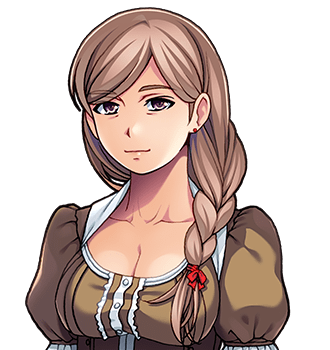

# Mrs Thistle

"You've been Chosen." For her son, see <a href="Bram_Thistle">Bram Thistle</a>. For the village, see <a href="../Places/Thistlewick">Thistlewick</a>. For the pie, there is no article. It was a good pie, that.

<table class="infobox">
<caption>Mrs Thistle</caption>
<tr><td colspan="2" class="infobox-image">"I know, love."</td></tr>
<tr><th>Known as</th><td>Mrs Thistle; Mother, to her son; "Bram's mum", to the whole of the Forty-Eighth's company, who were all fed</td></tr>
<tr><th>Born</th><td>Annie Brook, 6 June 1957, at the mill below <a href="../Places/Thistlewick">Thistlewick</a></td></tr>
<tr><th>Sex</th><td>Female</td></tr>
<tr><th>Married</th><td>Will Thistle, turnip farmer, 1977</td></tr>
<tr><th>Son</th><td>Bram, born 1979</td></tr>
<tr><th>Is</th><td>Alive, well, and has read the version that says otherwise</td></tr>
<tr><th>Makes</th><td>A good pie. She asked me to put that in</td></tr>
<tr><th>Pie dish</th><td>Went in 1989. Came back in 2000. She never missed it</td></tr>
<tr><th>Sword over the grate</th><td>Unbearable about it, for a hundred years</td></tr>
<tr><th>Good shirt</th><td>Ironed Tuesday</td></tr>
</table>

<b>Mrs Thistle</b> is the mother of Bram Thistle, the Forty-Eighth Chosen One, and was the one who woke him on the morning he was chosen, and told him, and sent him to see the Elder, and told him to take the sword off the wall, which had been up there a hundred years waiting for exactly this, and frankly had been unbearable about it. She is alive, and well, and has read the version of events in circulation that says otherwise. She makes a good pie.

## The mill

She was born Annie Brook in 1957 at the mill below Thistlewick, and married Will Thistle, who farmed the Thistle ground, in 1977, and their son was born two springs later, in the house, in the room under the sword. Of Mr Thistle she would say only that he was a good man with turnips, and that he is not in the house, and that that is enough to say about him in an encyclopedia, and that the rest is hers. I asked in the village, where everybody had an answer and no two of them were the same, and I have respected hers rather than theirs.

She has farmed the ground with her son since, and kept the house, and the chair that was a turnip, which she uses for the good visitors. I have sat on it.

## The morning

> "Bram. There are eleven people outside and one of them has a scroll."

> "You've been Chosen."

> "I know, love. Go and see the Elder. Then take the sword off the wall. It's been up there a hundred years waiting for exactly this, and frankly it has been unbearable about it."

I asked her how she had known what to say. She said that every mother in Thistlewick knows what to say, because every mother in Thistlewick has a sword over the grate and has been told what it is for, and has looked at it every day, and has hoped that it would go on hanging there, and has had the words ready anyway. She said that she had had them ready since he was born, and that she had hoped never to need them, and that when she did, they came out in the right order, and that she was very proud of that, and then she went and made a pie.

She asked me, when I first wrote to her, to correct one version in circulation which has it that the Forty-Eighth's mother was dead, as heroes' mothers generally are. She is not. She has read it. She asked me to put in that she makes a good pie. She does. I have had three slices of it, over two visits, and I would like to put that in as well. - H.B.

## The pie dish

In 1989 her pie dish went from the kitchen windowsill, where it had been put to cool. She did not miss it, she says, because she had another, and it was a long time before she noticed. In the year 2000 it came back. It was handed to her, washed, with a label, by a young woman who said that she had taken it, at fifteen, and had kept it eleven years, and had never sold it.

> "That's not mine. ...So it is. I never missed it."

And then, after a while: "Was the pie any good?"

She was told that it had been. "It was a good pie, that," she said, and put the kettle on.

## The letter

The morning after the ending, there was a letter on the mat from the Committee, which she did not open. "Morning, love. There's a letter come. It's on the mat. It's from the Committee. I haven't opened it. I've looked at it." It was clause nineteen, and a pension, and the key to a cottage by the sea at Nether Sopping. "A cottage! By the sea!" And then, being his mother: "You'll want your good shirt. I ironed it Tuesday."

## Afterwards

She is forty-four. Her son is home, and farming, and has the cottage at Nether Sopping for when he comes south, which is about monthly. She has been down to see it once. She says that it is a very nice cottage, and that the sea is very large, and that she was glad to get home. The sword is not over the grate now. There is a clean rectangle of wall where it used to be, and she has not painted over it, and she says that she is not going to, and that it is the best thing that has ever been on that wall.

## See also

- <a href="Bram_Thistle">Bram Thistle</a>
- <a href="../Places/Thistlewick">Thistlewick</a>
- <a href="Nix">Nix</a>, and the pie dish
