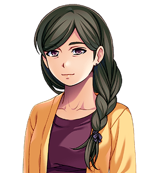

# Nora Cotterill

"Mrs Cotterill." For the family, see <a href="The_Cotterills">The Cotterills</a>. For the argument, see <a href="Spare_Cotterill">Spare Cotterill</a>, who lost it a great many times and won it once, and would like the second number printed larger.

<table class="infobox">
<caption>Nora Cotterill</caption>
<tr><td colspan="2" class="infobox-image">"No, love."</td></tr>
<tr><th>Known as</th><td>Mrs Cotterill; Mam; "your mother", by the whole of Upper Clanging, to the whole of Upper Clanging</td></tr>
<tr><th>Born</th><td>Nora Sprag, 30 August 1954, at Haggit's Bank, a pit hamlet half way down the valley road, a pit family</td></tr>
<tr><th>Married</th><td><a href="Ernest_Cotterill">Ernest Cotterill</a>, 1975, at the chapel, on a Saturday, between shifts</td></tr>
<tr><th>Children</th><td>Ten. Not going to be another one</td></tr>
<tr><th>Names</th><td>Chose them. Has them off by heart. Was tired for two of them</td></tr>
<tr><th>Has had him out of</th><td>A boiler, nine times; a flue; a culvert; a drain we do not discuss</td></tr>
<tr><th>Fighting style</th><td>You Are Nine; Ask Your Father; That Is Not The Point; I Have Said No</td></tr>
<tr><th>Record</th><td>Undefeated, until she stopped at a quarter</td></tr>
<tr><th>Potatoes</th><td>More</td></tr>
</table>

<b>Nora Cotterill</b> is the mother of the ten Cotterills of <a href="../Places/Upper_Clanging">Upper Clanging</a>, all of whom she named, after the parts that hold an engine together, until she ran out. She is the only person in the north who ever won an argument with Spare, and she won it a great many times, in the front room, under rules she made up as she went along, and then one day, at a quarter, she stopped. She will ask you whether you have eaten. Your answer does not come into it.

## Haggit's Bank

She was born Nora Sprag in 1954, at Haggit's Bank, a row of pit cottages half way down the valley road to Great Dunnage, where the coal for the foundries came out, the youngest of six in a family of colliers. A sprag is the wedge you knock under a wagon to stop it running away down the incline. Her father used to say that she was well named. Her brothers used to say so too, but more bitterly, because she was the one who told on them.

She came up the valley at nineteen, to be a pit-head lass at the foundry's coal yard, and met Ernest Cotterill on her second day, when he walked into a coal wagon she had just sprag'd, and apologised to it. She says that she knew then. He says that he did not know anything for some time, owing to the wagon.

## The names

They were married in 1975, and Cotter came in January twelve-month. She had decided by then that all the children would be named for the things that hold an engine together, because, she says, that is what a family is for, and because Mr Cotterill was at the works so much that she wanted him to feel at home when he came in. The plan went well for eight. She has the eight off by heart, and will say them for you in one breath, as she said them to the Forty-Eighth:

> "Cotter, Rivet, Gudgeon, Tappet, Ferrule, Grommet, Clevis, Shim. And Spare. We had run out. He said call it Spare, and I was tired."

She would like it recorded that she had not run out. She had *Washer* in reserve. Mr Cotterill said not Washer. That is a different thing from running out, and she was tired, and the subject is closed, or was, until the spring of 2000, when Spare got to it first. "He said call it Washer, and I was tired." She has been tired, by her own count, twice in twenty-seven years, and both times somebody got named.

Grommet, who is apprenticed at the forge, has pointed out to her every day since 2000 that the names are wrong: a shim is a packing piece, and a ferrule fastens nothing. She would like it printed that the names are not wrong. They are what she called them. I have printed it. - H.B.

## Out of a boiler

Spare has been going into the works' boiler since he was six. His mother does not mind the boiler. She minds the coming out, which is where she is. "I have had him out of a boiler. Nine times. And out of a flue, and a culvert, and a drain we do not discuss. Every time, he came out. Every time, I was there."

That was the whole of her case against the Tower, and it was a good case, and I have never heard it bettered by any lawyer. "You are going to a tower that eats the people who go to it. I would not be there."

## The argument

The argument was fought in the front room, many times, with Spare on his own, and the rest of the family arranged on the stairs to watch. Her moves have been written down by Clevis, who kept a book on the outcome, and who describes them as: *You Are Nine*, which hurt; *Ask Your Father*, which sent Mr Cotterill in, who said "Mam," and was told "I know"; *That Is Not The Point*, which does nothing whatsoever, and is not meant to; and *I Have Said No*, which is the one that ends it. She was immune to his tantrum. She is the only person in the world who is. She has had nine years' practice and eight children's before that.

She won every time, until the day she did not. She stopped at a quarter. What she said then is in Spare's article, and I will only give the terms, which she set out like a contract, and which Miss Pargeter of Frostwick, when I read them to her, said were the best-drafted she had heard in the north: *Jumper on. You do not go in first. You write. It does not have to be long, and it does not have to be true.* And to the Forty-Eighth: "And you. Bring him back."

He was brought back. "You did not," she said to Spare, when he told her that he had gone in first, which he had not, quite. "Tea is at six. Wash your hands."

## The letters

He wrote. He wrote from every town the company went through, four lines each, every one untrue, and she read them out to the shift at the Hoyle Works at the dinner hour, with her reading glasses on, slowly, with the punctuation in. The last one said that the dragon was coming home with them for its tea, and that she was please to do more potatoes, because it had never had a potato. There was no dragon. "I know, love," she said. "I did more potatoes anyway."

She has kept every letter, tied up in string. There is no dragon in any of them that came true, and she says that is not the point, and she would know, because that is one of her moves.

## Afterwards

Washer was born in the spring of 2000, on time, the only one of them that ever was. Ferrule made her stay sat down for a week, and she got up four times, and was counted. She is still at the house at the end of the street, and still does more potatoes, and still asks whether you have eaten. I had eaten. It made no difference. I have never had a better dinner, and I was asked three times whether I wanted any more, and the third time it was not a question.

She says there is not going to be another one. Mr Cotterill says that is all of them. They say it together, most evenings, as if one of them might forget.

## See also

- <a href="The_Cotterills">The Cotterills</a>
- <a href="Ernest_Cotterill">Ernest Cotterill</a>
- <a href="Spare_Cotterill">Spare Cotterill</a>
- <a href="Washer_Cotterill">Washer Cotterill</a>, who was on time
