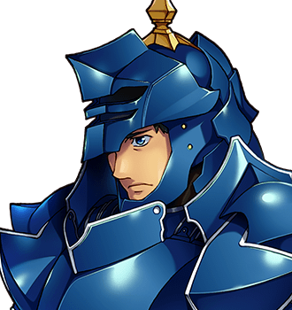

# Sir Aldric Pemberton-Gore III

For the family seat, see <a href="../Places/Fenmarch_Hall">Fenmarch Hall</a>. For his order, see <a href="../Institutions/The_Order_of_the_Errant">The Order of the Errant</a>. For his horse, see below; she is doing very well.

<table class="infobox">
<caption>Sir Aldric Pemberton-Gore III</caption>
<tr><td colspan="2" class="infobox-image">Slightly behind you at all times</td></tr>
<tr><th>Known as</th><td>Sir Aldric; Pemberton-Gore the Third</td></tr>
<tr><th>Born</th><td>1 February 1954, <a href="../Places/Fenmarch_Hall">Fenmarch Hall</a></td></tr>
<tr><th>Sex</th><td>Male</td></tr>
<tr><th>Of</th><td><a href="../Places/Fenmarch_Hall">Fenmarch Hall</a>, which is small, moated and damp; latterly <a href="../Places/Thistlewick">Thistlewick</a>, which he was trying to leave</td></tr>
<tr><th>Rank</th><td>Knight Errant, At Large</td></tr>
<tr><th>Arms</th><td>A knight rampant regardant</td></tr>
<tr><th>Age</th><td>Forty-eight</td></tr>
<tr><th>Good at</th><td>Defence; standing in front of whoever is bleeding; encouraging everybody</td></tr>
<tr><th>Bad at</th><td>Damage, speed, gates</td></tr>
<tr><th>Horse</th><td>Duchess, a grey mare, now a partner in haulage</td></tr>
<tr><th>Squire</th><td>His nephew, who finds the gates</td></tr>
<tr><th>North gate of Thistlewick</th><td>Found unaided once, 9 June 2001</td></tr>
</table>

<b>Sir Aldric Pemberton-Gore the Third</b> is a real knight of a real house, which is small, moated and damp, and was for six years the most loyal resident of <a href="../Places/Thistlewick">Thistlewick</a>, a village he was trying to leave. He arrived in 1994, meaning to go out by the north gate, and never found it, though it is nineteen paces from where he usually stood and has a sign. He is the kindest person on the Quest by a distance that is not close.

"I seek only the north gate," he told the Forty-Eighth. "It moves, you see. A cunning enchantment. I shall find it." Then: "...Unless. Do *you* know the way?" <a href="Bram_Thistle">Bram</a> did, and Sir Aldric joined on the spot, "slightly behind you at all times", which he has been ever since.

## The house

The Pemberton-Gores hold Fenmarch Hall, in its moat, among the marshes, eleven miles from anywhere in a direction he could not indicate. The family arms are *a knight rampant regardant*: a knight looking back over his shoulder, which for two centuries everybody took to be a pun about vigilance. He is the third of the name. The first and second were also lost.

He rode out from Fenmarch in 1991, at thirty-seven, with a letter from his father to carry to <a href="../Places/Little_Gore">Little Gore</a>, four miles away, his first errand. He did not get there. He did a great deal else instead, in a great many places, most of them by accident, and kept the letter in his tabard the whole time, where it went soft at the folds.

## Thistlewick

By 1994 he had reached Thistlewick, and in Thistlewick he stayed, not on purpose. He left many times. He also arrived many times, believing it to be another village, and the village decided, without ever discussing it, that this was fine, and that somebody should keep an eye on his laundry. He stood about in the street in a condition of readiness, which he wishes me to say was not waiting. "It greatly resembles waiting." He wrote to his father, and did not send it, because the wording proved difficult. "'Currently between quests' is accurate and reads extremely badly."

He also says, and I have three witnesses, that he had narrowed the gate down to the village.

## On the Quest

He covers whoever is bleeding without being asked, encourages everybody, and does very little damage, and everybody I have spoken to who went north with him says they would not have got there without him. In the course of the Quest he discharged, very late, nearly every obligation he had ever been given.

**The errand.** He still had his father's letter. He insisted on leading the party to Little Gore, and proposed a route of a hundred and ten miles, by the coast, which the party let him take, and which got there. The letter was an invitation to a wedding, nine years before, which everybody had attended anyway. The bride, Mrs <a href="Hester_Vane">Hester Vane</a>, now a mother of three, was delighted to see him, and put the letter on the mantelpiece, where it is.

**The vigil.** A knight is confirmed by keeping vigil in a chapel. He had kept eleven, every one in the wrong chapel, two of them at the Chapter House at Coldbarrow ("It says CHAPTER HOUSE on the door. I thought it was being modest") and one in a barn, which had a weathercock. The right one was the Order's chapel at <a href="../Places/Weeping_Bottom">Weeping Bottom</a>, under <a href="Sir_Hamo_Tench">Sir Hamo Tench</a>, and the party kept the twelfth with him there. The rules forbid the knight to move or speak until dawn. Things came. He did not move. He took everything. At first light he was confirmed, thirty years late, and given the shield that had been waiting over the chapel door since he was sixteen.

The Sisters had taken the device on it for a pun. It is not. Regardant means looking back to see who is behind you, which is the whole of the Order of the Errant, and he had never been facing the wrong way. He had been facing his friends.

**The Chapter House.** The Order of the Errant keeps a great map at <a href="../Places/Coldbarrow">Coldbarrow</a> with a pin for every knight in the field. Sir Aldric had nine. Six of them were correct on different dates, and three were the same week. Chapter Clerk <a href="Mordaunt">Mordaunt</a> did not regard this as an embarrassment but as a data problem, formed a committee, and offered him a promotion on condition that he stay in one place for the duration of the review. He refused it beautifully. The Order promoted him anyway, to Knight Errant, At Large. He carries his own pin now. Wherever he is, the map is correct.

**Duchess.** He had a horse, and nobody, himself included, had asked after her in six years. She is fine. One winter, in 1994, she walked in off the west road into a yard at <a href="../Places/Great_Dunnage">Great Dunnage</a>, saddled, with nobody in the saddle, and Mr Plummer took her in. She has been in steady work ever since, and is well thought of, and is now a partner in the firm, which trades as Plummer &amp; Partner, haulage. The reunion was, I am told by everybody who saw it, very touching. She did not want to leave. He said of course, and meant it. He calls on her. Not on Tuesdays, which she plans.

**The Wrong Dragon.** In 1992 he was sent to slay a dragon and arrived at a different one, in the rocks above the water, who is elderly, has read a great deal, and is not a dragon in the sense the commission meant. They talked about Horace until it got dark. It was established on his second visit, eight years later, that the dragon had been talking about the poet and he about his horse, whom he had only ever called Horse; both had had a lovely time. The right dragon has since been slain by somebody else, who drinks in the <a href="../Places/The_Slain_Wyvern">Slain Wyvern</a> and is insufferable about it. The valley's last wild dragon is therefore uneaten, and a knight reads it the Odes, when he can find the way.

## The Fourth

His nephew, Pemberton-Gore the Fourth, was ten when Sir Aldric rode out and was raised on the story of the knight who went out and never came back, which is the family's best tale and is not how Sir Aldric would put it. At nineteen he came looking, found the north gate of Thistlewick on his first attempt, and has not said so. He squires for his uncle now, three paces behind. "It's how you squire. I read it. He keeps stopping, though."

Sir Aldric has been home to Fenmarch, at last. He went the long way round, and it was still a way.

## Afterwards

He is Knight Errant, At Large, which is the only rank in the Order with no fixed address, and he holds it with great distinction. His squire finds the gates. Duchess is doing so well.

On the ninth of June 2001, at about eleven in the morning, Sir Aldric found the north gate of Thistlewick on his own, without his nephew, and went out through it, and was very pleased. I have the date from three witnesses who were in the lane. He has not been able to find it since, and has said so, cheerfully, to all three of them.

If there is one member of the company the reader should feel bad about having left at home, it is this one. I did not go on the Quest and I feel bad about it anyway.

## See also

- <a href="../Places/Fenmarch_Hall">Fenmarch Hall</a>
- <a href="../Institutions/The_Order_of_the_Errant">The Order of the Errant</a>
- <a href="../Places/Little_Gore">Little Gore</a>
- [The Obligatory Quest](../History/The_Obligatory_Quest)
