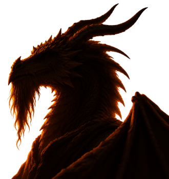

# Somebody Large

"Come in, come in. Mind the books." For the cave, see <a href="../Places/Wayside_Sights#the-wrong-dragon">Wayside sights</a>. For the young knight, see <a href="Sir_Aldric_Pemberton-Gore_III">Sir Aldric Pemberton-Gore III</a>. For the dragon in every sense, who is somebody else, see <a href="Mrs_Emberthwaite">Mrs Emberthwaite</a>.

<table class="infobox">
<caption>Somebody Large</caption>
<tr><td colspan="2" class="infobox-image">In the dark, which is how most people meet it</td></tr>
<tr><th>Known as</th><td>The Wrong Dragon, on the map. Somebody Large, which is what I have put, because it is accurate</td></tr>
<tr><th>Is</th><td>A dragon, in the sense that the map says so. Not a dragon in the sense anybody means</td></tr>
<tr><th>Born</th><td>Not asked</td></tr>
<tr><th>Sex</th><td>Not asked. It calls everybody "dear"</td></tr>
<tr><th>Lives</th><td>A cave in the rocks above the water, in the far south-east, full of books</td></tr>
<tr><th>Shelving</th><td>In the order it read them, which is nobody else's</td></tr>
<tr><th>Reading</th><td>Horace. The Odes</td></tr>
<tr><th>Slain</th><td>No. Found, and read to</td></tr>
<tr><th>Described</th><td>No</td></tr>
</table>

<b>Somebody Large</b> lives in a cave in the rocks above the water, in the far south-east, and reads. The map says it is a dragon, and it will tell you that it is, in the sense that the map says so, and that it is not a dragon in the sense anybody means. People come about the dragon, and are generally relieved, and then a little disappointed, and then they stay for tea. I have not identified it further, and I am not going to.

## Calling in

From the path you hear something very large breathing inside the cave, slowly, the way people breathe when they are reading. If you call in:

> "Come in, come in. Mind the books. They're in the order I read them, which is nobody else's."

It is dark inside, and warm, and full of books, and at the back something enormous is sitting in an armchair with a blanket over what you think are its knees.

> "Is it about the dragon? It's usually about the dragon."

It is always pleased to see people. It is always a little sorry for them, about the dragon, because they have usually come a long way and brought a great deal of armour.

## The young knight

> "There was a young knight, oh, eight years ago. Very correct. He had a commission with 'dragon' on it and a great deal of armour, and we talked about Horace until it got dark. I do hope he found his dragon. He was so looking forward to it."

He had not. In the year 2000 he came back, and stood at the mouth of the cave with his helmet off, and said that he had come about the dragon, eight years ago, and it knew him at once. It told him where his dragon had gone: somebody did it in, a year or two after he had called, who drinks in the Slain Wyvern and is insufferable about it. It asked after Horace. It turned out, after a pause, that Sir Aldric had believed for four hours in 1992 that they were talking about his horse, and that it had believed they were talking about the poet, and that it had wondered at the time why the Odes had so much in them about oats.

Then it asked him whether he would read to it. Its eyes are not what they were. It said that that is why it talks so much. He asked whether there was a lamp, and there was, and he lit it.

## What the lamp showed

Books to the roof, a blanket with ducks on it, and a pair of reading spectacles the size of cartwheels.

The rest of it, nobody who was there has described to anybody, and Sir Aldric has not described it either, and nor will I, and I was not there. Sir Aldric sat down and read it the Odes until it was dark, and they are not about oats. On the back of his commission he wrote his first report in eight years: DRAGON: FOUND. NOT SLAIN. READ TO. P-G.

> "Come again, dear. Bring the horse."

It would rather not be in the Bestiary; it was not asked, and Miss Halloway did not ask, and I am told that it would rather be in the library. This volume is the nearest thing I have to a library, so it is here, among the people. I wrote to ask whether it minded, and Sir Aldric took the letter, and brought back the answer, which was that it did not mind in the least, dear, and that it hoped I would put in the bit about the oats, and could I recommend anything. I sent it my own second volume. Sir Aldric says that it is reading it, and that it has got to the good bit, and that I can have it after. - H.B.

## Afterwards

There is a lamp lit in the cave now, and it has not been let go out. Sir Aldric goes back to read, when he can find the way, which is about one time in three; when he can, he takes the book down off the shelf without being told which, and nobody remarks on it. When he cannot, it keeps the lamp lit, and turns its own pages, slowly, and waits. They have finished the Odes twice and started again. People still come about the dragon, now and then, and are relieved, and a little disappointed, and stay for tea.

## See also

- <a href="Sir_Aldric_Pemberton-Gore_III">Sir Aldric Pemberton-Gore III</a>
- <a href="../Places/Wayside_Sights#the-wrong-dragon">The Wrong Dragon</a>, in Wayside sights
- <a href="Mrs_Emberthwaite">Mrs Emberthwaite</a>, a dragon in every sense
- <a href="Something_Unscheduled">Something Unscheduled</a>, who is also large, and also glad of visitors
