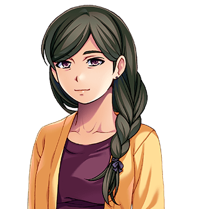

# The Cotterills

For the ninth, see <a href="Spare_Cotterill">Spare Cotterill</a>, who has an article of his own and would like that noticed. For the street they live on, see <a href="../Places/Upper_Clanging#the-cotterills">Upper Clanging</a>.

<table class="infobox">
<caption>The Cotterills</caption>
<tr><td colspan="2" class="infobox-image">Mrs Cotterill, who chose the names</td></tr>
<tr><th>Of</th><td><a href="../Places/Upper_Clanging">Upper Clanging</a>, the house at the end of the street, and most of the street</td></tr>
<tr><th>Mam</th><td><a href="Nora_Cotterill">Nora Cotterill</a></td></tr>
<tr><th>Da</th><td><a href="Ernest_Cotterill">Ernest Cotterill</a>, on nights</td></tr>
<tr><th>Children</th><td>Ten</td></tr>
<tr><th>Named for</th><td>Fastenings, nearly</td></tr>
<tr><th>Tin cups on the rain barrel</th><td>Ten, on ten nails</td></tr>
<tr><th>Mr Cotterill's view of the walk home</th><td>Has never once minded it</td></tr>
<tr><th>Another one</th><td>Not going to be</td></tr>
</table>

The <b>Cotterills</b> of <a href="../Places/Upper_Clanging">Upper Clanging</a> are a works family of ten children, named, by their mother, after the parts that hold an engine together, until she ran out; the ninth is called Spare. They live in the house at the end of the street, and also, at most hours of the day, on the rest of the street, in the works, at the forge, in the Safety Valve and at the Parish Rooms, which is where the Forty-Eighth had to go to meet them all, because you do not take a boy out of a family you have not met.

## Mam and Da

**<a href="Nora_Cotterill">Mrs Cotterill</a>** chose the names, and has them off by heart. "Cotter, Rivet, Gudgeon, Tappet, Ferrule, Grommet, Clevis, Shim. And Spare. We had run out. He said call it Spare, and I was tired." She will ask you whether you have eaten. If you say yes she will feed you anyway, because she does more potatoes. She is the only person in the north who ever won an argument with Spare, and she won it a great many times, and then one day she stopped at a quarter, and he went, with the washer and his bag; that is in his article, and I will only say here that it was a fair fight, and that his mother is a formidable opponent and knew exactly what she was doing at every point of it, including the last.

**<a href="Ernest_Cotterill">Mr Cotterill</a>** is on nights: twelve on, twelve off, six days. "It is not the work I mind. It is the walk home in the dark." He thinks about that for a moment. "Mind, I have never once minded the walk home." He is always very glad to get home. Mrs Cotterill says so, and so does everybody on the street, and I have nothing to add.

## The children

I have the ages from **Gudgeon**, who copies the parish register at the Parish Rooms in the best hand Mrs Tunnicliffe has ever had, out of eleven, and who has written *Cotterill* more than four hundred times. As they stand in this year of 2002:

| Who | Age | |
| --- | --- | --- |
| **<a href="Cotter_Cotterill">Cotter</a>** | 26 | The eldest. Married to **<a href="Bessie_Cotterill">Bessie Marsden</a>**, Winnie's granddaughter. Was down the valley at the big foundry at Great Dunnage, at the Iron Company's gate, until the spring of 2000 |
| **<a href="Rivet_Cotterill">Rivet</a>** | 24 | Days, while Da does nights. They pass at the door at six. He says "Rivet." Rivet says "Da." "That is a conversation, that is." Has shared a bed his whole life, and one of the people in it is Grommet, and he has never once been in a room by himself |
| **<a href="Gudgeon_Cotterill">Gudgeon</a>** | 22 | Clerks at the Parish Rooms; copies the register; knew exactly which drawer Form P-9 was in, without looking. Read it aloud to the Forty-Eighth one section at a time |
| **<a href="Tappet_Cotterill">Tappet</a>** | 20 | Brings the castings up to the works on Tuesdays, six crates, and watched the airship not fly for four years. She would still get in it. When it flew she stood under the empty gantry and said, "It flew," and that was all she said, grinning |
| **<a href="Ferrule_Cotterill">Ferrule</a>** | 18 | In charge from six, when Da goes to work, and then nobody gets to sit down |
| **<a href="Grommet_Cotterill">Grommet</a>** | 17 | Apprenticed to Bryd Ollerenshaw at the forge, and put upon. Mr Ollerenshaw says he has got the makings, and says it slowly. Points out to the family every day that their names are wrong: a shim is a packing piece, and a ferrule is a collar, and fastens nothing, and only stops a split. Small enough to go inside a boiler, and has |
| **<a href="Clevis_Cotterill">Clevis</a>** | 15 | Ran a book on the tenth one's name. Gib was evens; Cleat two to one; Washer twenty to one, because Da had said not Washer |
| **<a href="Shim_Cotterill">Shim</a>** | 13 | Collects things. A tin of washers, mostly, and three bolts, a doorknob and a bearing, and the bearing is the best one, because you can hold it and it goes round. Gave Spare a washer |
| **Spare** | 11 | The ninth. See <a href="Spare_Cotterill">his article</a> |
| **<a href="Washer_Cotterill">Washer</a>** | 2 this spring | The tenth, born in the spring of 2000, at six in the morning, on the hooter |

Grommet asked me to print that the names are wrong. I have printed it. Mrs Cotterill asked me to print that the names are not wrong, they are what she called them. I have printed that as well. Mr Cotterill asked me to say that he had no view, and has not had one since about Ferrule.

## The spring

The tenth was due in the spring, and the family had given all the small clothes away, and Mrs Cotterill had had to go round the town and ask for them back. Mam was not to lift anything, and lifted things the moment Ferrule's back was turned. Spare said he was going away before the baby came, and Shim said he could have a washer.

He came back. On the morning it was spring, every Cotterill in Upper Clanging was indoors, and the street was empty for a day, and **Washer** was born at six on the hooter, the only one of them, Mrs Cotterill says, that was ever on time. Asked what happened to not Washer, she says, "Spare got to it first. He said call it Washer, and I was tired." Mr Cotterill came off nights for it, for the first time in twenty-two years, and was very pleased, and did not say so, and did not need to. "I said not Washer," he says, with no hope at all, and great contentment. Clevis paid out most of Upper Clanging. The book is closed. Mrs Cotterill says that there is not going to be another one. Mr Cotterill says that is all of them.

## Afterwards

Cotter has been home for good since that spring, and Bessie's came in the summer, as she said it would, on time, and is not named in this encyclopedia because Winnie has asked me not to, until the seating plan is settled. Ferrule is still in charge from six. Grommet has been two years at the forge now, and Mr Ollerenshaw still says he has the makings, a little faster. Tappet has asked Miss Hoyle whether there will be room aboard the Two Hundred and First, and was told that it is not a question with an answer; it is a question with a schedule. Shim's bearing is still the best one.

Through the kitchen window there is a line of vests in order of size, and the peg on the end that was put there in hope has a vest on it now. Round the rim of the rain barrel there are ten tin cups on ten nails. Washer has not said a word yet, and Spare is working on it, and the whole street has money on what the first one will be. Clevis is not taking bets. He says the family has been through enough.

## See also

- <a href="Spare_Cotterill">Spare Cotterill</a>
- <a href="../Places/Upper_Clanging">Upper Clanging</a>
- <a href="Bryd_Ollerenshaw">Bryd Ollerenshaw</a>
- <a href="Ott_Hoyle">Ott Hoyle</a>
- <a href="../Places/Much_Pottering">Much Pottering</a>, which is twinned with them, in a way
