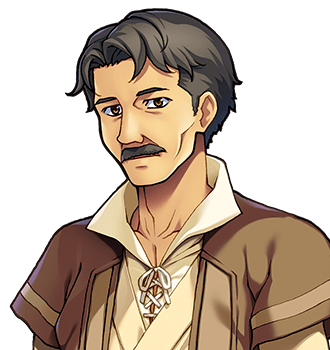

# The Ferryman

For the town, the harbour and the boat shed, see <a href="../Places/Nether_Sopping">Nether Sopping</a>. For the tide table, see <a href="Nix">Nix</a>. For the oar, which is a sword now, see the same.

<table class="infobox">
<caption>The Ferryman</caption>
<tr><td colspan="2" class="infobox-image">Tide's wrong today</td></tr>
<tr><th>Known as</th><td>The Ferryman</td></tr>
<tr><th>Born</th><td>1951, <a href="../Places/Nether_Sopping">Nether Sopping</a></td></tr>
<tr><th>Sex</th><td>Male</td></tr>
<tr><th>Of</th><td>The pier, Nether Sopping</td></tr>
<tr><th>Goes</th><td>Anywhere. Anywhere at all</td></tr>
<tr><th>Fare</th><td>A penny</td></tr>
<tr><th>Boat</th><td>One, bought 1989. Not yet named</td></tr>
<tr><th>Tide</th><td>Wrong, since he bought the boat</td></tr>
<tr><th>Keeps</th><td>The key of the boat shed, and a receipt in his hat</td></tr>
</table>

<b>The Ferryman</b> keeps a boat at the pier in <a href="../Places/Nether_Sopping">Nether Sopping</a> and will take you anywhere at all - the islands, the far shore, that bit on the map with the writing you can't read - for a penny, when the tide is right. The tide is wrong today. It has been wrong since he bought the boat. He would like you to come back tomorrow, and he means it, and so far tomorrow has been wrong as well.

## Passage

> "Passage? Aye. Where to?"

You ask him what the options are, and he tells you, and the options are everything. He is the only man I have met who offers the whole of the sea to anybody who asks, at a penny, and I believe that he would take you, all the way, and wait for you at the other end and bring you back. Then he looks at the water for a while.

> "Tide's wrong today, mind. Come back tomorrow."

He was born in the town in 1951, in a house on the harbour front, and worked on other people's boats from the age of twelve, and in 1989 he bought one of his own, with everything he had, to run a ferry. He has not yet crossed in it. He has been to the end of the pier in it a great many times, to see, and the tide has been wrong, and he has come back in, and tied up, and looked at the water.

He has not named her. He says he will name her on the first crossing, so as to have something to say when they get there.

## The tide table

In the year 2000 <a href="Nix">Nix</a> came back to Nether Sopping with eleven things out of the front of her ledger, which were the things she had had longest, and one of them was a printed tide table, with his boat drawn in the margin.

> "Never had a tide table."

He had had one for a week, the week he bought the boat, and Nix had had it since the week after. He read it. He looked at the water. He read it again.

> "Tide's right today."

He looked at the water again, for some time.

> "...Says here."

Then he held out a penny, which is the fare, and asked her what he owed her, and Nix said that you cannot pay somebody for your own tide table, because there is not a column for it. He has it open on his knee now, and is giving it a few more days.

## The boat shed

The shed by the pier has eleven boats in it, all upside down, all belonging to somebody who went north, and nobody has rowed them since. The Ferryman keeps the key. It was given to him, he says, because he is always there, which is true. When the Forty-Eighth's party needed an oar in 2000, Nix could have opened the lock in about four seconds, and did not; the Ferryman was fetched up from the pier instead, and let them choose an oar off one of the eleven.

> "Nobody's rowed her since. She'd like being a sword."

Nix wrote him a receipt - ONE OAR (SWORD), LENT, WITH THANKS - and he folded it into his hat, where it is. He took it out to show me, and read it, and put it back, and said that the boat it came from was pleased, he thought, and that it was more than his own had done.

I bought a tide table of my own at the Chandler's, for this year, and on my last afternoon in Nether Sopping I took it down to the pier and looked at it beside his, quietly, while he looked at the water. They agree on most days. I have not mentioned this to him. I asked him instead where he would go first, when it was right, and he said the islands, and then the far shore, and then that bit with the writing, and then he would come back and tell everybody. I said that I would like to come. He said that I would be very welcome, and that it was a penny, and that the tide was wrong today. - H.B.

## Afterwards

He is giving it a few more days. The tide table is soft at the folds now, and he has it by heart, and he still reads it every morning, and then looks at the water, which is where the tide is. The penny is still the fare, and he has had several people ask, since the Forty-Eighth came through and the town began to be visited, and has told every one of them to come back tomorrow, and a good many of them have, and stood with him at the end of the pier, and agreed with him about the water.

## See also

- <a href="../Places/Nether_Sopping">Nether Sopping</a>, the pier and the boat shed
- <a href="Nix">Nix</a>, and the RETURNED column
- <a href="../History/The_Chosen_Ones">The Chosen Ones</a>, and the people who went with them, whose boats are in the shed
