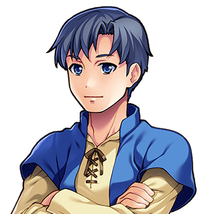

# The Gatekeeper

For the village, the square and the sign, see <a href="../Places/Thistlewick">Thistlewick</a>. For the forty-seven he waved off, see <a href="../History/The_Chosen_Ones">The Chosen Ones</a>. For the key, see <a href="Nix">Nix</a>, who had it.

<table class="infobox">
<caption>The Gatekeeper</caption>
<tr><td colspan="2" class="infobox-image">Forty-seven</td></tr>
<tr><th>Known as</th><td>The Gatekeeper. He has a name, and has asked for this one</td></tr>
<tr><th>Born</th><td>In <a href="../Places/Thistlewick">Thistlewick</a>. He did not say when, and I did not ask</td></tr>
<tr><th>Sex</th><td>Male</td></tr>
<tr><th>Of</th><td>The north gate, at the top of the square</td></tr>
<tr><th>Waved off</th><td>Forty-seven Chosen Ones. Forty-eight</td></tr>
<tr><th>Turned back</th><td>Anybody alone, under section four, subsection b</td></tr>
<tr><th>The gate</th><td>Open, for as long as anybody can remember</td></tr>
<tr><th>The key</th><td>On a nail beside it, since 2000. Very safe</td></tr>
</table>

<b>The Gatekeeper</b> keeps the north gate of <a href="../Places/Thistlewick">Thistlewick</a>, which has stood open for as long as anybody can remember, and he has waved forty-seven Chosen Ones off through it. He stands beside it with his arms folded, looking north, and when he tells you how many it was he looks north for a while, and then says the number again. He does not say how many came back. Most people decide not to make him.

## The gate

> "Forty-seven Chosen Ones I've waved off through that gate."
>
> "Forty-seven."

He was born in the village and has kept the gate, he says, for as long as it has needed keeping, and he would not say for how long that was, and I have learned, in Thistlewick, not to press a question that has numbers in it; see <a href="../History/Two_Reckonings">Two Reckonings</a>. He has a name. He told it me, and then asked whether I would put *the Gatekeeper*, because that is what the forty-seven called him, and he would like it to be the same in the book. I have.

A gate that is never shut does not need much keeping, and he would be the first to say so. What he keeps is the road. Nobody goes north through it who has not been Chosen, officially, at <a href="../Institutions/The_Prophecy_Committee">Prophecy Hall</a> - "the gold one" - and nobody goes through it alone:

> "Hold up. You're alone. Prophecy, section four, subsection b: a Chosen One travels with a Party. Minimum one other person. It's about the optics."

He has read the Prophecy, the parts that concern gates, and he applies it without fear or favour. I asked him whether he had ever turned a Chosen One back. He said yes, every one of them, the first time, because they all come up the square on their own on the first morning, and he sends them back down it to ask around. Then they come back with somebody, and he asks them whether they are sure, because it is a long walk and the scenery repeats, and then he waves.

> "Very sensible. Nobody ever went north and came back saying it was fine."

That is what he says to the ones who say *not yet*. He says it kindly. He has said it, I gather, a great many times, and it has never once been meant as an argument for going.

## The forty-eighth

<a href="Bram_Thistle">Bram</a> came up the square in the year 2000, alone, and was sent back down it to ask around, and came back with company, and was asked whether he was sure. He went north. The Gatekeeper waved, and looked north for a while afterwards, as he always does, and then went back to his place by the gate.

For six years before that, <a href="Sir_Aldric_Pemberton-Gore_III">Sir Aldric Pemberton-Gore</a> had been in the square, forty paces south of him, looking for the north gate. The Gatekeeper saw him most days. He says that he thought Sir Aldric was waiting for somebody, and did not like to interrupt. There was a notice about it on the board. Thistlewick does not read its notices, and its Gatekeeper is of Thistlewick.

## The key

The gate turned out to have a key. It had been in the lock, and <a href="Nix">Nix</a> had had it for eleven years, and in the year 2000 she brought it back with ten other things out of the front of her ledger and gave it to him.

> "The gate's got a key?"

He looked at the gate, which was open, and at the key, for some time.

> "Forty-seven of them through there, and not one ever had to knock."

He hung the key on a nail beside the gate, where it will be very safe, and where it still is, and the gate is still open.

Just outside the gate is a sign, POINT OF NO RETURN, in red, and under it, in smaller letters, *not really, you can come back whenever, we just like the sign*. I asked about the smaller letters all over the village and nobody knew who had added them. The hand is the same as the one on the label under the nail, which says KEY (GATE). I have not asked him. I think a man who waves forty-seven people off up a road is entitled to put something underneath a sign about it. - H.B.

## Afterwards

Nobody need go north any more, and the gate has not been shut. I asked him whether it would be. He looked north for a while, and said that it had been open for forty-seven of them and it could stay open for whoever was next, and that it was not a gate for keeping people in. Then I asked him the question you are not supposed to ask him, which was how many had come back.

> "All of them, I'm told."

And then, after a while: "One of them came back here."

He still stands by the gate with his arms folded, and still turns back anybody who comes up the square alone, out of habit, and sends them down to ask around, and some of them do, and come back with a friend, and go for a walk.

## See also

- <a href="../Places/Thistlewick">Thistlewick</a>, the north gate and the sign
- <a href="../History/The_Chosen_Ones">The Chosen Ones</a>, all forty-eight
- <a href="Nix">Nix</a>, and the RETURNED column
- <a href="Sir_Aldric_Pemberton-Gore_III">Sir Aldric Pemberton-Gore III</a>, who found the gate on 9 June 2001
- <a href="../History/Two_Reckonings">Two Reckonings</a>
