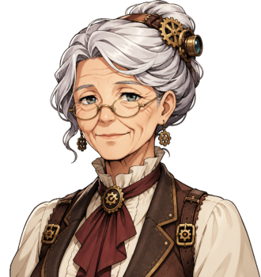

# Winnie Marsden

For the town and the Safety Valve, see <a href="../Places/Upper_Clanging">Upper Clanging</a>. For her granddaughter, who has her face, see <a href="Bessie_Cotterill">Bessie Cotterill</a>. For the dinner, you cannot get in. You had to be born in it.

<table class="infobox">
<caption>Winnie Marsden</caption>
<tr><td colspan="2" class="infobox-image">Class of 'Nineteen</td></tr>
<tr><th>Known as</th><td>Winnie; Mrs Marsden; "Gran", by Bessie, and since the summer of 2000 by Cotter, who was told to</td></tr>
<tr><th>Born</th><td>Winifred Platt, 4 October 1919, <a href="../Places/Upper_Clanging">Upper Clanging</a>, in the Cold Winter's autumn</td></tr>
<tr><th>Sex</th><td>Female</td></tr>
<tr><th>Class</th><td>Of 'Nineteen. Two hundred and forty, near enough all together</td></tr>
<tr><th>Married</th><td>Albert Marsden, pattern-maker, 1941; widowed 1979</td></tr>
<tr><th>Drinks</th><td>A half of shandy, on a doily embroidered CLASS OF '19</td></tr>
<tr><th>Dinner</th><td>Every year, second Saturday</td></tr>
<tr><th>Seating plan</th><td>Settled when they were four, in 1923</td></tr>
<tr><th>Column for the Cotterills</th><td>None, until 2000. Drawn in, in pencil</td></tr>
<tr><th>Not being unkind about it</th><td>No</td></tr>
</table>

<b>Winnie Marsden</b> sits by the fire at the Safety Valve in <a href="../Places/Upper_Clanging">Upper Clanging</a> with a half of shandy on a doily embroidered CLASS OF '19. She was born in the autumn after the Cold Winter, when the foundry was banked down for six weeks and there was no heat in the whole town but what was in the houses, along with two hundred and thirty-nine others, and they have had a dinner on the second Saturday every year since, with a seating plan settled when they were four. You cannot get in. She is not being unkind about it.

## The Cold Winter

In January 1919 the foundry at Upper Clanging was banked down for six weeks, for the first and only time in its history, for want of coke. There was no work. There was no heat in the whole town but what was in the houses. In the autumn two hundred and forty children were born, near enough all together, and the town has called them the Class of 'Nineteen ever since. Mrs Tunnicliffe at the Parish Rooms, who keeps the census, says so, and so does the census, which, as she says, is only dates.

Winifred Platt was born on the fourth of October, in the middle of them, at the house behind the Safety Valve, a fitter's daughter. She says that she does not remember a time before the Class, and that she supposes nobody does, it being the sort of thing you are born into, like a family, only larger and with a better dinner.

## The plan

The Class went to school together in 1923, at four, in two rooms, and the teacher, Miss Agnes Thewlis, sat them in alphabetical order on the first morning, and wrote the order down on a sheet of foolscap, and that sheet, kept by Winnie since 1950 in a biscuit tin, is the seating plan of the Class of 'Nineteen's dinner, and has been used at every dinner since the first, in 1939. It has two hundred and forty places on it. It does not have a column for anything else.

> "Class of 'Nineteen. We have a dinner. I do not suppose you would know about the dinner."

> "There is a seating plan. There has been a seating plan since we were four. You cannot get in. I am not being unkind about it. You had to be born in it."

She married Albert Marsden, a pattern-maker at the foundry, in 1941, and he was not Class of 'Nineteen, and in thirty-eight years of marriage he never once went to the dinner, and he said he did not mind, and she says that he did not, and that he waited up.

The Class of 'Nineteen is eighty-two this year. Of the two hundred and forty, a little over sixty came to the dinner last October. Every place on the plan is laid all the same, and every place that is not filled has a card on the plate with the name on it, in Winnie's hand, and the dinner is served round them, and nobody in Upper Clanging thinks this is anything but the right way to do it, and nor, having been allowed to stand at the door for five minutes, do I. - H.B.

## The Cotterills

In 1999 her granddaughter Bessie married Cotter Cotterill, the eldest of the foundry family, at the chapel, on a Saturday. Winnie spent the reception at a side table with the plan.

> "My granddaughter has married one of the foundry family. There are nine of them. Ten in the spring. They will all want seats. There is a plan. It was settled when we were four. It does not have a column for this."

She went home early and sat up with it, and nobody has been told what she said to it. In the spring of 2000, when the tenth came:

> "Ten, then. I have been to the plan. There is a column for it now. I drew it in myself. In pencil."

And then, in the summer, when Bessie's came: "Second Saturday. There will be a high chair."

It is the first thing on that plan that has ever been in pencil. Bessie says it is the first time she has ever known her gran to leave anything open to revision, and Winnie says that it is not open to revision, it is in pencil, which is a different thing, and that pencil is for things that are going to change, and that a baby is going to change, and that is all.

## Afterwards

She is eighty-two. She still sits by the fire at the Safety Valve, on the same chair, on the same doily, and Mr Kell still brings the half without being asked. The plan has a pencil column now, with eleven Cotterills in it and a high chair. Bessie's child, her great-grandchild, is not named in this volume, at her request, until the seating plan is settled, and she has told me that she does not expect it to be settled, and that that is rather the point of pencil.

## See also

- <a href="Bessie_Cotterill">Bessie Cotterill</a>
- <a href="Mrs_Tunnicliffe">Mrs Tunnicliffe</a>, born in June
- <a href="The_Cotterills">The Cotterills</a>
- <a href="../Places/Upper_Clanging">Upper Clanging</a>
- <a href="../History/The_Cold_Winter">The Cold Winter</a>
