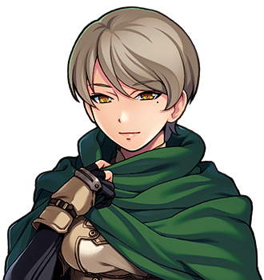

# Wren Halloway

For her work, see <a href="../Bestiary/">the Bestiary</a>, which is hers, and which I have printed whole and not touched. For the goose, see <a href="../Bestiary/The_Goose">The Goose</a>, in the same.

<table class="infobox">
<caption>Wren Halloway</caption>
<tr><td colspan="2" class="infobox-image">Not to be jogged</td></tr>
<tr><th>Known as</th><td>W. Halloway; the Cataloguer</td></tr>
<tr><th>Born</th><td>17 April 1972. She has not said where, and has corrected two people who guessed</td></tr>
<tr><th>Sex</th><td>Female</td></tr>
<tr><th>Of</th><td>A corner of the Slain Wyvern, and then outside it, and then a seat under the goose</td></tr>
<tr><th>Trade</th><td>Cataloguer of monsters, by what they are</td></tr>
<tr><th>Carries</th><td>A crossbow; seventeen specimen jars; the monograph</td></tr>
<tr><th>Good at</th><td>Several hits at range, poison, taking armour off things, getting two of whatever they drop</td></tr>
<tr><th>Bad at</th><td>Raw damage; tolerating the phrase "basically a dragon"</td></tr>
<tr><th>Published</th><td><i><a href="../Bestiary/The_Fauna_of_the_Valley">The Fauna of the Valley</a>, by What They Are</i>, 2000</td></tr>
<tr><th>Reviewers</th><td>Three, one a duck</td></tr>
<tr><th>Named</th><td><i>Bramus agricola</i></td></tr>
<tr><th>On the wyvern</th><td>A goose</td></tr>
</table>

<b>Wren Halloway</b> is a cataloguer: she does not hunt monsters, she <b>documents</b> them, and the fighting is a step in the methodology that she resents. "You cannot measure a wing that is actively in use." She went north with the Forty-Eighth, came back with eleven type specimens and the only honest monograph on the creatures of this region, and is the author of the Bestiary in this volume, which I commissioned from her and have not altered by one word, because she would know.

She met the Forty-Eighth in the Slain Wyvern, at a table of specimens, and the first thing she said to him was, "Don't jog the table. Nothing in here is dead enough to be casual about." Her terms for joining were first refusal on anything unusual, that she write the entries, and that nobody - "NOBODY" - say "it's basically a dragon". She has since drafted a clause about the phrase.

## The discipline

Everybody else names monsters after how they died. She names them after what they are, which she calls the same job done properly. Taxonomy, for her, is a moral position.

The difficulty is the previous authority. Doctor Amias Rowbotham FRS spent forty years naming some three hundred species after himself, his subscribers and his dogs, and the standard work is therefore a monument to a man rather than a description of a valley. Every correction she publishes reads to the field as an attack on a dead man they were all rather fond of. She published once, at twenty-three, and was reviewed by three of his students. She does not discuss the reviews. I have read them, and she is right not to.

## The goose

She was thrown out of the <a href="../Places/The_Slain_Wyvern">Slain Wyvern</a> for saying that the wyvern over its mantel is a goose. It is a goose. <a href="Halloran_Vance">Halloran Vance</a>, the Forty-First, brought it home from the marshes in 1940 and made it into a wyvern with wire, in two days, because a whole town was waiting on the quay for a monster and he had nothing to give them. Mrs <a href="Dorcas_Thrupp">Dorcas Thrupp</a> keeps the Wyvern, and would not take the wyvern down, or have it corrected, because the Forty-First was a good man and brought back what he could, and that is where the conversation ends.

Miss Halloway was right, and she was right at length, and she was asked to leave for it. Of everything that happened to anybody in the company, it is the nearest thing to unfair.

What came of it is a second plaque. It is beside the first. It does not correct the first, and does not repeat it. It says what the bird is, and where it was got, and by whom, and why. Mrs Thrupp read it twice, said nothing, and put it up herself. Both plaques are on the wall now.

## On the Quest

**The monograph.** Publication at the <a href="../Institutions/The_Collegium_Arcanum">Collegium Arcanum</a> required a type specimen, intact, for every entry: eleven fights she objected to and conducted anyway, with a very bad grace and very good results. It required a subscription list, which she got, and three Fellows to review it, which she got, one of whom is the Collegium's duck. *The Fauna of the Valley, by What They Are*, by W. Halloway, is on the Collegium's shelf, in a gap exactly an inch wide that had been waiting for it. It has eleven type specimens and three reviewers. Page four hundred says goose.

**The Gloamwood Society.** The Society had existed for forty years to prove that the Thing In The Woods is not there, with a newsletter, nine members and an annual walk. She proved it comprehensively. The Society was delighted. Its newsletter had its best ever issue. One member was quietly devastated, and was looked after very carefully by everybody else, and was fine by the end of the walk.

**The Fenmarch Collection.** At <a href="../Places/Fenmarch_Hall">Fenmarch Hall</a> there is a gallery of impossible animals in glass cases, and she was engaged to authenticate them. They were composed by <a href="Mr_Ottershaw">Mr Ottershaw</a>, taxidermist, who is ninety and unrepentant and an artist: he did not forge them, he composed them, and the joins are magnificent. She wrote it up honestly, which required her to say that the workmanship is the finest she has seen, which she meant. Seventy-nine of the animals are composed. The family has never been prouder. Case forty was not examined.

**Bramus agricola.** She named a new species after the Forty-Eighth: a small brown thing that lives in turnip fields, is of no consequence whatever, and is remarkable for one attribute, which is that it survives things it has no business surviving, by luck, repeatedly, in a manner she describes in print as "statistically indefensible". He was deeply touched until she explained why, and then deeply touched anyway, because it was accurate. The Prophecy does not read journals. It has read this one.

## Afterwards

She is welcome in the Slain Wyvern, which she affects not to care about. She sits under the goose, by choice, most evenings, writing. Volume two of the monograph is in hand. It will contain a corrigendum about one specimen, which she will not name.

I asked her whether case forty at Fenmarch had been left unexamined by accident. She said that a cataloguer does not examine a specimen she has not been engaged to examine, and that I should mind my own entries. I have looked at case forty myself, through the glass. I do not know what it is. That is not my field.

## See also

- <a href="../Bestiary/">The Bestiary</a>, by W. Halloway
- <a href="../Bestiary/The_Goose">The Goose</a>
- <a href="../Bestiary/Bramus_agricola">Bramus agricola</a>
- <a href="../Places/The_Slain_Wyvern">The Slain Wyvern</a>
- [The Obligatory Quest](../History/The_Obligatory_Quest)
