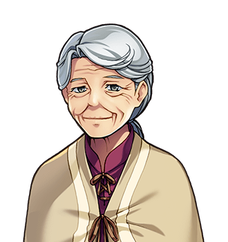

# Ysolde Marrow

For the man she kept alive, see <a href="Ambrose_Fitch">Ambrose Fitch</a>. For the table she chairs, see <a class="new" href="../Institutions/The_Healers_Table">the Healers' Table</a>.

<table class="infobox">
<caption>Ysolde Marrow</caption>
<tr><td colspan="2" class="infobox-image">With the kit open</td></tr>
<tr><th>Known as</th><td>Mrs Marrow; the Forty-Fourth's</td></tr>
<tr><th>Trade</th><td>Field medicine, forty years of it</td></tr>
<tr><th>Of</th><td><a href="../Places/Nether_Sopping">Nether Sopping</a>, the table by the bar in the <a href="../Places/The_Slain_Wyvern">Slain Wyvern</a></td></tr>
<tr><th>Age</th><td>Eighty</td></tr>
<tr><th>Kept alive</th><td>The Forty-Fourth, nine years, on and off; a duke's son, nine weeks</td></tr>
<tr><th>His hit points</th><td>Four. She counted</td></tr>
<tr><th>Chairs</th><td><a class="new" href="../Institutions/The_Healers_Table">The Healers' Table</a></td></tr>
<tr><th>Never been to</th><td><a href="../Places/Thistlewick">Thistlewick</a></td></tr>
<tr><th>Argued with it anyway</th><td>Forty years</td></tr>
</table>

<b>Ysolde Marrow</b> is a field medic of <a href="../Places/Nether_Sopping">Nether Sopping</a>, who kept <a href="Ambrose_Fitch">Ambrose Fitch</a>, the Forty-Fourth Chosen One, alive for nine years, on and off, and has had an argument with a village she has never been to for forty years since. She sits at the table by the bar in the <a href="../Places/The_Slain_Wyvern">Slain Wyvern</a> with a canvas roll of field medicine open in front of her, out of habit. She is eighty, and will tell you so, usually as a reason why you are not to argue with her.

## The trade

She will tell you, if you ask what the job was like, about the duke's son. The party was paid to walk him from the coast to the Tower, for the exposure, they said; for his character. He had four hit points. She counted them. He walked into every fight they had, not bravely, but the way you walk into a room, and she stood in front of him for nine weeks. He made it. He runs a shipping concern now, and sent her a card once, with a Y in the wrong place in her name.

Everybody in the Wyvern has heard about the duke's son. Everybody nods anyway, because it is a very good one.

What she says about the trade itself she has from Ambrose: you keep someone alive, and then they go and live, and you don't get to see much of it. "He was right about most things."

In her kit, which every fold of is worn where somebody's hand went, there is one bottle labelled FOR AFTER. It is tea.

## The Forty-Fourth

When they put Ambrose in the mound, with a curse on it, she had a good deal to say, and has said it at the bar for forty years to anybody from Thistlewick who would stand still. "Forty years they ignored him, and then they did THAT." In the year 2000 the Forty-Eighth came back from the Barrow and found her looking up before he had said anything at all. "You've been out to the mound."

He told her what Ambrose had asked for, and that it was there now, on the top, facing the sea. He told her, too, the message: that she was right about the four hit points. She was quiet for what felt like a long time. Nobody in the room looked over. Everybody in the room was listening.

> "Forty years I've had that argument with a village I've never been to. They wanted a hero in a mound. He wanted somewhere to put his legs up."

Then she gave the Forty-Eighth her kit, forty years of field medicine in a canvas roll, and told him not to argue, because she was seventy-eight and had had a night. "You're going north. They all go north. Come back, and I'll want it back, and I'll be very rude about the state you've got it into. Do you hear me? Come back."

## The Table

Once a year she chairs the Table, in the back room of the Wyvern behind the red curtain: every party medic within forty miles, around a long table, the worst thing each of them has ever had to improvise with, round the table, in turn. In 2000 the Table had a new member, <a href="Merribell">Merribell</a> of Thistlewick, who is the youngest by thirty-eight years, and who had nothing to tell them, because nobody had ever died on her. Mrs Marrow told her to write it down, all of it, every cup of water and every pair of socks, while she still thinks it is boring, because one day it won't be. "And the day it doesn't, you come down here, and you tell us. That's what the Table is for, love." The Table's kit went to the youngest. It always has. It had been a while.

## Afterwards

The kit came back. I am not able to say what state it was in, having been told by Mrs Marrow that the state it was in is a matter between her and the Forty-Eighth, and having heard, from the other side of the bar, what she said to him about it, which took some time and was very rude, as promised. She has it open in front of her again, out of habit. The bottle labelled FOR AFTER has been refilled.

When Bram told her he had been in Ambrose's cottage, she asked whether he had watered that thing in the pot. He had. "He watered it every morning for forty years. It was dead when he bought it. He said it was the principle." She has been out to the Barrow since, once, and sat on the bench, and come back, and has not said a word about it to anybody, which is the longest she has gone without saying a word about Thistlewick in forty years.

The Table sat again in 2001, and Merribell spoke, for eleven minutes, and the minutes record it as the most useful address in the Table's history, and the subject was water. Mrs Marrow chaired. She has told me that she is not going to retire, and that if I print anything to the contrary she will want it back.

## See also

- <a href="Ambrose_Fitch">Ambrose Fitch</a>
- <a href="../Places/The_Barrow_of_the_Forty-Fourth">The Barrow of the Forty-Fourth</a>
- <a href="Merribell">Merribell</a>
- <a href="../Places/The_Slain_Wyvern">The Slain Wyvern</a>
- <a class="new" href="../Institutions/The_Healers_Table">The Healers' Table</a>
