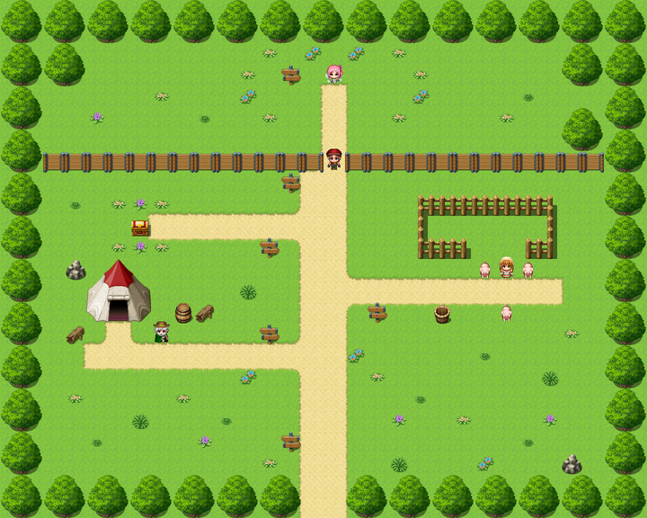

# Firstfield Meadow

This article is about the meadow at the foot of the rainbow. For the Guild that runs it, see <a href="../Institutions/The_Guild_of_Guides">The Guild of Guides</a>. For tutorials in general, and why nobody finishes them, see the <a href="../Cliches/">Glossary of Cliches</a>.

<table class="infobox">
<caption>Firstfield Meadow</caption>
<tr><td colspan="2" class="infobox-image">The meadow, from above. There are signs</td></tr>
<tr><th>Known as</th><td>Where Every Journey Begins*</td></tr>
<tr><th>Footnote</th><td>*Journeys already in progress also welcome</td></tr>
<tr><th>Where</th><td>At the foot of the rainbow, north-west of Thistlewick</td></tr>
<tr><th>Kept by</th><td>The Guild of Guides, Firstfield Chapter</td></tr>
<tr><th>Guide</th><td>Fizz, Tutorial Sprite, Third Class</td></tr>
<tr><th>Stations</th><td>Four: items, treasure, quests, combat</td></tr>
<tr><th>Chest restocked</th><td>At nine</td></tr>
<tr><th>Sheep</th><td>Three, according to the Guild</td></tr>
<tr><th>Tutorials completed</th><td>One</td></tr>
</table>

<b>Firstfield Meadow</b> is a small meadow at the foot of the rainbow, a short way north-west of <a href="Thistlewick">Thistlewick</a>, off the road, where the Guild of Guides explains things to Chosen Ones. Every journey begins there. Forty-seven Chosen Ones skipped it, by pressing the button really fast. The Forty-Eighth did not, and is the only graduate on record.

## The meadow

It is a pleasant meadow, with flowers, a tent, a fence with a gap in it, and a great many signs. A long board by the path reads CONTROLS. UP IS UP. DOWN IS DOWN. LEFT AND RIGHT ARE ALSO AVAILABLE. THE GUILD OF GUIDES RECOMMENDS TRYING ALL FOUR. Another reminds the visitor that he may save his progress at any time. He always could. It is a great weight off the mind anyway.

There is a barrel labelled BARREL (FOR PRACTICE), with a second label at the bottom: WELL DONE. YOU HAVE SEARCHED A BARREL. THERE WILL BE MANY MORE. There is a log labelled SIT HERE TO REST, and under it, RESTING DOES NOTHING. IT IS FOR THE ATMOSPHERE. There is another log labelled OBSTACLE (EASY), and when you walk round it a small voice somewhere in the meadow cheers.

## Fizz

**<a href="../People/Fizz">Fizz</a>** is the meadow's guide: Tutorial Sprite, Third Class, small, bright, and audible from the road. Her first words to the Forty-Eighth were HEY! LISTEN! Her second were that every journey begins here. He pointed out that his had begun some time before, in a turnip field, and that since then he had walked out of a village and down a road. She said every. Journey. Begins. HERE. Then she explained walking to him, because he had just done it, and told him he was doing so well.

She explains everything once. The Guild is very firm on once. She is very firm on signs, and will tell you that a sign is a sign, and that signs are for reading, and that you should press the button to read it, and that she knows you already did, she knows. She does not cover lore. Asked what the <a href="../People/Grimspite_the_Inevitable">Dark Lord</a>'s weakness was, where the Sacred Key was, or what the lever does, she said LORE, three times, and was right about the lever, which does not exist, and which there always is.

Her ambition is to be a **Boss Warning Sprite, First Class**, and wait outside the last door and shout IT'S WEAK TO FIRE. She practises on the sheep. The sheep is not weak to fire. She asks you not to check. Since the Quest she has applied for the post, and has put the Forty-Eighth down as a reference. I wrote to the Guild to ask whether he had been consulted. The Guild wrote back to say that that was lore.

## The four stations

**Station One: Items.** <a href="../People/Old_Hollis">Old Hollis</a>, by the tent, has been expecting you. He has been expecting everybody. He gives every hero a stick, with the words *It's dangerous to go alone! Take this*, adjusted for the size of the party; the Forty-Eighth's was a three, then a four. He had given eleven thousand, two hundred and six sticks in forty-one years, and not one of them had ever come back. They go into cupboards. Every hero's mother has a cupboard, and in it is a stick. His wife Nell cuts them, every evening, by the fire, and picks out the straight ones, because she says a hero deserves a straight stick.

The Forty-Eighth gave his stick back. Hollis shouted NELL, NELL, ONE'S COME BACK at the tent, and a small, round, delighted woman came out, inspected it, went back in, and came out with a straighter one. The first is on their mantelpiece. It is the first thing on that mantelpiece in forty-one years that is not Hollis, and she dusts it twice a day.

**Station Two: Treasure.** A chest in the flowers, with a Potion in it and a note: WELL DONE FOR OPENING THE CHEST. PLEASE CLOSE THE CHEST. The Guild restocks it at nine. It is the most-opened chest in the world, and the only one that has ever been expecting you. <a href="../People/Nix">Nix</a> checked it for a false bottom. There was one, and under it a second note, WELL DONE, NIX, and Nix said that they had met her, then.

**Station Three: Quests.** The sign says that Mrs Fenwick's sheep are lost, and adds, in brackets, that they are not lost, and, in more brackets, that they are not sheep. **<a href="../People/Dilys_Fenwick">Dilys Fenwick</a>** stands by the fence with three pigs, one of them leaning on her. The Guild ordered sheep and sent these, and the form says sheep, so they are sheep. The Guild said a meadow has to have a fetch quest, and she said her sheep were not lost, and they said, well, lose them a bit. So they are lost, a bit. They are very good about it, and have been practising their baa, and would like that noted. If you decline to find them she says *But thou must*, and then says sorry, the Guild gave her that line.

She and her husband Tam were married in the meadow. Fizz explained the vows to them first, twice, in capitals, and Tam cried at the second one, and says it was the capitals.

**Station Four: Combat.** AMBUSH IN PROGRESS. PLEASE QUEUE. THE AMBUSH IS CONTRACTED TO LOSE. THE AMBUSH WOULD LIKE YOU TO KNOW HE TRIES. The ambush is **<a href="../People/Norbert_Pelling">Norbert</a>**, who stands in the gap in the fence with a sandwich, and puts it down, and wipes his hands on his trousers, and says STAND AND DELIVER, and then, your best attack, if you'd be so kind. Then he falls over, quite convincingly, and has a lie down, which is in the contract and is the best part of the job. In the year 2000 he had lost three thousand, one hundred and five times. His wife has the first one framed, and packs his lunch, and puts a note in it every day: LOSE WELL, LOVE. She says he is the best loser in the county. She means it nicely. He asked.

<a href="../People/Corvin_Ash">Corvin Ash</a> asked Norbert whether he was his rival. Norbert said, sorry, no, he was booked up through the spring.

## Graduation

At the top of the meadow is the graduation sign: TUTORIALS COMPLETED IN THIS MEADOW: ONE. The *one* is painted over a nought, very carefully, by somebody with small hands and no experience of paint. The Forty-Eighth received a Certificate of Completion, which goes in the accessory slot, next to the stick. Nobody knows why it goes there. It is in his house, in the cupboard, with the stick.

I asked the Forty-Eighth why he had not skipped it, when forty-seven before him had. He said that nobody had told him you could. Then he said that Fizz had looked as if she had been waiting a long time, and that it had not taken very long, really, and that he had got a stick.

## See also

- <a href="Thistlewick">Thistlewick</a>, a short walk south
- <a href="../Institutions/The_Guild_of_Guides">The Guild of Guides</a>
- <a href="../People/Bram_Thistle">Bram Thistle</a>, the graduate
