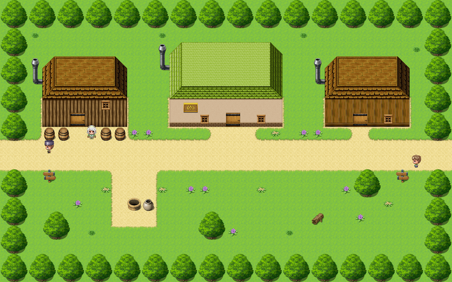

# Gladhollow

This article is about the small town in the far south-west. For welcoming in general, and the people who do it at the gates of towns, see the <a href="../Cliches/">Glossary of Cliches</a>.

<table class="infobox">
<caption>Gladhollow</caption>
<tr><td colspan="2" class="infobox-image">Gladhollow, from above</td></tr>
<tr><th>Known as</th><td>Gladhollow (welcome to it)</td></tr>
<tr><th>Where</th><td>The far south-west, a gate at each end</td></tr>
<tr><th>Mayor</th><td>A. Podmore</td></tr>
<tr><th>Official Welcomer</th><td>West gate. One copper a day</td></tr>
<tr><th>Farewell Boy</th><td>East gate. A copper and a half</td></tr>
<tr><th>Arms</th><td>Two crossed swords. (Welcome)</td></tr>
<tr><th>The key</th><td>Under the pot. Of course it is</td></tr>
<tr><th>Best kept plant</th><td>Eleven years running. The only entrant</td></tr>
<tr><th>Heroes</th><td>Please, no</td></tr>
</table>

<b>Gladhollow</b> is a small town of one street in the far south-west, with a gate at either end. At the west gate a boy says <i>Welcome to Gladhollow!</i>, and nothing else, because it is in his duties. At the east gate another says <i>Farewell from Gladhollow!</i> and <i>Mind how you go.</i> In between, the town has had a great many heroes through it, and has learned to lock its doors.

## The Welcomer

The council's notice at the west gate reads: OFFICIAL WELCOMER (WEST GATE). ONE COPPER A DAY. DUTIES: TO SAY "WELCOME TO GLADHOLLOW!" AND NOTHING ELSE. The paper has been read so often it has gone as soft as cloth. In the margin, in pencil, somebody has been keeping a count.

The Welcomer in the year 2000 was **<a href="../People/Toby_Wendle">Toby Wendle</a>**, ten, with a saucepan on his head, which rings like a bell when you walk into him. He does not fall over. He has had a great deal of practice. He straightens the saucepan, takes a deep breath, beams, and says *Welcome to Gladhollow!*, and there is no rest of it, and he is delighted.

He is not allowed a second sentence, so he has worked on the first, and has fifteen ways of saying it. The list is on his kitchen table, headed FIFTEEN WAYS, and I have it from the Forty-Eighth, who heard all of them, in order: the Standard; the Formal, a bow so low the saucepan falls off, caught without looking; the Whisper, for people who look tired; the Song, on three notes going up, the last a little beyond him, and he goes anyway; the Salute, with the handle of the saucepan; the Surprised; the Slow One, one word at a time, for anybody from abroad, which the job description does not mention, and he checked; the Dramatic Pause; the Rainy Day, with the saucepan held over your head, for practice; the Very Loud, for people on horses; the Sorry, for people who have walked into him, with a touch of the plaster on his cheek; the Tour, turning slowly on the spot and pointing at every building, at the mayor's house rather longer than the others; the Evening, hushed and golden, which he could not wait for; the Classic, which is exactly the same as the first, and he is extremely pleased with it; and the fifteenth, which was not finished, and which he tried anyway, going up at the end, *Welcome to Gladhollow?*, and looked anxiously to see whether a question counted as a second sentence. It was decided that it did not. He wrote something on the back of his hand.

Asked about the town, he will say *Welcome to Gladhollow*, with his eyes on the mayor's house, and both hands flat beside him, pushing, like somebody sliding a very heavy bookcase aside. His eyes then go to the well, and to the pot beside the well, and to the well, and to the pot, and then, very innocently, to the sky. Then he points at his granny's barrels, and at his granny, and puts a hand on his heart. He has said nothing. It is all in the duties.

## The town

**Granny Wendle**'s barrels stand outside her door, and every hero who comes through has the potions out of them. She does not mind. They are very good potions. She would like them back, though. They are for her knees. Each one is rolled up in a stocking in the straw, with a label sewn in, PLEASE RETURN TO MRS WENDLE, GLADHOLLOW. Her front door is locked, because there is nothing in there but her good china, and she has met heroes: every pot off the dresser and smashed on the floor before she had the kettle on, looking for coppers. There is never coppers in a pot. Ask anyone. The Forty-Eighth gave her a potion back, and she said that was Tuesday's knee sorted.

**The end house** has a card in the window: NO HEROES, PLEASE. THERE IS NOTHING IN THE CUPBOARDS, NOTHING IN THE BARRELS AND NOTHING UNDER THE BED. WE HAVE CHECKED. SO HAVE THE LAST NINE OF YOU. Through the window every cupboard is open, and every one has a card in it saying NOTHING HERE. They have planned for you.

**The well** has its lid padlocked shut, and beside it an old clay pot, and under the pot is the key. Of course it is. The water is cold and clear and tastes faintly of stone, and you put the key back.

Through one window an old man is asleep in a chair with a newspaper over his face, and the headline says HERO PASSES THROUGH. It has been the headline for some time. By the road there is a log with WELCOME carved into one end and FAREWELL into the other, by two boys with one penknife.

## The Farewell Boy

At the east gate the Farewell Boy in the year 2000 was **Ned**, Toby's brother, slightly bigger, with his hair brushed very flat for the job, and he had clearly been waiting for somebody to leave. His duties are two sentences, and he was paid a copper and a half. When the Forty-Eighth asked him about the boy at the west gate he said *Farewell from Gladhollow! That's our Toby*, and had spent his second sentence on his brother, and did not look as if he minded at all.

Under the notice was pinned VACANCY SHORTLY. APPLICATIONS TO THE MAYOR, and under that an application, pinned up so that everybody could see it. It was one sentence long.

## The mayor's house

The mayor's house has a bookcase full of the town council's minutes, going back a very long way, with one volume sticking out further than the rest. If you pull it the bookcase swings out on a hinge, and behind it there are steps down, and at the bottom there is a room. I describe what is in it because the town has asked me to, now.

There is a ledger headed T. WENDLE, WELCOMER: a copper a day, in one column, going back years, and in the next column, in the mayor's hand, another copper from the council for every one he has saved. He has saved every one. At the bottom, underlined twice: DO NOT TELL TOBY. Under that, in pencil, in a much rounder hand: *I havent.* There is a bag of coppers tied at the neck, labelled FOR THE UNIFORM, a good deal heavier than a copper a day. There is a cap on a stand, blue with white piping, brand new and much too small for anybody but one person, and the label inside says FAREWELL BOY, and somebody has written TOBY under it, and somebody else has crossed that out because it was not official yet, and then written it in again, smaller. On the desk the mayor had left a note: GONE TO SEE ABOUT A FITTING. BACK AT FOUR. - A. PODMORE, MAYOR. The town map has a very small boy drawn in pencil at each gate.

The council's minutes record that the Welcomer is to say *Welcome to Gladhollow* and nothing else: carried, nine to nil, with one abstention, in pencil, T. WENDLE (AGED SEVEN).

## Since the Quest

Toby Wendle has been Farewell Boy since the spring of 2001, in the cap, which fits. He has two sentences now, and uses both of them with enormous care, and I am told that *Mind how you go* is said fifteen different ways. There is a new Welcomer at the west gate, a girl of eight, who has been given the saucepan, and has been told that she may say *Welcome to Gladhollow!* and nothing else, and has asked Toby how he managed, and he has not told her, because it is not in his duties. He has given her the list.

The potted plant in the mayor's house has won BEST KEPT PLANT, GLADHOLLOW, eleven years running, and is the only entrant, and is very modest about it. It has won twice more since. The mayor says that this is a matter of record, and that I may print it.

## See also

- <a href="Olde_Evermore">Olde Evermore</a>, to the north
- <a href="Restwell">Restwell</a>
