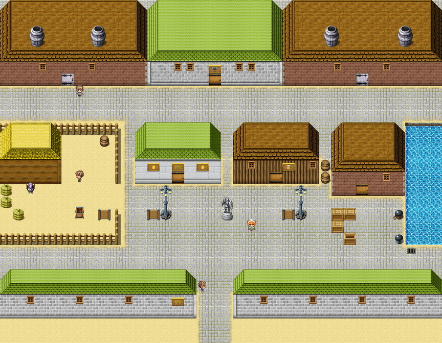

# Great Dunnage

This article is about the town inside its wall, its halls and its warehouse. For the works up the valley, which Great Dunnage would like you to know is only one works, see <a href="Upper_Clanging">Upper Clanging</a>. For the Smiths, see <a href="../Institutions/The_Worshipful_Company_of_Smiths">The Worshipful Company of Smiths</a>.

<table class="infobox">
<caption>Great Dunnage</caption>
<tr><td colspan="2" class="infobox-image">Great Dunnage, inside its wall</td></tr>
<tr><th>Known as</th><td>The Corporation of Great Dunnage</td></tr>
<tr><th>Where</th><td>In the west, inside its own wall, on the cut, eleven miles down the valley from Upper Clanging</td></tr>
<tr><th>Arms</th><td>An anvil, a bell and a key</td></tr>
<tr><th>Motto</th><td><i>Quis similis nobis?</i> Who is like unto us? The Corporation has looked into it</td></tr>
<tr><th>Works</th><td>Nine, and the Other Nail Works</td></tr>
<tr><th>Mayor</th><td>Gristwood, in the most hat you have ever seen</td></tr>
<tr><th>First Mayor</th><td>Alderman Josiah Dunnage, in allegorical armour. He sold nails</td></tr>
<tr><th>Counting House</th><td>Sealed 1788. Opened informally 2000. Form L incomplete</td></tr>
<tr><th>Anthem</th><td>Nine verses, to be sung standing. Verse two is the same, but more</td></tr>
<tr><th>Haulage</th><td>Plummer &amp; Partner. The partner is the grey</td></tr>
</table>

<b>Great Dunnage</b> is the largest town in the west, a walled works town on the canal with nine works inside its wall and a Corporation that is very proud of every one of them. It has never heard of you. Nobody is too busy for Great Dunnage; they only think they are.

## The gate

Over the gate, on a gilded board, are the arms of the Corporation: an anvil, a bell and a key, done so small and so gold that from the road they look like a flourish. The key is the key to the Counting House. It is the only one the town still has, and it is painted on a board. Under the arms is the motto, QUIS SIMILIS NOBIS? Who is like unto us? The Corporation has looked into it.

In the gateway, in the Corporation's blue coat, stands a **watchman** who has been asked to be impressive and is doing his best. He asked the Forty-Eighth his name and business. <a href="../People/Bram_Thistle">Bram</a>, of <a href="Thistlewick">Thistlewick</a>, Chosen One number forty-eight. Forty-eight what? Thistlewick: that's the <a href="../History/The_Prophecy_of_Thistlewick">Prophecy</a> people, down south. Charming. He wrote in his ledger BRAM (THISTLEWICK) - PROPHECY, SOME SORT, and let him in, and told him to mind the carts, mind the canal, and mind the Mayor. He is the only person I have found in the whole of this history who had never heard of the Forty-Eighth, and the Forty-Eighth says that it was the most restful conversation of the year.

## The town

In the square stands a statue of a knight in full armour with a sword and a shield: ALDERMAN JOSIAH DUNNAGE, FIRST MAYOR. ERECTED BY THE CORPORATION, TO THE CORPORATION'S OWN DESIGN, AT THE CORPORATION'S EXPENSE, IN HONOUR OF THE CORPORATION. Under it, smaller: THE ARMOUR IS ALLEGORICAL. ALDERMAN DUNNAGE SOLD NAILS.

The Nine Works of the Corporation are listed on a board: the Dunnage Iron Company, the Bell Foundry, the Nail Works, the Chain Works, the Wire Works, the Anchor Works, the Screw Works, the Brass Works, and the Other Nail Works. Along the bottom, smaller: SEE ALSO UPPER CLANGING - A WORKS, UP THE VALLEY. The anthem is posted beside it, to be sung standing, all nine verses, on the Mayor's Day: *Great Dunnage! Great Dunnage! Nine chimneys, and more! We make what they make up at Clanging, but more.* Verse two is the same, but more. **Mrs Poskitt** went up to Upper Clanging for the day once, and says you would love it: only the one works, and they all know each other, which she thought was ever so sweet. Great Dunnage is like that, but nine times.

The foundry gate has a board wired to it: NO VISITORS. THE CRUCIBLES ARE NOT MIMICS. THE MOULDS ARE NOT MIMICS. NOTHING IN HERE IS A MIMIC. PLEASE STOP HITTING THINGS TO CHECK. The Iron Company's gate says NO ADMITTANCE EXCEPT ON BUSINESS, and under it, newer, HEROES ARE NOT BUSINESS. Somebody has had a hero in, once. On the quay the crates are stencilled GREAT DUNNAGE - TO ALL PARTS, and smaller, (MOSTLY SUMP). A barrel with the Corporation's seal on it is dated 1788 and says EMPTY, like everything else in Great Dunnage that was sealed in 1788.

At the Iron Company's gate, in the year 2000, was **<a href="../People/Cotter_Cotterill">Cotter Cotterill</a>**, eldest of the <a href="../People/The_Cotterills">Cotterills</a> of Upper Clanging, on the big furnace till the spring and then home for good. He went home every Saturday, off at six, eleven miles up the valley, and back down for the Monday. Twenty-two miles, for one night. He is always very glad to get home. He has been home since the spring of 2000, for good, and the heel-irons <a href="../People/Hob_Grumnir">Hob</a> made him are on his boots still.

## Plummer & Partner

In the haulage yard in the north-west corner, **<a href="../People/Mr_Plummer">Mr Plummer</a>**, a broad man with a moustache, does anything, anywhere, by Tuesday, with his partner, who is the grey. She walked in off the west road one winter, on her own, with a good saddle on and nobody in it. Nobody came for her, so she stayed. She is the best worker in the yard, knows every road in the valley, has a stall with her name on it and a say in the routes, and plans the Tuesdays. Her name is **Duchess**; there was a crest on the saddle, and it seemed to suit her.

The crest was a knight in a field, looking back over his shoulder. It was Sir Aldric Pemberton-Gore's saddle, and she was his horse, whom he had tied up in a village with a sign six years before, and gone to find the gate. He only ever called her Horse. He crossed the yard to her, slowly, and she put her nose into the front of his tabard, where it always went, and breathed out. Mr Plummer said that she would be his, of course, saddle and all, only she did the canal run, and the Tuesdays. <a href="../People/Sir_Aldric_Pemberton-Gore_III">Sir Aldric</a> looked at her, and said, *Oh, no. No, no. Look at her. She is doing so well.* The sign inside the yard gate now reads PLUMMER &amp; PARTNER. HAULAGE. (THE PARTNER IS THE GREY.) And under that, newer, very neat: (HER KNIGHT CALLS. NOT TUESDAYS.)

## The Counting House

The Counting House is mostly door: bronze, a good deal taller than a man, with a lock in the middle the size of a cartwheel. It was sealed in 1788, when the key was lost, and the town has been run since on a memorandum, framed beside it: THAT, the Counting House being sealed, the accounts of the Corporation be taken as read; and THAT the Corporation be assumed to have enough. Carried unanimously.

It was to be opened formally, by a licensed person, with the preamble read in full. A licence is issued on completion of Form L, *An Application by a Licensed Person to Open the Counting House*, to be completed by the licensed person and countersigned by a licensed person. There are no licensed persons. The Town Clerk's book of applications to open the Counting House goes back two hundred and twelve years, and every one is marked DECLINED - FORM L INCOMPLETE, and the clerk who wrote the first one also designed Form L. **<a href="../People/Mayor_Gristwood">Mayor Gristwood</a>** had the preamble ready. It took forty minutes, and he was down to thirty-eight.

In the year 2000 Nix, who locates things, and says that doors are things, put an ear to the lock and did something small with two fingers, and it took nine seconds, and the Door stood open while the Mayor was still on *mindful*. That was not the Opening. The Counting House is opened informally; the Opening proper will follow on completion of Form L. Form L is still blank, and in law the Counting House has never been opened.

Behind the Door there was one room, and one chair in it, and on the chair a note, and under the note, very neatly stacked, a little money: WE SPENT IT. J. POCKLINGTON, CLERK TO THE CORPORATION. 1788. Two hundred and twelve years the Corporation had been assumed to have enough, on the strength of a chair. It is, to be fair, a very good chair. The Mayor sat down on it, as the first Mayor to do so. The money came, when counted, to one thousand seven hundred and eighty-eight crowns, which nobody can explain, and the Mayor said it was not the Corporation's, because the memorandum says they have enough. Nix asked its provenance, and was told none whatever, and wrote that down. The Mayor read the preamble to the chair, in full, twice. He has since been composing a shorter one.

## The Smiths' Hall

The Worshipful Company of Smiths of Great Dunnage holds its Assize of Hammers every three years, at which every smith in the land may submit one piece, to be judged by the Wardens against the Schedule. Very few manage to submit one. It is a very good Schedule. **<a href="../People/Prime_Warden_Stannard">Prime Warden Stannard</a>**, a tall woman in black with iron-grey hair and gold at her collar, stands at the Company's table as if it might try something. **Warden Crabbe**, Junior Warden, reads the Schedule out at the Assize, all forty-one clauses, and it takes most of the day. People ask why they don't just pin it up. They do. He reads it out as well. **Miss Fettle**, Appraiser, in round spectacles, looks at swords the way other people look at sunsets, and always asks after the tang. She does not charge for tangs. She also does curses, elective, on Form C-1, in triplicate, the economy one lasting till you next sleep in a proper bed. They are mostly paperwork.

The Schedule's first two clauses are that a piece shall be the entrant's own work, from the ore up, and the entrant's own property. Hob Grumnir has never owned anything he made; somebody wants a thing, and he says take it, and there is a shelf for the invoicing. In the year 2000 he asked eleven people for one thing back, for the spring, and every one of them said no, with a better reason than his. He laid Beatrice on the Company's table instead. She was disqualified, under clause one, not being his own work, and passed clauses two to forty-one, and the Wardens' notes are pinned up beside the prize piece of the last Assize, which is a very good hinge:

BEATRICE. A hammer. From H. Grumnir, Thistlewick. Clause one: not satisfied. Two to forty-one: satisfied. DISQUALIFIED. Remarks: in the Wardens' opinion, right about everything.

Hob said that she would be unbearable, and that he would not bother entering again, because he had had what he came for.

The hall is worth seeing for itself. The Company's shield reads STRIKE WHILE IT IS HOT, and under it, AND THEN LET IT COOL. WE ARE NOT ANIMALS. The banners read BY HAMMER AND HAND, and under that, in chalk, AND BY SCHEDULE. An apprentice's examination armour has a note pinned to it: PASSED. ONE ELBOW BACKWARDS. The prize shield of 1987 is <a href="../People/Bryd_Ollerenshaw">Bryd Ollerenshaw</a>'s, BEST IN HALL; Hob did not enter in eighty-seven, because he had a cold, and would have won. Another suit of armour has a card in Warden Crabbe's handwriting: ENTERED FOR THE PRIZE BY A SMITH WHO WISHES TO REMAIN ANONYMOUS.

## The Bell

The Bell is an inn where the panel for the Contest at the Sign of the Bell eat, and they cannot help it; they mark the soup. **Mrs Dewhirst** keeps it, a room is fifteen crowns, and you will be judged at breakfast. Breakfast, the morning the Forty-Eighth stayed, got a seven. **<a href="../People/Mrs_Harbottle">Mrs Harbottle</a>**, in gold lace, chairs the panel, which practises on everything between contests: the fire was a six; the door was a four, because it creaks in the wrong key. **Mr Ambler** gives everything a nine, and cannot hear, and nobody has ever had the heart. **Miss Quayle** gives everything a two. It averages out.

The Contest is always tonight; it has simply not had the entries. In the year 2000 it had four: <a href="../People/Septimus_Dray">Mr Septimus Dray</a>, Instrumental (Other Wind), on the serpent, for eleven minutes, very like a drain that has had bad news; <a href="../People/Lettice_Moon">Miss Lettice Moon</a>, Ballad (Sad), fourteen verses, everybody dies, including the narrator, who comes back for the chorus; <a href="../People/Mr_Tweddle">Mr Tweddle</a>, Birdsong (Open), whose thrush that had lost its keys went looking for them all round the room and found them, and drew a three from Miss Quayle, at which the room gasped; and <a href="../People/Piper_Quill">Piper Quill</a>, Ballad (Not Sad), which nobody had ever entered. She came second, by one point, to the thrush. Her article has it.

There is also a snug at the Bell, which in the year 2000 was booked in the name of Mr Fairweather, for eleven minutes, as a standing appointment. What was said in it is not mine to print, and I have not.

## The Bonded Warehouse

On the quay is the Bonded Warehouse, kept by **<a href="../People/Mr_Tibbs">Mr Tibbs</a>**, wharfinger, in half-rimmed spectacles. Nothing out without the ticket, and the duty, and him. Brandy, iron, cloth, and a piano from abroad, the wrong way up in a crate marked THIS WAY UP, on which the duty is more than the piano. The bonds are numbered, and are a history of the town in themselves. No. 2, one statue of the First Mayor, actual size, duty on the hat. No. 7, ten thousand buttons, all different, declared as one button, repeated. No. 9, a ship in a bottle; the ship is full size; the bottle is not described. No. 11, fog, one barrel, from <a href="Nether_Sopping">Nether Sopping</a>, duty paid in advance by Nether Sopping, to be rid of it. No. 23, spare keys for the Counting House; the crate is empty, which explains a great deal. No. 31, rain, one barrel, returned by Upper Clanging as second-hand. No. 40, one cabbage, very large, *for the show*. The show was in 1802. Nobody has been brave enough to check on the cabbage.

Bond No. 1 was a tall wardrobe, locked, the only thing in the warehouse that was: ONE COAT. HELD. RENT PAID TO DATE. The Bond Book had a date for it, and the word *coat*, and nothing else, and for eleven years the rent came by post every quarter, never late, no name. The coat was collected in the year 2000, by the party of the second part, and it fits. The Bond Book's first entry has a name now. It is in <a href="../People/Nix">Nix's article</a>, as much of it as she will allow, and Nix walked a long way round to avoid that door before she went through it. The rent has stopped coming. Mr Tibbs says he misses it, a little, every quarter day.

## The Bottom Lock

At the end of the basin, where the cut goes out under the road, is the bottom lock. In the spring of 2000 it jammed, with thirty of the Iron Company's boats sat on the cut, because something was on the paddle down in the culvert, and the Canal Company sent in their smallest man, and he did not come out. A man does not fit. <a href="../People/Spare_Cotterill">Spare Cotterill</a> fits. He checked that his jumper was on, because those are the terms, and gave the Forty-Eighth his bag to hold, and asked whether they would be there, and was told yes, and went down a ladder into a square black hole in the brickwork about the size of a nine-year-old. He was not frightened of the dark. He came out, and the man came out, and the paddle was cleared, and everybody was there. Spare's article has it, as he tells it, which is to say very briefly.

I asked the watchman at the gate, when I wrote for this article, whether he had heard of the Forty-Eighth now. He wrote back that he had looked in his ledger, and that he had a BRAM (THISTLEWICK) - PROPHECY, SOME SORT, in the spring of 2000, and that he was very welcome to come again, and to mind the Mayor.

## See also

- <a href="Upper_Clanging">Upper Clanging</a>, eleven miles up the valley
- <a href="../Institutions/The_Worshipful_Company_of_Smiths">The Worshipful Company of Smiths</a>
- <a href="../People/Nix">Nix</a>, for the coat
- <a href="../People/Hob_Grumnir">Hob Grumnir</a>, for Beatrice
- <a href="Carn_Drey">Carn Drey</a>, east of the town
