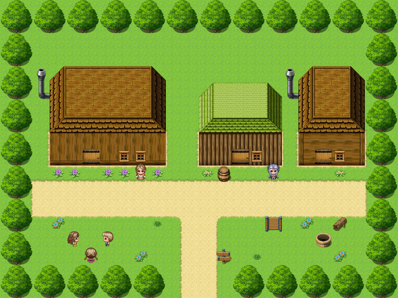

# Little Gore

For the elegy on the fingerpost, see <a href="../People/Piper_Quill#the-elegy">Piper Quill</a>. For the invitation, see <a href="../People/Sir_Aldric_Pemberton-Gore_III">Sir Aldric Pemberton-Gore III</a>. For the big house four miles off, see <a href="Fenmarch_Hall">Fenmarch Hall</a>.

<table class="infobox">
<caption>Little Gore</caption>
<tr><td colspan="2" class="infobox-image">Little Gore, from above</td></tr>
<tr><th>Known as</th><td>Little Gore</td></tr>
<tr><th>Where</th><td>The south-east, four miles from Fenmarch, which round here is the same as a long way from anywhere</td></tr>
<tr><th>Population</th><td>Eleven, and a cat, and some more since</td></tr>
<tr><th>Knight in the field</th><td>Dame Winifred Cope, of the <a href="../Institutions/The_Order_of_the_Errant">Order of the Errant</a></td></tr>
<tr><th>Reports</th><td>Nothing to report. Quarterly</td></tr>
<tr><th>Banns</th><td>Hester Plumb and Thomas Vane. Third time of asking</td></tr>
<tr><th>Invitations</th><td>Followed</td></tr>
<tr><th>Carrier</th><td>Abel Thrush, 1941 - 1991. He walks it still</td></tr>
</table>

<b>Little Gore</b> is a hamlet of a few houses round a green in the south-east, on a sandy road four miles from <a href="Fenmarch_Hall">Fenmarch</a>. Eleven years ago its whole population walked to Fenmarch in the rain for a wedding nobody had invited them to, because nobody had told them not to. The invitation arrived in the year 2000. It is on the mantelpiece.

## The green

**<a href="../People/Hester_Vane">Mrs Hester Vane</a>**, in the front garden of the nearest house, is plainly delighted to see anybody. She has been to Fenmarch, and that is the furthest; she was married there, eleven years ago this summer. The whole of Little Gore walked over for it, all eleven of them, in their best, and it rained the whole way, and nobody minded at all. Her husband **Tom** is in the gardens at Fenmarch, and walks it every day, four miles there and four back, and says it is the best part.

On the green, three children play weddings. **Bess**, with a daisy chain on her head, is the bride, or Mum; it is the same thing. **Alfie**, with his hair wetted flat, is Dad, and has to stand there and look pleased, and Dad says that is the whole job. **Nell** is everybody else: the whole of Little Gore, half of Fenmarch, the vicar, the rain and the cake. Mrs Vane asks visitors to mind them, because they will marry you if you stand still. A log by the green has a row of daisies laid along it very carefully; they are the pews. A barrel of confetti is labelled FOR THE NEXT ONE, and there is confetti on the barrel, the step, the cat and the vicar.

**The banns** are on the board by the post, older than all the other notices and very carefully kept out of the rain: BANNS OF MARRIAGE between HESTER PLUMB, of this parish, and THOMAS VANE, of the parish of Fenmarch. Third time of asking. Pinned under them, on a card gone brown at the edges: INVITATIONS TO FOLLOW. Round them, newer, are three notices of births, a year or two apart, each with a drawing of a very round baby in the corner.

## The invitation

The invitation was in Sir Aldric Pemberton-Gore's tabard. His father gave it to him the morning he rode out from Fenmarch in 1991, to carry four miles to Little Gore as his first errand: deliver this, and then you may go errant. He went errant for nine years, and did not deliver it. In the year 2000 he read the banns over the Forty-Eighth's shoulder, and the card under them, and went a colour, and said *Invitations to follow. I am the invitations.*

Whether he then set out for Little Gore the long way, by the coast and a lay-by in the far west and <a href="Frostwick">Frostwick</a> and the Fenmarch road twice, in different directions, both times on purpose, and came over a rise on the third evening and said THERE, told you I knew the way, or whether somebody pointed at the fingerpost, which said LITTLE GORE, is a matter on which the company differ, and I have not tried to settle it. Either way it was a very good way, and nobody would change a mile of it.

He took off his helmet, which nobody had seen him do, and held out the letter in both hands. SIR ALDRIC PEMBERTON-GORE THE SECOND REQUESTS THE PLEASURE OF THE PARISH OF LITTLE GORE AT THE WEDDING OF HESTER PLUMB AND THOMAS VANE, AT FENMARCH. Mrs Vane opened it on the doorstep, with the children round her, and said *It's my wedding*, and he said that it was, and that he did apologise, it was his first errand. She said that they had all come anyway, and that now they were invited properly, and it was going on the mantelpiece, and Bess was to fetch the good pin. It is there now, propped against the clock, where you can see it through the window from the road. Under INVITATIONS TO FOLLOW, in a fresh hand, very neat: FOLLOWED. (P-G.)

He stopped for tea. He said that he might not find his way out afterwards. Mrs Vane said that then he would stop for supper.

His nephew, the Fourth, came up the sandy road at a run that afternoon, and has been three paces behind him ever since. See the <a href="../People/Sir_Aldric_Pemberton-Gore_III">article on Sir Aldric</a>.

## Dame Winifred

**<a href="../People/Dame_Winifred_Cope">Dame Winifred Cope</a>** of the Order of the Errant stands outside her own front door as if it were a post. She is the Chapter's knight in the field at Little Gore, and has been since 1989, and there is a pin in her at <a href="Coldbarrow">Coldbarrow</a>, just the one. She is here; that is the whole of it. Somebody has to be where the pin is, or what is the map for? She writes every quarter, NOTHING TO REPORT, and they write back, VERY GOOD, and she says it is the nicest correspondence she has ever had. Her door has a card in the Order's lettering, KNIGHT IN THE FIELD. DO NOT DISTURB, and she is standing four feet from it, and as far as the Chapter is concerned that is the field.

Her helmet is good and plain, with a small G stamped inside the brim, and is <a href="../People/Hob_Grumnir">Hob Grumnir</a>'s. He asked whether he might borrow it back, for the spring. She said that she was in it. That turned out to be the whole of her reason, and it was a very good one.

Sir Aldric has called her a very fine post, and has said that she is happy, and that he honours her. She says that is very kind, and that there is still nothing to report.

## Abel Thrush

The fingerpost on the green points one arm at the houses, LITTLE GORE, and the other back down the road, FENMARCH 4 MILES, and there are a great many initials carved into it, and a heart round two of them, eleven years deep.

On the back of it, from 1991 until the year 2000, there was a card, gone soft with weather: WANTED: AN ELEGY. For ABEL THRUSH, carrier, who walked this road fifty years and never had one. Something with a bit of a tune. The parish will pay. Ask anybody. Piper Quill asked anybody, eleven of them, in Little Gore, Fenmarch and <a href="Sump">Sump</a>, and every one described a different man, and she wrote the elegy out of all of them, and pinned it under the Fenmarch arm. It is there now, under a little roof somebody has made for it, and people stop and read it on their way past. It is printed whole in <a href="../People/Piper_Quill#the-elegy">her article</a>. Little Gore's own contributions to it were that he never spoke a word, that he read no letter and knew them all, that he carried a cow to Fenmarch once because it would not walk, that he could whistle with two fingers so that you could hear it at Sump, and that he brought the letter round the green.

I have not been to Little Gore. Mrs Vane wrote to me, when she heard I was writing this, to say that I should be very welcome, and that it was only four miles from Fenmarch, and to mind the children, who would marry me if I stood still. She enclosed a drawing by Nell, of the wedding, with all the hats much bigger, and a man in armour at the back, holding a letter, very late.

## See also

- <a href="Fenmarch_Hall">Fenmarch Hall</a>
- <a href="Sump">Sump</a>, the other end of the carrier's road
- <a href="Coldbarrow">Coldbarrow</a>, where Dame Winifred's pin is
