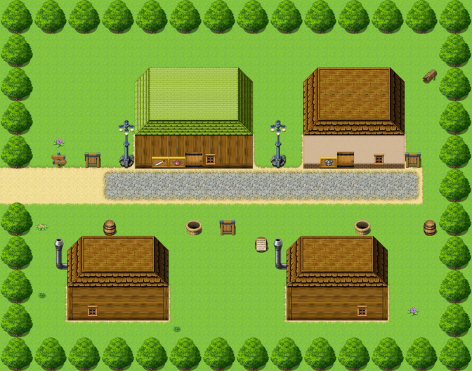

# Penultima

For the sword in the window, see <a href="../Artefacts/The_Sword_of_Ultimate_Ending">The Sword of Ultimate Ending</a>. For the actual last shop, see below; it is closed.

<table class="infobox">
<caption>Penultima</caption>
<tr><td colspan="2" class="infobox-image">Penultima, the last town but one</td></tr>
<tr><th>Known as</th><td>The Last Town Before The End</td></tr>
<tr><th>Where</th><td>On the road north, just short of the Tower</td></tr>
<tr><th>Signs</th><td>LAST CHANCE FOR POTIONS (WE MEAN IT)</td></tr>
<tr><th>Rates</th><td>Seasonal</td></tr>
<tr><th>Season</th><td>All of them</td></tr>
<tr><th>Wells</th><td>Two. One crown a bucket; half a crown at the other, tell nobody</td></tr>
<tr><th>Twinned with</th><td>Nowhere. There is nothing to be twinned with</td></tr>
<tr><th>The last shop</th><td>Ye Final Shoppe</td></tr>
<tr><th>The actual last shop</th><td>Closed for the season</td></tr>
</table>

<b>Penultima</b> is a small town on the road north, the last before the <a href="The_Obligatory_Tower">Obligatory Tower</a>, which lives on the fact. Every Chosen One in living memory has come through it on the way up, with a hundred years' savings in his purse and no other shop in front of him, and Penultima has priced accordingly. It is not dishonest. It is seasonal.

## The town

The sign is a board, repainted often, in gold: PENULTIMA. THE LAST TOWN BEFORE THE END. Underneath, smaller and newer: LAST CHANCE FOR POTIONS. Underneath that, smaller again and newest: (WE MEAN IT).

When a Chosen One comes into the street, a bell rings once, briskly, the way a shop bell rings, and along the street, unhurried, several shopkeepers turn over several small cards. Nobody looks at him while they do it. A man on a ladder hangs a fresh board over the old one. The old one said SUMMER RATES. The new one says SEASONAL RATES. When the Forty-Eighth came through it was the twelfth of November. The bell does not ring twice for the same customer. There would be no point.

Everything in Penultima is the last of something. The well is the LAST WELL BEFORE THE END, ONE CROWN A BUCKET, SEASONAL; the other well across the street is the LAST WELL BEFORE THE END (THE OTHER ONE), HALF A CROWN, TELL NOBODY. There is a LAST LOG at the top of the town, priced. There is a barrel with a price on it, and it is empty, and the price is for the barrel. There is another barrel with a card on it, THIS BARREL HAS BEEN SEARCHED BY A CHOSEN ONE, and in Penultima that is a selling point, and it is priced accordingly. Through one window a family is at its supper, and there is still a price tag on the teapot; they stopped noticing years ago. Through another a man is counting his money very slowly, for the pleasure of it, and then counting it again.

Pinned to a barrel under glass is the parish notice: PENULTIMA IS TWINNED WITH NOWHERE. THERE IS NOTHING TO BE TWINNED WITH. WE HAVE WRITTEN TO THE TOWER TWICE.

The Tower has a correspondent now, and I asked him whether he had had Penultima's letters. He wrote back that he had, both of them, and had not known what to say, and was sorry, and that he was told the potions were very good.

## Ye Final Shoppe

YE FINAL SHOPPE - LAST SWORDS FOR TWO HUNDRED LEAGUES. Chalked under it: LAST POTIONS. Under that: LAST SPOONS. Under that: LAST CHANCE TO BUY A SPOON, REALLY, THINK ABOUT IT. It also does a final cup of tea, at a price which is also final.

It is kept by **<a href="../People/Gideon_Markup">Gideon Markup</a>**, who welcomes you, and asks what you are buying, and, when you say that you have only just come in, says of course, of course, take your time, everything is priced, everything has always been priced. Asked about the prices, which are high, he says *seasonal*. He has been in the trade thirty-three years, and it has been seasonal every one of them. It is a very reliable season. The shop buys at one crown and sells at forty, and asks you about its warranty. There is no warranty. Asking about it is free.

Some of the stock deserves a mention. Forty potions, each labelled LAST POTION. Rope, sold by the yard, priced by the inch. Two jars side by side, each labelled UMBRELLAS - THE LAST ONE. FINAL WINE, under which Mrs Markup has written (IT IS NOT. WE HAVE A CELLAR.). A crate of things bought at a crown each, among them half a potion; Gideon is waiting for somebody who needs exactly half a potion, and is sure they are on their way. A book, HOW TO HAGGLE, marked NOT FOR SALE. A gilt case with the first crown the shop ever took, NOT FOR SALE, and under it, smaller, (OFFERS). A case of rings, each tag reading MAKE AN OFFER, except one, under which Gideon has written (NOT THAT ONE). It is a plain gold band, old, and very well polished.

In the window, behind a velvet rope, is a sword and a shield, polished every morning. The card reads THE SWORD OF ULTIMATE ENDING. 9,999,999 CROWNS. Gideon priced it in 1969. Asked whether sir might hold it, he says, warmly, that sir cannot afford to hold it. He has said it to everyone who has ever come through that door, and he is not going to stop now.

**<a href="../People/Dorothy_Markup">Dorothy Markup</a>** keeps the ledger, and every page balances, and in the margin of every page, very small, is G. WAS HONEST TODAY, a few of them with a question mark. He brings her tea every morning, and then he does the window, and has never once in thirty-three years had to be asked. He has never sold the sword. He has given one discount, in thirty-three years, of eleven coppers, off a lamp, to a girl who would not stop haggling. The first volume of the Markup accounts opens with it, in his hand: DISCOUNT - ELEVEN COPPERS - WORTH IT. She has ruled round it twice. She has still got the coppers.

## Ultimate Outfitters

Two hundred yards up the street is a good shop front, boarded, with the paint still sound: ULTIMATE OUTFITTERS - THE ACTUAL LAST SHOP. A painted hand points confidently up the road, TWO HUNDRED YARDS FURTHER ON. Two hundred yards further on there is the road, and then the hills, and then the Tower. There has never been anything else. Through a crack in the boards you can see a shop exactly like Ye Final Shoppe, with everything in it priced at exactly one crown less. A card in the window, in a different hand, has been there some years: THANK YOU PENULTIMA FOR NINE WONDERFUL MONTHS.

## Since the Quest

The road north has fewer Chosen Ones on it than it had, there being no clause twelve, and Penultima has noticed. It has not changed its prices. It does a good trade in people going up to see the chair, who need something for the walk, and in people coming down, who need something to say they went. The sign has a fourth line now, smaller than the third: LAST CHANCE FOR A SOUVENIR.

## See also

- <a href="The_Obligatory_Tower">The Obligatory Tower</a>, two hundred yards further on, and then some
- <a href="../Artefacts/The_Sword_of_Ultimate_Ending">The Sword of Ultimate Ending</a>
