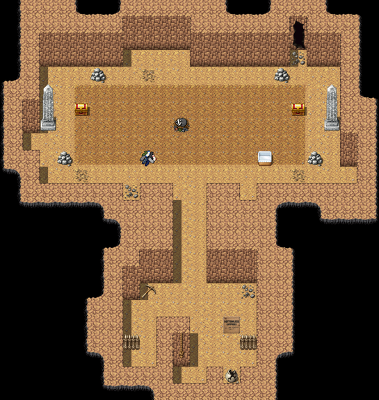

# The Bottomless Pit

For what lived at the bottom, see Miss Halloway's <a href="../Bestiary/">Bestiary</a>, where it is not called a Thing.

<table class="infobox">
<caption>The Bottomless Pit</caption>
<tr><td colspan="2" class="infobox-image">The Pit, from above. The bottom is not shown</td></tr>
<tr><th>Known as</th><td>The Bottomless Pit; a wonder of the district</td></tr>
<tr><th>Where</th><td>A hillside in the western hills, west of <a href="Thistlewick">Thistlewick</a>; <a href="Nether_Sopping">Nether Sopping</a>'s, by custom</td></tr>
<tr><th>Custodian</th><td><a href="../People/Fenwick_Splint">Fenwick Splint</a></td></tr>
<tr><th>Admission</th><td>2 crowns. Children, 1. Free, for ever, to one party</td></tr>
<tr><th>Refunds</th><td>None, re: depth</td></tr>
<tr><th>Depth</th><td>Four feet</td></tr>
<tr><th>Bottomless</th><td>Approx.</td></tr>
<tr><th>The step</th><td>There isn't one. That's the joke</td></tr>
<tr><th>Contents</th><td>Two hundred years of lost property, mostly eaten; socks, odd</td></tr>
</table>

The <b>Bottomless Pit</b> is a hole in a hillside in the western hills, with a hut, a rope and a turnstile, kept by its custodian, <a href="../People/Fenwick_Splint">Fenwick Splint</a>, as a wonder of the district. It is four feet deep. It is called the Bottomless Pit because "the Pit" is not a wonder of the district.

"Two crowns and you may look into the Bottomless Pit, which is a wonder of the district and, I'll be straight with you, four feet deep." Mr Splint says this to every visitor, and then he says to mind the step, and then he says that there isn't one, and that that is the joke, and that he does it every time. He does.

## The pit

At the bottom there is a painted board facing up at the visitors: BOTTOMLESS (APPROX.), and somebody has added, YOU ARE STANDING ON IT. There is a pickaxe, left by somebody who came down to dig for the bottom of the pit; they found it almost at once, and left in a hurry, embarrassed. There is a broken pot with one sock in it.

The town of Nether Sopping has been throwing things down the Pit, or losing them near it, for about two hundred years, and all of it has come to rest at the far end, where the pit goes back into the hill further than anybody expected. There is a drift of odd socks four feet deep, which is to say, as deep as the pit. None of them match. There is a hamper marked PROPERTY OF THE 39TH - DO NOT TOUCH. There is a picnic hamper with a note in it, BACK IN AN HOUR - H.V., in the same hand as the plaque under the wyvern in the <a href="The_Slain_Wyvern">Slain Wyvern</a>. Nobody came back for it. I do not know why, and I have not been able to find anybody who does.

## The badger

For forty years Mr Splint reported to the <a href="../Institutions/The_Adventurers_Guild">Adventurers' Guild</a> that something had moved in down the far end and was eating the lost property. Two hundred years of lost property, and it had *eaten* it. The Guild said that a badger was not a monster. He said, come and see the badger. They never came and saw the badger.

The Forty-Eighth's company came and saw the badger. It was the size of a hay cart, and asleep on a mattress of everything Nether Sopping had ever failed to come back for, and it opened one eye, and had a strong opinion. It left, at speed, up a slope nobody knew was there, and took one boot with it. It had earned the boot. Miss Halloway's notes on the badger, and on the other thing asleep in the crack in the north wall, which she says is the single most normal thing in the cave, are in the Bestiary.

"You've done it. You actually did it." Mr Splint looked into the pit for a while. He paid seven hundred crowns, which is a great deal for a custodian of a four-foot pit, and told them that admission was free for them now, for ever. "It's four feet deep and you're welcome in it whenever you like."

I paid my two crowns and went down, for this article. Mr Splint told me to mind the step, and that there wasn't one, and that that was the joke. I said that I had heard it was. He said that he did it every time, and that it had never been told to a historian before, and that he would like that noted. It is noted.

## See also

- <a href="Nether_Sopping">Nether Sopping</a>
- <a href="../People/Fenwick_Splint">Fenwick Splint</a>
- <a href="../Institutions/The_Adventurers_Guild">The Adventurers' Guild (Provisional)</a>
- <a href="../Bestiary/">The Bestiary</a>
