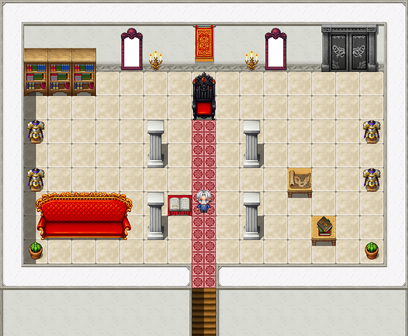

# The Former Premises

Contributed by P. Hollowell, Caretaker (retained)

I wrote to Mr Hollowell to ask whether I might describe the Former Premises, which I cannot visit, because the only way there is by air. He wrote back by return, eleven pages, offering to give me the tour in writing, since I could not come to it. It is printed here as he gave it. For the tower the engagement moved to, see <a href="The_Obligatory_Tower">The Obligatory Tower</a>. For the contract, see <a href="../History/The_Prophecy_of_Thistlewick">The Prophecy of Thistlewick</a>. - H.B.

<table class="infobox">
<caption>The Former Premises</caption>
<tr><td colspan="2" class="infobox-image">The hall, from above, with the lift</td></tr>
<tr><th>Known as</th><td>The venue; the castle on the cloud</td></tr>
<tr><th>Where</th><td>The sky, above the southern sea</td></tr>
<tr><th>Built by</th><td>Malagant the Provisional</td></tr>
<tr><th>Means of support</th><td>As before</td></tr>
<tr><th>Access</th><td>By air. That was rather the point</td></tr>
<tr><th>Heroes arrived</th><td>None. It worked perfectly</td></tr>
<tr><th>Lift</th><td>Courtyard to battlements. Commissioned following a complaint (upheld)</td></tr>
<tr><th>Caretaker</th><td>P. Hollowell, retained, pending instructions</td></tr>
<tr><th>Visitors' book</th><td>One entry</td></tr>
</table>

Visitors! Oh, VISITORS. Come in, come in, mind the step. No, there isn't one. Force of habit.

<a href="../People/Prosper_Hollowell">Prosper Hollowell</a>. Caretaker. Retained. Welcome to the Former Premises! I should shake your hand, and I shall imagine that I have, and then again, in case it did not take.

## The tour

The tour starts here. It also ends here. It is one hall. I have been working on it.

You will have come by air. Of course you will. It is the only way, and that was rather the whole point of the place. These were the premises of the engagement: two thousand years of Dark Lords, raised up here by somebody's grandfather so that no hero could ever reach them. And no hero ever did. It worked perfectly. Not one. I do think that is worth saying at the start, because people tend to hear the rest of it and forget.

Then there was a complaint, about the climb. Then a second one. Then a recommendation. So the engagement was moved into a tower, with a door at the bottom. Ground floor. Very sensible. The heroes have to be able to ARRIVE, you see. That was four thousand eight hundred years ago. I was retained. I have kept it ready ever since, in case it is re-let.

**The old throne**, on your left as you come in, facing the door, black and red, polished to a shine. There is a dust sheet folded on the seat, ready to go back over it the moment you leave.

**The armour.** Four suits. One is labelled DISPLAY ONLY - NO LONGER IN SERVICE. One has a little tag on one finger, KEPT FOR THE LOOK OF THE THING - H. One has a feather duster under one arm, as if it has been helping. It has not, but it is nice to think so. The last stands a little apart from the others, facing the door, in case anybody ever comes. I polish that one more than the rest. I could not tell you why.

**The windows.** Through the tall one: sky, and under the sky, more sky, and a very long way down, the sea. Through the other a cloud will drift by at eye level, and is politely ignored.

**The waiting area.** A sofa for visitors, in case of a wait. There has never been a wait. The cushions are plumped every morning anyway.

**The deeds**, framed. The builder is given as MALAGANT THE PROVISIONAL, and the site as the sky, above the southern sea. Visitors always ask what holds it up, and I always show them the clause. *Means of support: as before.* They read the deeds through twice, looking for the before. There isn't one. I have never thought that a weakness in a document.

**The quarterly reports**, bound, one for every quarter since the lease lapsed: nineteen thousand two hundred of them. These are the copies. The originals were filed. Tucked into each is the reply, which is the same form letter every time, THANK YOU FOR YOUR REPORT, WHICH HAS BEEN FILED, and I have found that very steadying. The longer recent ones are mostly about the lift.

**The lift.** LIFT - COURTYARD - BATTLEMENTS. Commissioned following a complaint (upheld). It goes up, smoothly and in perfect silence, to the battlements, and from the battlements you can see four thousand feet of sky, straight down, all the way to the sea. Then it comes back down, smoothly and in perfect silence, to the hall. It does not go any further than that. Nobody asked it to. It works beautifully. It always has. It is the best thing in the building, and I have said so in every report.

**The potted plant** by the door is watered by the rain, from underneath, and is the best-watered plant in the world. I mention that on every tour, and visitors are always very nice about it.

## The visitors' book

The visitors' book is on the lectern. It does not leave the lectern; it never has. It is ruled in three columns, NAME, FROM, REMARKS, and for four thousand eight hundred years there was nothing in any of them, on any page. It was the one gap in the record.

In the year 2000 I had visitors. Living ones, from below, by air, in an airship from <a href="Upper_Clanging">Upper Clanging</a>, which I am told has a lift of its own of a kind, and I should very much like to see it. They were going up the tower; they had the look. I asked them whether they would ask the current incumbent to sign the book, for the file, and gave them a slip, ruled to match, because the book does not leave the lectern. They came back with it. I have pasted it in, square:

NAME: GRIMSPITE THE INEVITABLE. FROM: HERE. REMARKS: Never been. Heard marvellous things about the lift.

He had heard marvellous things about the lift. I have read that a great many times. That quarter's report has, under ITEM TWO: VISITORS, where every other report on the shelf says NONE, the word *Yes!*, underlined twice. I believe that is the first underlining in nineteen thousand two hundred reports, and I do not regret it.

## The post

In the spring of that year I had a letter from the <a href="../Institutions/The_Prophecy_Committee">Prophecy Committee</a>, sent to me as a matter of course: NOTIFICATION OF CHANGE OF ADDRESS. THE ENGAGEMENT HAS REMOVED TO: THE OBLIGATORY TOWER. GROUND FLOOR. DOOR AT THE BOTTOM. PLEASE AMEND YOUR RECORDS. I had amended them four thousand eight hundred years previously, but it was very kind of them to write.

After that, one morning, came a second letter:

NOTICE OF TERMINATION. The Engagement is concluded. The Premises are released from retention. No further action is required.

No further action. I have filed it, under N, for Notice, and under T, and under C, in case, and that took me until about half past nine. Then I looked round the hall, and it was very clean, and I had nothing else to file. Four thousand eight hundred years, and that is the file.

But the book has one in it now. It is in the record, and nobody can take it out of the record. And the lift is still running. I cannot think who would stop it.

## Pending instructions

Mr Bellwether has asked me what I shall do now that I am released from retention. I have thought about it a good deal. The Premises are in perfect working order, and somebody ought to keep them so, in case. I have no instructions to the contrary. I am therefore staying on, pending instructions. I have stopped drawing my retainer, since I am no longer retained, and I have written a quarterly report to say so, and had the reply, which is that it has been filed. I find I do not mind in the least.

If any reader of this volume is passing by air, the tour starts in the hall, and also ends there, and the lift is always running. Beautifully.

P. HOLLOWELL, Caretaker. The Former Premises, the sky. First quarter, 2002.

Mr Hollowell's letter came by the <a href="../People/The_Courier">courier</a>, the man in the red coat, who had been up there, it seems, before anybody else ever was. I asked the courier how he got up there, and he said he was on his rounds, and did not say whose. <a href="../People/Spare_Cotterill">Spare Cotterill</a>, who went up with the Forty-Eighth, wrote home from the waiting area: "I waited. Only the post came."

## See also

- <a href="The_Obligatory_Tower">The Obligatory Tower</a>, where the engagement moved
- <a href="../People/Grimspite_the_Inevitable">Grimspite the Inevitable</a>, the only entry in the book
- <a href="Upper_Clanging">Upper Clanging</a>, for the airship
