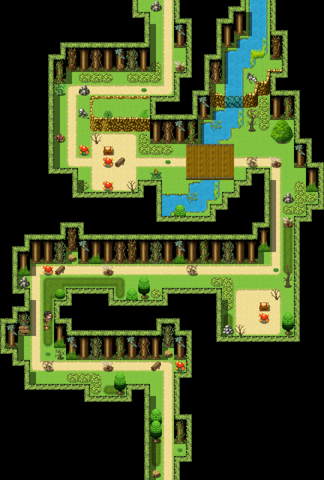

# The Gloamwood

For what lives in it, as opposed to what was said to, see Miss Halloway's <a href="../Bestiary/">Bestiary</a>. For the man on the log, see <a href="../People/Godfrey_Stopford">Godfrey Stopford</a>, the Forty-Sixth.

<table class="infobox">
<caption>The Gloamwood</caption>
<tr><td colspan="2" class="infobox-image">The near part of the wood. It goes on like this</td></tr>
<tr><th>Known as</th><td>The wood; the woods; "enough"</td></tr>
<tr><th>Where</th><td>Across the north road, between <a href="Thistlewick">Thistlewick</a> and the <a href="The_Obligatory_Tower">Obligatory Tower</a></td></tr>
<tr><th>Ways through</th><td>One. The gap is the road</td></tr>
<tr><th>Contents</th><td>Trees; mushrooms, named; beanstalks, dead; a chest</td></tr>
<tr><th>The chest</th><td>A mimic. Everybody knows</td></tr>
<tr><th>Residents</th><td><a href="../People/Godfrey_Stopford">The Forty-Sixth</a>, on a log</td></tr>
<tr><th>Things in it</th><td>Argued about for two hundred years. See below, and the Bestiary</td></tr>
<tr><th>Society</th><td>The Gloamwood Society (1960), nine members</td></tr>
<tr><th>Searched</th><td>Yes. The logs say so</td></tr>
</table>

The <b>Gloamwood</b> is a dark wood across the north road out of <a href="Thistlewick">Thistlewick</a>, and the only way north. The road ends at a wall of trees. There is a gap. The gap is the road now. Every Chosen One has gone through it, and one of them, the Forty-Sixth, went no further, and is still there, sitting down.

"You think about it," the Forty-Eighth told me, of the moment at the mouth of the wood. "It does not improve."

## The first path

The near half of the wood is a long path between big trees, much walked, and dressed, over the years, by everybody who has walked it.

**The carved tree.** Somebody has carved an arrow into the bark, pointing north. Underneath it, in a shakier hand, a second arrow points back the way you came. Further on, a boulder has an arrow chalked on it pointing north, and under it, by a different hand: ARE YOU SURE? A mossy log has its moss on the north side, as the books say it should, and somebody has nailed a small sign to the south side: OTHER WAY.

**The logs.** Every hollow log on the path has a hand-lettered sign at one end: SEARCHED. Somebody has been along the whole path with these, and it saves everybody a great deal of time.

**The beanstalks.** One goes straight up into the canopy and stops, as though it had thought better of it, with a card nailed to the bottom: GIANT NOT IN. PLEASE DO NOT CLIMB. THIS MEANS YOU, JACK. The others are dead. One has a little wooden marker in front of it like a gravestone: HERE LIES A MAGIC BEAN. IT WAS NOT.

**The mushrooms.** Pale ones in a neat row, which are edible and, I am told by a naturalist, delicious, and which I am to tell nobody about or there will be a society. (There is a society. It is about something else.) Red ones with white spots, of the kind in every picture book with a gnome sitting on top: there is no gnome, but there is a very small dent in the top of the biggest one, as if one had just left. One has a tiny door painted on the stalk, very carefully, by somebody with a very fine brush and a great deal of hope.

**The boulder** is hunched over in exactly the shape of a sleeping troll. It is a boulder. You may check from the other side, to be sure, and then a third time, and by the third time you will feel that it knows.

**The chest.** A treasure chest, alone, in the middle of a wood, on a path, in perfect condition. It is a mimic. Everybody knows it is a mimic. Nearly everybody opens it. Not far from it are a helmet, a boot, and a note in a jar: IF FOUND, I WAS RIGHT ABOUT THE MIMIC. The mimic was carrying an Elixir about with it as bait, which is either clever or very sad. It is splinters now.

## The man on the log

Half way along the first path is a log across the way, with a cushion on it, and a little card on the cushion: RESERVED - NUMBER FORTY-SIX.

The Forty-Sixth is a man in very good armour, and he is sitting on the log. He set out in 1980, and got as far as the woods, and decided that the woods were enough. "Nobody writes songs about that. But I'm here, and I'm forty-six, and I'm sitting down." Beside the log is a sack of letters, a great many, in two hands, one round and one narrow, going back years. They are from <a href="../People/Nabb">Nabb</a> and <a href="../People/Tolly">Tolly</a>, of his old party, who write every month, both of them. He does not write back. "I read them. Reading them's the answer. They know that. Nabb doesn't, but Tolly does, and Tolly does the stamps."

I know Nabb, and Tolly. They drink at the <a href="The_Slain_Wyvern">Slain Wyvern</a>, and Nabb gave the Forty-Eighth one of the six accounts in my history, which is the whole story: he stopped, on the path, and said the woods were enough, "and we looked at each other, and we said: fair." Everyone wants there to be more. There isn't more. Post goes out on Thursdays. Tolly buys the stamps in twos, because it is a long way, and he is worth two stamps. Nabb says the man who collects the post says he reads them.

## The deep wood

Beyond the log the path goes into the dark part of the wood, where the trees are a wall, and there is a clearing, and there is the Thing.

The Thing in the Woods has been argued about in Thistlewick for two hundred years. Is it a bear? Is it several bears? Is it a bear-shaped hole in the idea of a wood? Nobody ever got close enough to settle it. The Forty-Eighth got close enough, and the Thing stopped being in the woods, and Thistlewick has never believed him, and he has never told them anyway. What it was, in the sense of *what it was*, is a matter for a naturalist, and the naturalist has dealt with it in the [Bestiary](../Bestiary/).

The clearing has a ring of mushrooms round it, very large, very even and very obviously magic, with a little rope round it and a sign: SITE OF SPECIAL INTEREST. DO NOT DANCE IN. Each mushroom has a label on a stick: MUSHROOM 14 OF 31. THE SOCIETY COUNTS THEM EVERY YEAR. There were thirty-one last year as well. Near by there is a log with a flask, a sandwich box and a notebook on it, all labelled G.S., which has been the Society's picnic spot for forty years. There are some bones, and a sign beside them in the Society's hand: THESE ARE A SHEEP'S. THE SOCIETY HAS CHECKED. IT WAS A VERY OLD SHEEP AND IT DIED HAPPY. PLEASE STOP REPORTING IT. The Society has given each of the pale mushrooms a name. One of them is called Norman. Miss Halloway has written to them to say that it is a Cyril.

## The Gloamwood Society

The **Gloamwood Society** was founded in 1960 to prove that the Thing in the Woods is not there. It has nine members, meets at the <a href="The_Gilded_Turnip">Gilded Turnip</a> on Thursdays, walks the wood once a year, and has published *The Sighting* four times a year for forty years, edited by Mr Dunmore, under the chair of <a href="../People/Mrs_Lumb">Mrs Lumb</a>. For forty years it took anything: a shape, a smell, a feeling. For forty years it found nothing, so far, that would stand up.

In the year 2000 Miss Halloway read all forty years of *The Sighting* in an afternoon, and told them that she could prove it did not exist, and that it never had, and the whole Society leaned forward as one. The walk was that night. It is always that night, when there is news. I was not there, and I have the account from Mr Dunmore's issue one hundred and sixty, which they printed extra of, and from Miss Halloway, who corrected it.

There is nothing in the Gloamwood. That is proved, in writing, by a professional. The Society cheered. The method, and what the sightings were sightings of, are in the Bestiary, where Miss Halloway has asked me to leave them.

One member did not cheer. **Miss Edith Pellow** saw something in the clearing in 1971, and wrote it up in issue forty-four, and counted nine. Nobody had seen it since. Miss Halloway had read issue forty-four. She told Miss Pellow that of forty years of sightings, hers was the only accurate one. On the walk home the whole Society contrived, without anybody arranging it, to be on either side of her, and by the edge of the wood she was telling everybody about the nine, and nobody minded in the least.

Miss Halloway was made an honorary member, the first, and given the badge. She wears it on the cloak.

The Society's walk of 2001 was, as the tally promised, very well attended: three hundred and twelve walkers, in good boots, with lanterns. Nothing was found. It was minuted with satisfaction. Miss Pellow led it. I am told she stopped the walk in the clearing, at dusk, and pointed, and said "There," and that three hundred and twelve people looked, and that there was nothing there, and that it was the best walk the Society has ever had.

## Bassoons

The Gloamwood is the only road between the south and the works town of <a href="Upper_Clanging">Upper Clanging</a>, and it is a hard road to walk at night with eight feet of folded tube in a case. <a href="../People/Enoch_Bagshawe">Mr Enoch Bagshawe</a>, first bassoon of the Works Band, sat on the milestone at the mouth of the wood for some time, many nights, because if anything so much as looked at him he would drop the case, and that would be the reed, and the reed took three weeks. The band had never had a bassoon. It is a brass band; he is aware.

<a href="../People/Nix">Nix</a> took him through. She halves encounters; it is a knack. With mothballs as well, which the Band keeps the uniforms in, he crossed the whole wood by night without a single encounter, or half of one, and at the north end he opened the case in the road and played one long low note on the reed by moonlight, for no reason but that he could. The Works Band has a bassoon.

## See also

- <a href="Thistlewick">Thistlewick</a>, to the south
- <a href="The_Obligatory_Tower">The Obligatory Tower</a>, to the north
- <a href="../People/Godfrey_Stopford">Godfrey Stopford</a>, the Forty-Sixth
- <a href="../History/The_Chosen_Ones">The Chosen Ones</a>
- <a href="../People/Wren_Halloway">Wren Halloway</a>
- <a href="../People/Mrs_Lumb">Mrs Lumb</a>, chair of the Society
- <a href="../Bestiary/">The Bestiary</a>
