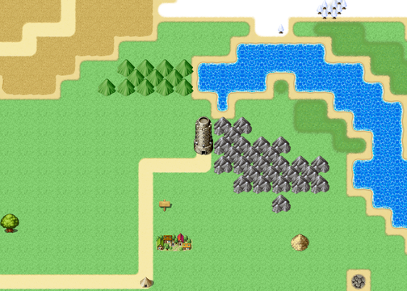

# The Obligatory Tower

This article is about the building. For its occupant, see <a href="../People/Grimspite_the_Inevitable">Grimspite the Inevitable</a>. For why anybody went there, see <a href="../History/The_Prophecy_of_Thistlewick">The Prophecy of Thistlewick</a>. For the names it nearly had, see <a href="Prophecy_Hall#struck-material">Prophecy Hall</a>.

<table class="infobox">
<caption>The Obligatory Tower</caption>
<tr><td colspan="2" class="infobox-image">The Tower, with Penultima below it, as the airship sees them</td></tr>
<tr><th>Known as</th><td>The Tower; the Dark Lord's tower</td></tr>
<tr><th>Where</th><td>At the top of the north road, two hundred leagues from <a href="Thistlewick">Thistlewick</a> by the fingerpost</td></tr>
<tr><th>Established</th><td>Approx. 4,800 years ago, by the contract; about two thousand, by the calendar</td></tr>
<tr><th>Management</th><td>The same throughout</td></tr>
<tr><th>Floors</th><td>Four, and the top</td></tr>
<tr><th>Door</th><td>At the bottom. Ground floor</td></tr>
<tr><th>Key</th><td>Under the mat</td></tr>
<tr><th>Visitors</th><td>47, by the signpost; latterly about one a month</td></tr>
<tr><th>Survivors</th><td>[the number has been scratched off]</td></tr>
<tr><th>Made of</th><td>Not known. Nobody ever asked</td></tr>
<tr><th>Please</th><td>Wipe your feet</td></tr>
</table>

The <b>Obligatory Tower</b> stands at the top of the north road, and is where the Dark Lord lives, and has lived, under the Prophecy of Thistlewick, for four thousand eight hundred years by the contract's count. Forty-eight Chosen Ones have climbed it. It is exactly as tall as everybody said, which is somehow the most unsettling thing about it.

The engagement was held, before the Tower, at a castle on a cloud which no hero could ever reach, and its caretaker keeps the Committee's letter on the subject face down on his lectern, unfolded and folded again a great many times. It is headed NOTIFICATION OF CHANGE OF ADDRESS, and gives the new venue as *The Obligatory Tower. Ground floor. Door at the bottom. Please amend your records.* See <a href="The_Former_Premises">The Former Premises</a>.

The plaque by the door says the Tower was established approximately four thousand eight hundred years ago. I wrote to its occupant to ask whether "approximately" was the plaque-maker's or his. He wrote back, in a very beautiful hand, that it was his; that the plaque had originally said <i>exactly</i>; that he had thought it presumptuous; and that he had hoped I was keeping well. He did not say how approximately. I did not ask him how old he is, having asked once.

## The approach

The north road comes out of the <a href="The_Gloamwood">Gloamwood</a> and climbs the valley. On the way is a **wayshrine**: a roof, a bench, and a box of supplies with a note, FOR CHOSEN ONES. PLEASE REPLACE WHAT YOU TAKE. NOBODY EVER REPLACES WHAT THEY TAKE. Inside is a visitors' book with forty-seven names in it. The last entry reads *Feeling good about this one!* It is the Forty-Seventh's. The Forty-Eighth added his name, and did not add a comment.

The **southern signpost**, at the fork, says NORTH, the Obligatory Tower, and under that somebody has freshly carved HE IS NOT THAT BAD ACTUALLY, and somebody else has carved YES HE IS underneath it. Both were right, in their way, and I have been to some trouble to find out who carved the first one, and failed.

The **northern signpost**, at the foot of the Tower:

THE OBLIGATORY TOWER. VISITORS: 47. SURVIVORS: [the number has been scratched off]. PLEASE WIPE YOUR FEET.

The number has been scratched off because it was forty-seven as well, and the Tower thought it looked like showing off. That is my guess, and it is marked as one.

## The door

At the door the Tower's long habit of being visited has left a great many arrangements, and the one everybody remembers is upstairs. The way to the top is through a heavy door on the fourth floor, barred from the other side, and in front of it there is a mat. It says WELCOME, which for a Dark Lord's tower raises a number of questions. Under it is a key, labelled SPARE - DO NOT LOSE AGAIN. Four thousand years of this and the answer was the mat. Not every party needs the key. A party with <a href="../People/Nix">Nix</a> in it does not, because the bar is on the inside, which means there is a gap, and a gap is just a door that hasn't been asked properly.

Beside the door is a plaque: THE OBLIGATORY TOWER. EST. APPROX. 4,800 YEARS AGO. UNDER THE SAME MANAGEMENT.

**Roland Fairweather left here.** At the foot of the Tower, in the year 2000, he stopped walking, and looked like a man who had been checking the time all week, and said, "Ah. Yes. There it is." He had to be somewhere. He never knew where. He put everything he was carrying on the grass, including his sword, and shook hands with everybody, including, carefully, anyone who was not looking, and was forty paces off before he had finished saying that he would stay to watch. It was the eleventh door. See <a href="../People/Roland_Fairweather">his article</a>.

**Maud Penhallow waited here**, by one account. Forty paces off, Roland stopped, and looked back once, at a girl standing beside the door with a practice sword. She raised it to him, the way you are taught to at nine. "He said somebody ought to see the end of one," she said. "I'm the understudy. I'll wait here. When you come out, I'll go and tell him how it ends." There is another account, in which she was not here at all, and heard the end over a pie; <a href="../People/Maud_Penhallow">her article</a> gives both, and is vague, at her request, about which.

**The Two Hundred landed here.** Not at the door. Beside it. <a href="../People/Ott_Hoyle">Miss Hoyle</a>'s airship came down on the grass two squares from the door, ticking as she cooled, and the party walked the two squares, because clause seven requires a Chosen One to go on foot, and nothing that flies has ever been allowed to set down at the door. The attempt log at the <a href="../Institutions/The_Hoyle_Works">Hoyle Works</a> records it as REACHED THE TOWER. LANDED ADJACENT. Miss Hoyle's account of it is hers to give, and she has given it in her own article, in numbered paragraphs.

## Inside

The Tower is four floors and the top, each floor its own maze of halls, and the stairs are in a different place on every one, so that a flight up comes out above itself on the floor above and you have to cross the whole floor to find the next. I have this from everybody who has climbed it, and they all say it with feeling.

It is furnished in the manner the Prophecy expects of a dark tower, and it is plain, from every room, that the occupant has never once believed in it. I give a selection, from the accounts of the company and of the forty-seven, which agree on this if on nothing else.

**The ground floor.** A notice in the stairwell, at eye level: MIND THE STEP. I MEAN IT. THE STEP HAS TAKEN MORE OF YOU THAN I HAVE. - G. A night porter's straw bed, with a card, NIGHT PORTER (OFF DUTY), and a cold cup of cocoa with a biscuit on the saucer. A card table, set for four, with the hands dealt and never played; one of them is a very good hand indeed, in front of the empty chair nearest the stairs. A skeleton slumped against the wall, with a cushion behind it and a blanket over its knees, because it is a draughty tower. A pot with nothing in it but a note: I WOULDN'T EITHER. - G. A barrel stencilled DUNGEON SUPPLIES - GLOOM, which is empty, because the gloom has got out and is everywhere. A crate of ROCKS (SPARE), for when a corridor has started to look too tidy. The skeleton of a dragon, curled round on itself like a dog asleep by a fire, with a sign on the tail, PLEASE DO NOT TOUCH, which may be meant for you or for the dragon. A banner with the Dark Lord's arms, a tower rampant on a field of slightly more tower; another with a laundry label, HAND WASH ONLY. DO NOT TUMBLE. DO NOT LET THE CHOSEN ONE SET FIRE TO IT (AGAIN). A cobweb, LISTED. DO NOT DUST. - G.

**The barracks.** The minions' lockers, GRUB, SNAG and GRUB (THE OTHER ONE). Grub's has a packed lunch and a card: IF YOU ARE THE CHOSEN ONE, THE KEY IS NOT IN HERE. IT IS NEVER IN THE LOCKERS. Snag's has clean socks, folded, and a letter from home that begins DEAR SNAG, ARE YOU EATING. Grub (the Other One)'s is locked, with a card in the door: NICE TRY. A bunk with a teddy bear under the pillow in a horned helmet. Clipboards on the bunks: SICK LEAVE, SICK LEAVE, ANNUAL LEAVE, SICK LEAVE. The Tower has very good terms and conditions. The staff canteen: MONDAY, GRUEL; TUESDAY, GRUEL; WEDNESDAY, CHEF'S SPECIAL (GRUEL); one bottle of brown sauce, ONE SQUEEZE EACH. THAT MEANS YOU, SNAG. Three cells for Chosen Ones who have been captured, never used, because in four thousand eight hundred years nobody has ever been captured. It seemed rude. One has a little vase of dried flowers on a shelf, in case. A clock stopped at twenty past three, labelled: SOMETIMES IT IS TWENTY PAST THREE. THEN IT IS RIGHT, AND I FEEL BETTER. - G.

**The galleries.** A statue of a knight in HEROIC POSE NO. 3, with a chart round the side of the plinth showing poses one to twelve; number seven is mostly pointing. A gargoyle with a little bell round its neck so that it cannot creep up on anybody. A wardrobe of black cloaks on numbered hangers, one of them very slightly less black than the others from being washed with something red. A row of coffins, every one marked RESERVED, because the management was told that a tower ought to have coffins, for the look of it: one has a fern in it, doing beautifully in the dark, one is the dry store and full of spare candles sorted by length, one smells of lavender, and the last is OUT OF ORDER. A banner, ABANDON HOPE, and under it in smaller and newer stitching, (BUT DO WIPE YOUR FEET).

**The basin.** On the third floor, a basin of clear water, in a tower with no plumbing. Scratched into the rim: HE LEAVES IT OUT FOR US. NOBODY KNOWS WHY.

**The Obelisk.** An obelisk covered in very small writing. It is a list: forty-seven entries, each a date and a name and the word RENEWED. There is room for a forty-eighth. There will not be one.

**The barred door**, on the fourth floor, with the stairs to the top beyond it. See above, under mats.

**The Contingency Cache.** A cupboard, six feet from the stairs, with ten hooks inside, each with a small brass label: CHOSEN ONE. HEALER. SMITH. MAGE. SPECIALIST. KNIGHT. MUSICIAN. Two more were added later, in a different hand and a cheaper brass: RIVAL. CATALOGUER. The tenth hook is labelled GUEST, and underneath it in pencil: HE WON'T BE HERE. HE NEVER IS. I LEAVE IT OUT ANYWAY. On every hook but that one, a legendary weapon for that kind of Chosen One. On the inside of the door: RESTOCKED EVERY CENTURY. NOBODY HAS EVER OPENED THIS CUPBOARD. IT IS SIX FEET FROM THE STAIRS. I DO NOT UNDERSTAND ANY OF YOU. The Forty-Eighth's company opened it, and it now has ten empty hooks and a very smug note.

**The library**, under a great mural in an old script, whose translation card says STAFF NOTICES. PLEASE WASH YOUR CUP. (Another inscription, cut deep: THE PREVIOUS MANAGEMENT REGRETS ANY INCONVENIENCE.) On the shelves: *Villainy for Beginners*, read once, carefully, a very long time ago, with a bookmark in chapter one. *The Monologue: A Handbook*, of which chapter one is called "Don't", and there are no other chapters. *The Prophecy of Thistlewick, Annotated*, every margin full, clause twelve underlined so often that there is a hole in the page. *A Thousand And One Things To Do With A Tower*, all ticked, with a thousand and two written on the back: LEAVE IT. *Reading a Renewal Clause*, by a firm of lawyers in <a href="Great_Dunnage">Great Dunnage</a>, the most worn book on the shelf, which falls open at *notice*. *Bungalows of the Coast*, with photographs, one page turned down at the corner: a small white one with a view of the sea. *Tea: A History*, volumes one to nine. *Knitting for the Dark Hours*, with a scarf pattern in the back and a note in the margin, AUNT M - TOO LONG? A wine rack, full of cold tea, corked and labelled with the year, going back further than wine could possibly keep. A globe, with one pin in it, on a little spot by the sea, labelled ONE DAY. And on a stand, a book: *What To Say When They Arrive*. Every page is a different speech, crossed out. The last page has one word on it, and it has not been crossed out:

*Tea?*

## The top

The top of the Tower is the throne room, and its furniture and its occupant are described in <a href="../People/Grimspite_the_Inevitable">his article</a>: the tablet behind the throne, which is not a curse but a rota; the two statues of an aunt; the mirror that is late and the mirror that shows where you would rather be; the two seeing-orbs, which show only each other, except when somebody in another tower picks one of his own up by accident and apologises; and the four skeletons, which are plaster, for the look of the thing. Nobody has ever died up here. "Forty-seven of them, and they all won. Do you know how that looks, to the forty-eighth?"

Carved into the wall behind the throne, forty-seven times: THE DARK LORD SHALL RISE AGAIN. It is not a threat. It is a renewal notice. The forty-eighth carving will not be needed.

## Since the Quest

The Tower is not a Dark Lord's tower any more, contractually, and nobody has had the heart to tell the furniture. Its occupant is retired, and stays on, in his chair, with a kettle and the book at the bookmark. The door is not barred. The mat is still there, and the key is still under it, labelled. The Tower gets about one visitor a month, most of them people who would like to see the chair, and the Forty-Eighth once a year, on the day, and the kettle is on.

Roland Fairweather came back to the Tower after the ending, with the party, and stopped at the foot of it, out of habit, and waited. Nothing happened. He waited a little longer, to be sure. Nothing went on happening. "So this is the bit after," he said. "It's very quiet." He went up.

I have been invited to the top, more than once, by letter, and have said that I do not climb things. A historian is not obliged to visit every place he writes about; he would never finish. But I have counted the floors from the accounts and there are four, and the top, and I have begun to wonder, this winter, whether that is very many.

## See also

- <a href="../People/Grimspite_the_Inevitable">Grimspite the Inevitable</a>
- <a href="../History/The_Prophecy_of_Thistlewick">The Prophecy of Thistlewick</a>
- <a href="../History/The_Obligatory_Quest">The Obligatory Quest</a>
- <a href="The_Gloamwood">The Gloamwood</a>
- <a href="../People/Ott_Hoyle">Ott Hoyle</a>, for landing adjacent
